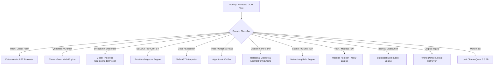

# DOMAIN ROUTING AND 12-DOMAIN COGNITIVE CLASSIFICATION REPORT

**System:** SETU-NETRA V2.0.0-RC1 (Kora Kaagaz Intelligence Core)  
**Module:** Domain Classification & Adaptive Solver Dispatch  
**Date:** 2026-11-12  

---

## 1. 12-Domain Cognitive Taxonomy

SETU-NETRA classifies every user query or document page inquiry into one of 12 canonical cognitive domains. Each domain is governed by an explicit routing policy and dedicated solver path:



### Domain Enumeration (`QuestionDomain`)
```python
class QuestionDomain(str, Enum):
    ARITHMETIC = "ARITHMETIC"
    MATHEMATICS = "MATHEMATICS"
    FORMAL_LOGIC = "FORMAL_LOGIC"
    LOGICAL_REASONING = "LOGICAL_REASONING"  # Alias
    SQL = "SQL"
    PROGRAMMING = "PROGRAMMING"
    DATA_STRUCTURES = "DATA_STRUCTURES"
    DBMS_NORMALIZATION = "DBMS_NORMALIZATION"
    COMPUTER_NETWORKS = "COMPUTER_NETWORKS"
    CRYPTOGRAPHY = "CRYPTOGRAPHY"
    PROBABILITY_AND_STATISTICS = "PROBABILITY_AND_STATISTICS"
    DOCUMENT_QA = "DOCUMENT_QA"
    GENERAL_KNOWLEDGE = "GENERAL_KNOWLEDGE"
```

---

## 2. Classification Heuristics and Feature Engineering

The classifier uses multi-signal heuristic analysis:
1. **`DBMS_NORMALIZATION` (Weight: 0.98):**
   * Regex patterns: `r"\b(?:functional\s+dependenc(?:y|ies)|normal\s+form|bcnf|1nf|2nf|3nf|candidate\s+key|highest\s+normal\s+form)\b"`
   * Relational schema detection: `r"\br\s*\([a-z0-9_,\s\.]+\)[\s\S]*\b(?:dependencies|f\s*=)\b"`
   * Dependency sets: `r"\bf\s*=\s*\{[^\}]+\}"`
2. **`ARITHMETIC` / `PROGRAMMING` Assignment (Weight: 0.98):**
   * Linear variable assignments: `has_var_assign` (`a = 10; b = 5`)
   * Formula targets: `has_formula_assign` (`result = a + b - 23 + 40`)
   * Pure numeric expressions with arithmetic operators (`(100 - 25) * 2`)
3. **`FORMAL_LOGIC` (Weight: 0.96):**
   * Categorical premise/conclusion indicators: `statements:`, `conclusions:`, `syllogism`, `definitely true`
   * Universal/particular quantifiers: `all X are Y`, `some Y are Z`, `no Z is W`
4. **`SQL` (Weight: 0.95):**
   * Relational clauses: `SELECT ... FROM`, `GROUP BY`, `ORDER BY`, `COUNT(*)`, `WHERE ...`
5. **`CRYPTOGRAPHY` (Weight: 0.95):**
   * Ciphers and number theory: `rsa`, `diffie-hellman`, `modular inverse`, `mod \d+`, `totient`, `phi`
6. **`MATHEMATICS` (Weight: 0.90):**
   * Symbolic equations: `quadratic equation`, `2d convolution`, `time complexity O(...)`, `matrix`, `derivative`

---

## 3. Dispatched Routing Policy

| Domain | Dispatch Target | Grounding Requirement | Epistemic Policy |
| :--- | :--- | :--- | :--- |
| `ARITHMETIC` | `SafeArithmeticEvaluator` | Zero external citations | `COMPUTATION_VERIFIED` |
| `MATHEMATICS` | Quadratic / Cramer Evaluator | Zero external citations | `COMPUTATION_VERIFIED` |
| `FORMAL_LOGIC` | Set-Theoretic Countermodel Prover | Zero external citations | `LOGIC_VERIFIED` |
| `SQL` | Relational Algebra Engine | Document schema (if given) | `LOGIC_VERIFIED` / `SQL_LOGIC_VERIFIED` |
| `DBMS_NORMALIZATION` | Attribute Closure $X^+$ Engine | Zero external citations | `LOGIC_VERIFIED` |
| `CRYPTOGRAPHY` | Modular Exponentiation / RSA Engine | Zero external citations | `COMPUTATION_VERIFIED` |
| `DOCUMENT_QA` | Hybrid Dense+Lexical Retriever | $\ge 1$ coordinate-grounded citation | `EVIDENCE_BACKED` |
| `GENERAL_KNOWLEDGE` | Local Ollama Model Adapter | Explicit source / uncertainty tag | `GENERAL_KNOWLEDGE` |
