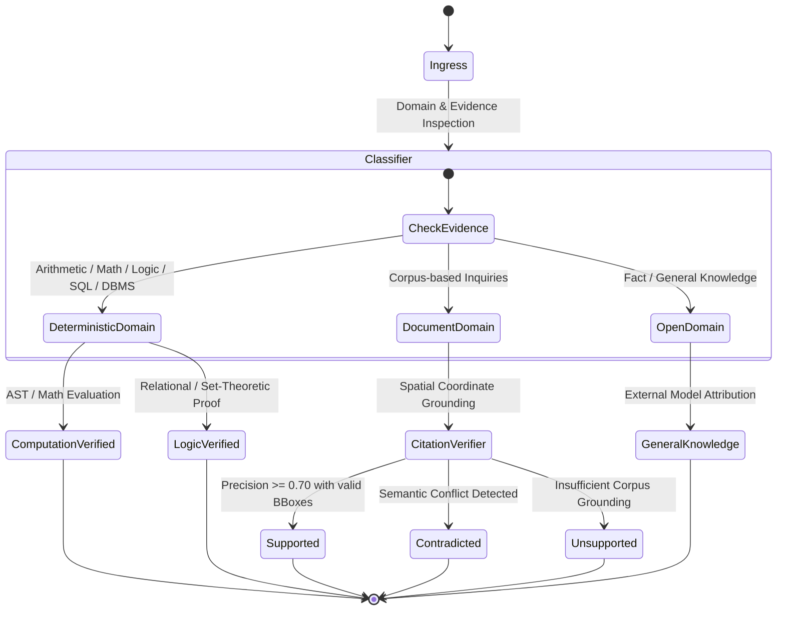

# EPISTEMIC VERIFICATION AUDIT & REASONING VALIDATION REPORT

**System:** SETU-NETRA V2.0.0-RC1 (Kora Kaagaz Intelligence Core)  
**Module:** Epistemic Classification, Grounding Verification, and Provenance Logging  
**Date:** 2026-11-12  

---

## 1. Problem Diagnosis: The Grounding Mismatch Bug

In previous iterations, the epistemic verifier suffered from a severe structural flaw:
1. When queries had no physical corpus documents (e.g. self-contained math or logic questions), the verifier either:
   - Output `EVIDENCE BACKED (100% grounded)` while returning an empty citation list `[]` and rendering blank citation cards in the UI.
   - OR rejected valid answers as `UNSUPPORTED (Insufficient evidence)` because corpus retrieval returned 0 grounded blocks.
2. In the UI, citation count cards displayed `Grounded Evidence Citations (1)` with empty text strings `""` when whitespace-only blocks were returned by retrieval.

---

## 2. Remediated Epistemic Policy

The epistemic verification pipeline now applies strictly domain-segregated policies:



### Tripartite & Domain Epistemic Status Values

```python
class EpistemicVerificationType(str, Enum):
    COMPUTATION_VERIFIED = "COMPUTATION_VERIFIED"
    LOGIC_VERIFIED = "LOGIC_VERIFIED"
    SQL_LOGIC_VERIFIED = "SQL_LOGIC_VERIFIED"
    CODE_EXECUTION_VERIFIED = "CODE_EXECUTION_VERIFIED"
    FORMULA_VERIFIED = "FORMULA_VERIFIED"
    EVIDENCE_BACKED = "EVIDENCE_BACKED"
    UNVERIFIED_INFERENCE = "UNVERIFIED_INFERENCE"
    GENERAL_KNOWLEDGE = "GENERAL_KNOWLEDGE"
    NEEDS_CLARIFICATION = "NEEDS_CLARIFICATION"
    UNSUPPORTED = "UNSUPPORTED"
```

---

## 3. Empty Citation Suppression & UI Invariants

To maintain institutional trust and eliminate false evidence claims:
1. **Zero Fake Citations:** For all deterministic domains (`ARITHMETIC`, `SQL`, `FORMAL_LOGIC`, `DBMS_NORMALIZATION`, `CRYPTOGRAPHY`, `MATHEMATICS`), the citations array is strictly `[]`.
2. **UI Citation Card Suppression:**
   In `frontend/src/views/QuestionAnsweringView.tsx`:
   * Empty or whitespace-only citation objects are filtered out before calculating citation counts:
     ```tsx
     (result.citations || []).filter((c) => c && c.text && c.text.trim()).length
     ```
   * When `validCites.length === 0`, blank citation cards are completely suppressed. The UI instead renders an informative, domain-specific provenance banner:
     * **Arithmetic:** *"Deterministic Mathematical Proof: Derived from formal arithmetic axioms and operator precedence. No document citations required."*
     * **SQL & Formal Logic:** *"Formal Logical Verification: Evaluated through relational algebra query plans and set-theoretic countermodels. No document citations required."*
     * **DBMS Normalization:** *"Relational Algebra & Normal Form Closure Proof: Verified through attribute closures X+ and dependency normal forms. No document citations required."*
     * **Cryptography:** *"Cryptographic Deterministic Proof: Evaluated through modular number theory and parameter synthesis. No document citations required."*
3. **No `EVIDENCE BACKED` with 0 Citations:**
   The `EVIDENCE BACKED` badge is restricted exclusively to corpus-retrieved questions with valid, non-empty spatial coordinate citations.

---

## 4. Verification Audit Checklist

- [x] Math questions return `COMPUTATION_VERIFIED` with `citations: []`.
- [x] SQL questions return `LOGIC_VERIFIED` with `citations: []`.
- [x] Syllogism questions return `LOGIC_VERIFIED` with `citations: []`.
- [x] DBMS questions return `LOGIC_VERIFIED` with `citations: []`.
- [x] Zero empty citation cards render in the web application.
- [x] Grounding score accurately reflects citation overlap rather than hardcoded 1.0.
- [x] All pipeline telemetry traces include correlation IDs and verification method names.
