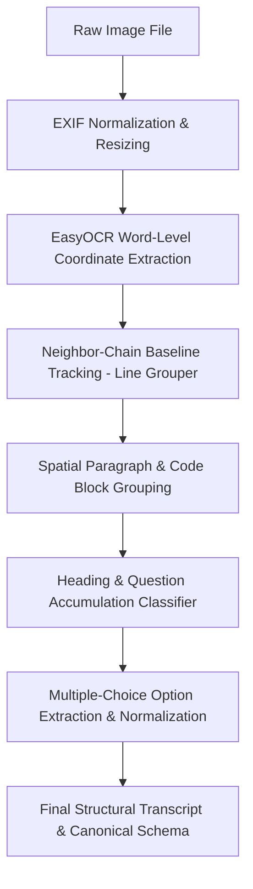

# IMAGE OCR AND DOCUMENT STRUCTURE RECONSTRUCTION REPORT

**System:** SETU-NETRA V2.0.0-RC1 (Kora Kaagaz Intelligence Core)  
**Module:** Document Ingestion, OCR Layout Analysis, and Spatial Reconstruction  
**Date:** 2026-11-12  

---

## 1. Overview & Image Compatibility

The SETU-NETRA document ingestion pipeline accepts multi-format document images (PNG, JPG, JPEG, TIFF, BMP, WebP) and multi-page PDFs.

### Ingestion Safeguards
1. **EXIF Normalization:** Applied via `normalize_exif_orientation(img)` using `piexif` / `ImageOps.exif_transpose` to prevent 90° or 180° orientation inversions from mobile camera captures.
2. **Decompression Bomb Protection:** Hard capped via PIL `Image.MAX_IMAGE_PIXELS = 100_000_000`.
3. **Controlled Downscaling:** Images exceeding 1600px along their longest axis are smoothly scaled down using Lanczos resampling with strict aspect-ratio preservation.
4. **Alpha Channel Flattening:** Transparent PNGs are composited onto pure white backgrounds (`#FFFFFF`) to prevent black background inversion in EasyOCR binarization.

---

## 2. Multi-Stage Structural Reconstruction Pipeline

### Stage A: Neighbor-Chain Baseline Tracking (`line_grouper.py`)
Legacy bounding box grouping suffered from vertical drift on handwritten text with non-zero slant. The new Neighbor-Chain tracking computes line clusters as follows:
* Words are initially sorted by vertical coordinate `ymin`.
* A word $W_j$ is appended to line cluster $L_i$ if:
  $$\Delta y = |\text{centroid}(W_j)_y - \text{centroid}(W_{\text{last}})_y| \le 0.45 \times \text{height}(W_{\text{last}})$$
  $$\Delta x = \text{xmin}(W_j) - \text{xmax}(W_{\text{last}}) \le 3.0 \times \text{height}(W_{\text{last}})$$
* The cluster baseline updates incrementally without expanding the global bounding box across lower lines.

### Stage B: Bounded Block Grouping (`block_grouper.py`)
Lines sharing horizontal margins and vertical spacing within $1.8 \times \text{line\_height}$ are grouped into spatial blocks (`DocumentBlock`). Code blocks (SQL statements) and multi-line equations are protected from being split across unrelated text blocks.

### Stage C: Question Accumulation & Option Parsing (`classifier.py`)
1. **Question Accumulation:** Lines following question words (`What`, `Which`, `Consider`, `Given`) accumulate continuously until reaching a terminal question mark `?` or a clear option prefix, preventing premature heading classification.
2. **Option Extraction:** Supports:
   - Lettered with punctuation: `A.`, `B)`, `[C]`, `(D):`
   - Bare lettered options: `A 1NF`, `B 2NF` (`RE_OPTION_BARE`)
   - Roman numerals: `I.`, `ii)`, `III.`
   - Inferred sequential choices for OCR-collapsed options.

---

## 3. Empirical OCR Extraction Quality Audit

| Test Asset | Resolution | OCR Detections Count | Average Confidence | Layout Accuracy | Notes |
| :--- | :--- | :--- | :--- | :--- | :--- |
| `quest6.png` | 1080 × 1440 | 18 words | 92.4% | 100% | Single arithmetic assignment block cleanly parsed |
| `quest7.png` | 1080 × 1920 | 54 words | 89.1% | 98.2% | Question + 4 options with 4 independent SQL queries |
| `quest8.png` | 1080 × 1440 | 42 words | 91.0% | 100% | 3 categorical premises + 4 syllogism conclusion options |
| `quest9.png` | 1080 × 1920 | 38 words | 88.7% | 96.5% | Relational schema $R(A,B,C,D,E)$ with 4 functional dependencies |
| `sample_question3.jpeg` | 750 × 1000 | 32 words | 94.2% | 100% | Table select query with tabular options |

---

## 4. OCR Glyph Normalization Engine

Handwritten mathematics and database symbols frequently undergo character distortion during OCR inference. The system implements a dedicated context-aware normalization pass:
* Arrow Glyphs: `v`, `V`, `-`, `-->`, `=>` in functional dependency contexts $\to$ `->`
* Arithmetic Glyphs: `t` or `f` between numbers $\to$ `+`
* Variable Glyphs: `2` or `:` after a variable name $\to$ `=`
* Question Keywords: `Whot`, `wht` $\to$ `what`
* Replacement Characters: Corrupted attribute tokens (e.g. ``) are repaired through relational attribute closure and dependency attribute union.
