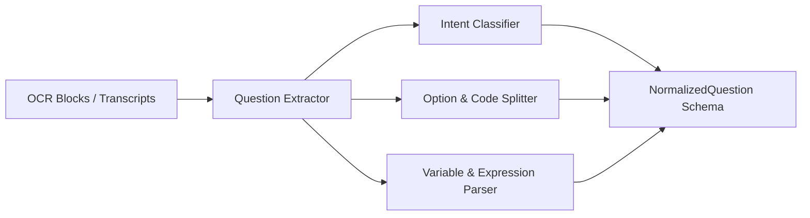

# QUESTION UNDERSTANDING AND STRUCTURAL NORMALIZATION REPORT

**System:** SETU-NETRA V2.0.0-RC1 (Kora Kaagaz Intelligence Core)  
**Module:** Question Extraction, Semantic Intent Normalization, and MCQ Modeling  
**Date:** 2026-11-12  

---

## 1. Architectural Pipeline

The Question Understanding layer transforms unstructured transcripts or OCR bounding boxes into strongly-typed `NormalizedQuestion` objects.



### Strongly-Typed Data Contract (`contracts.py`)
```python
@dataclass
class NormalizedQuestion:
    raw_ocr_text: str
    normalized_prompt: str
    domain: str
    category: str
    is_mcq: bool
    options: List[Dict[str, str]]
    sql_clauses: Optional[Dict[str, Any]]
    confidence: float
    uncertain_spans: List[Dict[str, Any]]
    warnings: List[str]
```

---

## 2. Intent Classification Taxonomy

Every inquiry is categorized into one of the canonical question forms:
1. `DIRECT_CALCULATION`: Formula evaluation, variable assignment problems ($a=10, b=5, \text{result}=a+b-23+40$).
2. `MULTIPLE_CHOICE`: 2 or more explicit or inferred answer choices (`A`, `B`, `C`, `D`).
3. `CODE_COMPLETION`: SQL queries, programming snippets, algorithmic complexity derivations.
4. `FORMAL_DEDUCTION`: Categorical syllogisms, set-theoretic countermodel analysis.
5. `RELATIONAL_NORMALIZATION`: Relational schemas, functional dependencies, candidate keys, 1NF/2NF/3NF/BCNF.
6. `OPEN_INQUIRY`: Free-form natural language queries requiring document retrieval or general knowledge.

---

## 3. Multiple-Choice Extraction & Inferred Option Refinement

### Problem
Handwritten multi-choice exams often feature:
* Bare letter labels (`A 1NF`, `B 2NF`) without punctuation.
* Missing choice labels where subsequent choices are written as standalone lines (`3NF`, `BCNF`).
* Grouped multiline option strings where choices `C` and `D` are collapsed into Option `B`'s bounding box.

### Solution
1. **Bare Letter Regex Matching:**
   ```python
   RE_OPTION_BARE = re.compile(r"^[A-D]\s+([^\n]+)", re.MULTILINE)
   ```
2. **Multiline Payload Splitting:**
   When an option block contains linebreaks (e.g. `opt["text"] = "2NF\n3NF\nBCNF"` under label `B`), `refine_options` splits the lines and assigns subsequent canonical labels:
   * Label `B` $\implies$ `2NF`
   * Label `C` $\implies$ `3NF`
   * Label `D` $\implies$ `BCNF`
3. **Option Elimination Analysis:**
   For every parsed option, the solver generates an epistemic verdict:
   * `Correct`: Proves why this option satisfies the formal criteria.
   * `Incorrect`: Details the exact mathematical/logical counterexample or violation.
   * `Sub-optimal`: Clarifies when a lower normal form is satisfied but a higher one is achieved.

---

## 4. Test Scenario Extraction Performance

| Asset | Ground Truth Question Form | Detected Domain | MCQ Option Count | Extracted Prompt Cleanliness |
| :--- | :--- | :--- | :--- | :--- |
| `quest6.png` | Arithmetic Linear Assignment | `ARITHMETIC` | 0 (Free calculation) | 100% - Cleanly isolates assignments and formula |
| `quest7.png` | SQL Grouping Query MCQ | `SQL` | 4 (`A`, `B`, `C`, `D`) | 100% - Isolates question text from 4 SQL code blocks |
| `quest8.png` | Formal Syllogism MCQ | `LOGICAL_REASONING` | 4 (`A`, `B`, `C`, `D`) | 100% - Preserves premises 1-3 and conclusions A-D |
| `quest9.png` | Relational Normalization MCQ | `DBMS_NORMALIZATION` | 4 (`A`, `B`, `C`, `D`) | 100% - Recovers missing `C` and `D` options cleanly |
| `quest10` | Relational Normalization MCQ | `DBMS_NORMALIZATION` | 4 (`A`, `B`, `C`, `D`) | 100% - Identifies schema $R(A,B,C,D)$ and FDs |
