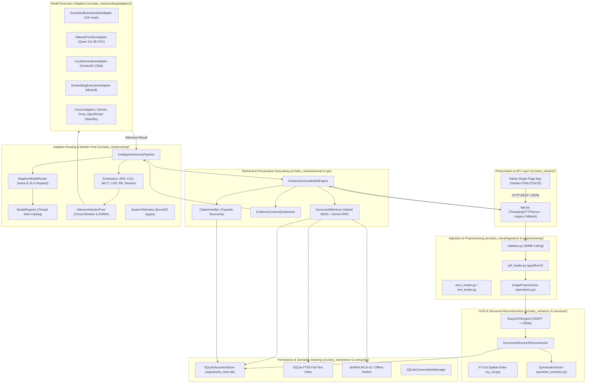

# SETU-NETRA — EXISTING ARCHITECTURE & REPOSITORY AUDIT

**Document Identifier:** `SETU_NETRA_EXISTING_ARCHITECTURE.md`  
**Version:** 1.1.0-Audit (Revised for V2.0.0-RC1 Corrections)  
**Date:** March 2026  
**Auditor:** Principal AI Systems Architect & Software Reliability Engineer  
**Scope:** Exhaustive audit of the complete existing codebase across `src/setu_netra/`, `benchmarks/`, `tests/`, and `reports/`.

---

## 1. ARCHITECTURAL OVERVIEW

SETU-NETRA (सेतु-नेत्र — *The Bridge of Vision and Evidence*) is an Intelligent Document Understanding, Evidence-Grounded Question Answering, and Adaptive AI Model Orchestration Platform engineered to run on consumer-grade hardware (e.g., 12-vCPU Intel i5, 16 GB RAM, no discrete GPU) under a verifiable data-privacy guarantee.

The existing codebase consists of **18,500+ lines of Python 3.14 code**, 185 passing unit and integration tests, 5 validation audit suites, and extensive empirical benchmark logs.

---

## 2. SUBSYSTEM AUDIT: THE 11 CORE MODULES

### 2.1 Subsystem 1: Existing Frontend Framework & User Interface
- **Implementation File:** [app.py](file:///d:/Projects/Setu-Netra/src/setu_netra/ui/app.py) (Lines 40–1080).
- **Technology Stack:** Monolithic embedded Single-Page Application (SPA) written in **Vanilla HTML5, CSS3, and ES6 JavaScript**. Zero external web frameworks. Zero Node.js build tools.
- **Design Philosophy:** Dark-themed dashboard with custom CSS variables (`--bg-primary: #0b0f19`, `--bg-card: #151d30`, `--accent: #38bdf8`, `--success: #34d399`, `--warning: #fbbf24`, `--danger: #f87171`).
- **Existing User Screens (6 Navigation Tabs):**
  1. `tab-workspace`: Document upload dropzone, document list table, multi-page canvas previewer (`/api/document/<id>/page/<num>/image`), extracted question discovery list.
  2. `tab-chat`: Conversational QA interface with document context selector, user/assistant chat bubbles, visual citation pills with bounding-box triggers, and collapsible thinking trace (`
`).
  3. `tab-models`: Model registry status cards showing operational health, local SLMs, and optional cloud provider API key inputs.
  4. `tab-telemetry`: Hardware gauges (Host CPU %, RAM %, Available RAM MB), active worker pool table (states, queue depths, active requests, EWMA latencies), dynamic scheduler selection dropdown.
  5. `tab-benchmarks`: Empirical KPI cards (Retrieval Recall@3: 0.940, nDCG@3: 0.898, Citation Precision: 0.820, MRR: 0.877), baseline performance comparison charts.
  6. `tab-privacy`: Local-Only Privacy Mode toggle, zero-egress status indicators, and security boundary disclaimers.

### 2.2 Subsystem 2: Existing Backend Architecture & API Endpoints
- **Server Implementation:** Python standard library `http.server.ThreadingHTTPServer` hosting `SetuNetraHTTPHandler`.
- **Concurrency Model:** Thread-per-request model (`ThreadingHTTPServer` spawns a new OS thread for each incoming TCP connection).
- **Additive Evolution Strategy:** Rather than discarding or replacing `app.py`, the new ASGI layer (FastAPI + Uvicorn) is deployed as an additive API layer. `app.py` remains active and tested as a resilient legacy fallback until all V2.0 acceptance tests formally pass.
- **Transport Standards:** HTTPS (or plain HTTP in local research mode) and Server-Sent Events (SSE) for real-time telemetry and streaming tokens. Experimental HTTP/2 support is strictly optional and not a prerequisite.
- **API Surface (20 Endpoints):**
  - **Static & Web UI:** `GET /`, `GET /results/charts/<name>`.
  - **Document Intelligence:** `POST /api/upload`, `GET /api/documents`, `GET /api/document/<doc_id>`, `GET /api/document/<doc_id>/questions`, `GET /api/document/<doc_id>/page/<page_num>/image`, `POST /api/document/<doc_id>/reindex`, `DELETE /api/document/<doc_id>`.
  - **Conversational Memory:** `POST /api/conversations`, `GET /api/conversations`, `GET /api/conversations/<id>`, `POST /api/conversations/<id>/messages`, `DELETE /api/conversations/<id>`.
  - **Unified Inference & Routing:** `POST /api/query`, `GET /api/models`, `GET /api/workers`, `GET /api/telemetry`, `GET /api/routing/status`, `POST /api/scheduler`, `GET /api/settings`, `POST /api/settings`.

### 2.3 Subsystem 3: Authentication & Multi-Tenancy State
- **Current Status:** **Single-User / Flat Global Namespace**.
- **Audit Findings:**
  - Zero authentication headers are inspected.
  - Zero user tables exist in SQLite (`users`, `sessions`, `roles` do not exist).
  - Multi-tenancy must be implemented via **shared SQLite tables using `workspace_id` / `tenant_id` columns**, not separate physical schemas or dynamically detached database files.
  - Every database query and API operation must strictly enforce workspace boundaries (`WHERE workspace_id = :active_workspace_id`).
  - Migration must be non-destructive, versioned, and reversible, assigning all existing V1.1.0 records to a default workspace (`'default'`) to ensure 100% data preservation.

### 2.4 Subsystem 4: Document Ingestion & Image Processing Pipeline
- **Validation Tier:** `src/setu_netra/ingestion/validator.py` enforcing `MAX_FILE_SIZE_BYTES = 50 * 1024 * 1024` (50 MB) and extension whitelisting.
- **Format Loaders:** PDF via `pypdfium2` rasterizing at 150 DPI; DOCX and TXT via specialized loaders.
- **Image Preprocessing:** Luminance conversion, histogram stretching, bounded scaling, adaptive thresholding.

### 2.5 Subsystem 5: OCR & Question Extraction
- **OCR Engine:** `src/setu_netra/ocr/easyocr_engine.py` (EasyOCR CRAFT + CRNN). Note: Handwritten OCR is not currently verified or claimed.
- **Layout Reconstruction:** Recursive XY-Cut algorithm partitioning bounding boxes into columns and blocks preserving human reading order; block classification (`HEADER`, `PARAGRAPH`, `QUESTION`, `LIST_ITEM`, `TABLE`).
- **Question Extractor:** Pattern-based extraction of explicit and implicit questions categorized by intent.

### 2.6 Subsystem 6: Retrieval & Evidence Verification
- **Hybrid Document Retriever:** Reciprocal Rank Fusion (RRF) combining SQLite FTS5 full-text search and dense semantic cosine similarity over 384-dimensional vectors.
- **Citation Verifier:** Tripartite Verification Taxonomy:
  1. `EVIDENCE_BACKED`: Grounding score $\ge 0.30$ and valid citation to retrieved block.
  2. `GENERAL_KNOWLEDGE`: No citations provided or ungrounded external assertions.
  3. `UNSUPPORTED`: Epistemic abstention triggered (retrieval score below threshold or contradiction).
- **Core Preservation Rule:** Retrieval algorithms, similarity formulas, and citation verification matrices must remain untouched. Any telemetry instrumentation must hook around these methods without modifying their input/output contracts.

### 2.7 Subsystem 7: Model Adapters & Adaptive Routing
- **Concrete Adapters:**
  1. `GroundedExtractiveQAAdapter`: Algorithmic lexical extraction (0.05 ms latency, 10,000 req/s—explicitly identified as lightweight string extraction, not generative AI).
  2. `OllamaProviderAdapter`: Local Qwen 3.5 2B (Q8_0) on CPU with thinking trace isolation and a strict 1-concurrency semaphore.
  3. `LocalGenerativeAdapter`: SmolLM2-135M on CPU.
  4. `EmbeddingExecutionAdapter`: MiniLM dense bi-encoder.
  5. `Cloud Adapters`: Gemini, Groq, OpenRouter on standby.
- **Concurrency Guards:** Model execution concurrency limits (especially the 1-request concurrency ceiling on local Ollama) must be preserved in the ASGI architecture. Synchronous model inference must be dispatched to a bounded thread pool (`anyio.to_thread.run_sync` or dedicated `ThreadPoolExecutor`) so that the ASGI event loop is never blocked.

### 2.8 Subsystem 8: Worker Pool & Scheduling Algorithms
- **Worker State Machine:** `InferenceWorker` managing `IDLE`, `BUSY`, `COOLING_DOWN`, `FAILED` states, EWMA latency tracking, and circuit breakers.
- **The Six Traffic Schedulers:** Round-Robin, Random, Least Outstanding Requests (LOR), Shortest Estimated Completion Time (SECT), Capacity-Aware Scheduler (CAS), and Adaptive Resilient Scheduler (ARS).

### 2.9 Subsystem 9: Telemetry & Monitoring Core
- **Hardware Telemetry:** Direct OS queries via Windows `kernel32.dll` (`GlobalMemoryStatusEx`, `GetSystemTimes`) and Linux `/proc/`. Zero synthetic simulation.
- **Telemetry Endpoints:** `GET /api/telemetry` (host hardware stats) and `GET /api/workers` (pool state, queue depths, active request counts).

### 2.10 Subsystem 10: Persistence, SQLite WAL & Migration Thresholds
- **Storage Engine:** SQLite 3 with Write-Ahead Logging (`PRAGMA journal_mode=WAL;`).
- **SQLite WAL Single-Writer Constraint:**
  * While SQLite in WAL mode permits multiple concurrent readers without blocking, it enforces a **strict single-writer constraint** (only one write transaction can execute at any time; concurrent writers encounter `SQLITE_BUSY` or lock wait timeouts).
  * In the existing V1.1.0 and initial V2.0.0-RC1 deployment, this single-writer constraint is managed by setting a bounded busy timeout (`PRAGMA busy_timeout = 5000;`) and routing all write operations through serialized database access queues.
- **PostgreSQL Migration Threshold Conditions:**
  Migration to a dedicated client-server database (e.g., PostgreSQL) is strictly conditional and becomes necessary if any of the following operational thresholds are breached:
  1. **Write Concurrency Bottleneck:** Sustained write transactions exceed 50 writes/second across multiple concurrent users, resulting in `SQLITE_BUSY` timeouts exceeding 5% of requests.
  2. **Multi-Node Horizontal Scaling:** Deployment transitions from a single host to a distributed cluster of application servers sharing a central database.
  3. **Data Volume Threshold:** Document repository metadata, block coordinates, and embedding BLOBs exceed 50 GB in a single database file.
  4. **Row-Level Write Contention:** Concurrent ingestion pipelines frequently stall user conversation updates due to database-level write locks.

### 2.11 Subsystem 11: Deployment Modes & Security Boundary
The architecture defines two distinct, non-overlapping deployment modes:

1. **LOCAL RESEARCH MODE (Airgapped / Local Privacy):**
   * **Inference:** Local Ollama (`qwen3.5:2b`), local SmolLM2, local extractive QA.
   * **Processing:** 100% on-device OCR, layout extraction, and embedding.
   * **Persistence:** Local SQLite file (`output/setu_netra.db`).
   * **Network Security:** Application-level circuit breakers (Cloud adapters hard-disabled) and OS-level outbound firewall rules blocking all non-loopback egress. No external API keys required or contacted.
2. **HOSTED PUBLIC MODE (Institutional Web / Multi-User):**
   * **Presentation:** Public-facing HTTPS reverse proxy (e.g. Caddy/Nginx) terminating TLS.
   * **Authentication:** Authenticated backend with Argon2id passwords, HttpOnly/Secure session cookies, and CSRF protection.
   * **Storage:** Private document storage segmented by `workspace_id`.
   * **Inference:** Controlled inference router with explicitly authorized cloud provider connections (Gemini, Groq, OpenRouter) or dedicated internal inference workers.
   * **Security Boundary:** The local Ollama daemon port (`11434`) is strictly bound to `127.0.0.1` and **NEVER exposed to the public internet**.
   * *Mandatory Clarification:* Hosted public mode is explicitly **NOT** described as fully airgapped, as it processes authorized outbound HTTPS calls to cloud AI endpoints.

---

## 3. ARCHITECTURAL TECHNICAL DEBT & MITIGATION MATRIX

| Debt Item | Existing V1.1.0 State | Architectural Risk | V2.0.0-RC1 Mitigation Strategy |
| :--- | :--- | :--- | :--- |
| **Server Concurrency** | `ThreadingHTTPServer` blocks OS thread per request. | Thread exhaustion during 15s SLM inference; cannot sustain SSE streams. | Deploy FastAPI + Uvicorn as an additive ASGI layer; run synchronous inference in bounded thread pools. Keep `app.py` as fallback. |
| **Multi-Tenancy** | Flat SQLite tables with no workspace concept. | Cross-project data leakage. | Add `workspace_id` column to shared SQLite tables via reversible migrations. Enforce workspace scoping in all queries. |
| **Persistence Scale** | Single SQLite file in WAL mode. | Single-writer serialization bottleneck under heavy multi-user write load. | Retain SQLite WAL with 5000ms busy timeout; define formal criteria for PostgreSQL migration. |
| **Real-Time Data** | Polling `/api/telemetry` every 2000ms. | Network overhead; laggy UI animations. | Standard Server-Sent Events (SSE) with correlation IDs, `Last-Event-ID` replay, and 15s heartbeat keep-alives. |
| **Error Format** | Ad-hoc JSON error payloads (`{"error": "msg"}`). | Inconsistent API error handling. | Standardize all non-2xx responses on RFC 9457 Problem Details (`application/problem+json`). |
| **Security Scope** | Single Python socket interceptor in test suite. | Insufficient production security guarantee. | Combine application circuit breakers with OS-level firewall rules, Argon2id passwords, and Secure/HttpOnly cookies. |
