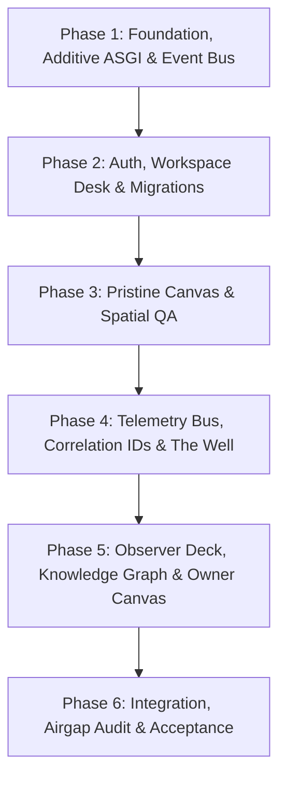

# SETU-NETRA: KORA KAAGAZ IMPLEMENTATION BLUEPRINT & PHASED MASTER PLAN
**System Version:** 2.0.0-RC1 (Kora Kaagaz Architecture)  
**Document Classification:** Master Implementation & Execution Plan (Revised for V2.0.0-RC1 Corrections)  
**Target Architecture:** Additive Async ASGI Layer, Spatial Provenance Engine & Real-Time Observer Core  
**Repository Working Directory:** `d:/Projects/Setu-Netra`  
**Date:** March 2026  

---

## 1. Executive Summary & Strategic Directive

SETU-NETRA Version 1.1.0 established an empirically verified foundation comprising 185 passing unit/integration tests, zero test failures, and 5 passing end-to-end acceptance audit suites. The core algorithmic pipelines—incorporating dual-tier adaptive model routing, capacity-aware worker scheduling, EasyOCR spatial extraction, hybrid dense-lexical retrieval, and tripartite citation verification—are fully operational and empirically verified.

The **Kora Kaagaz** (कोरा कागज़ — *"The Pristine Parchment of Truth"*) product specification elevates SETU-NETRA into an institutional-grade, multi-surface document intelligence and research evaluation platform.

### Core Architectural Directives & Review Corrections:
1. **Preserve Validated Algorithmic Core:** Zero rewriting or algorithmic disruption of validated core components in `src/setu_netra/` (retrieval, OCR, layout extraction, model adapters, router, schedulers, and tripartite verifier). Minimal, backward-compatible instrumentation hooks may be introduced only where existing telemetry is insufficient, and must be mathematically proven not to alter routing, retrieval, scheduling, or inference results.
2. **Additive ASGI Architecture with Legacy Fallback:** Deploy `FastAPI` + `Uvicorn` as an **additive API layer** alongside the existing `app.py`. The legacy application is preserved intact as an operational fallback until all V2.0 acceptance testing formally passes.
3. **Transport Protocol Standards:** Standard HTTPS (or HTTP for local testing) and Server-Sent Events (SSE) provide real-time telemetry streaming and token delivery. Experimental HTTP/2 support is **not** a prerequisite.
4. **Bounded Thread Concurrency:** Synchronous inference operations are dispatched into a bounded `ThreadPoolExecutor` via `anyio.to_thread.run_sync`. This prevents CPU-intensive model execution from starving the ASGI event loop while strictly preserving the model concurrency ceiling (e.g., maximum 1 concurrent request for local Ollama).
5. **Shared SQLite Persistence with Workspace Scoping:** Multi-tenancy is implemented strictly via shared SQLite tables utilizing `workspace_id` and `tenant_id` columns, rather than separate database schemas or dynamically attached files. All existing V1.1.0 data is preserved into a default workspace (`'default'`) via versioned, non-destructive, and reversible migrations. SQLite WAL's single-writer constraint is managed via bounded busy timeouts, and clear threshold conditions define when PostgreSQL migration becomes necessary.
6. **Two Explicit Deployment Modes:**
   * **Local Research Mode:** Local Ollama SLMs, local document processing, local persistence, with combined application-level and OS-level (firewall) outbound network blocks.
   * **Hosted Public Mode:** Public HTTPS frontend, authenticated backend, private document storage by workspace, controlled inference with explicitly authorized cloud endpoints (Gemini, Groq, OpenRouter). The local Ollama daemon is strictly bound to `127.0.0.1` and never exposed. *Hosted public mode is never described as fully airgapped.*
7. **Rigorous Telemetry & The Well:** Every request carries a correlation ID (UUIDv4). Telemetry flows through a single-process in-memory EventBus with bounded subscriber queues, slow-client drop policies, 15-second heartbeat keep-alives, and `Last-Event-ID` reconnection replay. The Well reservoir translates physical RAM headroom, QPS inflow, worker token velocity, and processing capacity into explicit, smoothed mathematical transformations. Zero synthetic activity or fake users are permitted.
8. **Security & Governance:** Passwords hashed with Argon2id; session management via `Secure`, `HttpOnly`, and context-appropriate `SameSite` cookies with anti-CSRF protection; object-level workspace authorization; and tamper-evident (not automatically immutable) SHA-256 chained audit logs.
9. **API Error Compliance:** All error responses strictly conform to **RFC 9457 Problem Details for HTTP APIs** (`application/problem+json`).

---

## 2. The 12 Kora Kaagaz Core Interfaces (Modules A–L)

```
+---------------------------------------------------------------------------------------------------+
|                                      SETU-NETRA KORA KAAGAZ CORE                                   |
+---------------------------------------------------------------------------------------------------+
|  [A] Public Manifesto & Playground   |  [B] Workspace & Session Desk  |  [C] Pristine Document QA |
+--------------------------------------+--------------------------------+---------------------------+
|  [D] Knowledge Graph Explorer        |  [E] Spatial Provenance Deck   |  [F] Report Studio        |
+--------------------------------------+--------------------------------+---------------------------+
|  [G] Model & Engine Registry         |  [H] Live Intelligence Map     |  [I] The Well (Capacity)  |
+--------------------------------------+--------------------------------+---------------------------+
|  [J] Owner Control Canvas            |  [K] Faculty Observer          |  [L] Security & Audit Log |
+---------------------------------------------------------------------------------------------------+
```

### Module A: Public Manifesto & Playground
* **Purpose:** Public landing page, philosophical treatise on document truth, architectural thesis, and interactive restricted guest sandbox.
* **Key Components:**
  * Interactive Manifesto explaining the mathematical fragility of ungrounded LLMs vs. Spatial Grounding.
  * Live Demo Playground restricted to pre-indexed benchmark documents (Attention Is All You Need, Financial 10-K, Clinical Trial Report).
  * Ephemeral Guest Session isolation with rate limiting (5 queries/min, 256 token ceiling).
  * Direct links to architectural whitepapers and faculty observer modes.

### Module B: Authenticated Intelligence Workspace
* **Purpose:** Project workspace organizer, multi-tenant session desk, and document repository management.
* **Key Components:**
  * Workspace Switcher: Logical namespaces isolating documents, embeddings, conversation history, and fine-tuned routing policies via `workspace_id`.
  * Document Drag-and-Drop Ingestion Desk with instant file validation, MIME verification, and SHA-256 fingerprint deduplication.
  * Extraction Progress HUD: Multi-stage pipeline status (Ingestion -> PDF Render -> EasyOCR -> XY-Cut Layout -> MiniLM Embedding -> BM25 Index).
  * Document Library View: Metadata grid with spatial status, page counts, OCR confidence distributions, and index freshness badges.

### Module C: Pristine Document & QA Canvas
* **Purpose:** High-precision document reader paired with evidence-grounded conversational question answering.
* **Key Components:**
  * Parchment Canvas: Multi-page high-resolution canvas with pinch/pan/zoom and sub-pixel coordinate alignment.
  * Dynamic Bounding Box Overlay Layer: Interactive spatial highlights keyed to extracted text blocks and visual figures.
  * Conversational Query Bar: Unified prompt input supporting natural language questions, structured queries, and model target directives (`@qwen`, `@smollm2`, `@gemini`).
  * Evidence-Bound Answer Cards: Streamed model responses featuring inline citation pills that highlight matching bounding boxes on the document canvas on hover or click.

### Module D: Knowledge Explorer & Entity Graph
* **Purpose:** Multi-document entity extraction, cross-document topic clusters, and semantic concept navigation.
* **Key Components:**
  * Force-Directed Knowledge Graph: Interactive 2D canvas displaying extracted entities (Organizations, Locations, Dates, Metrics, Key Terms) as nodes and co-occurrence/semantic relations as edges.
  * Entity Inspection Drawer: Frequency analysis, provenance block listing, and one-click query generation.
  * Cross-Document Semantic Bridges: Visual indication of concept links across distinct uploaded documents within the active workspace.

### Module E: Evidence & Reasoning Workspace (Spatial Provenance Deck)
* **Purpose:** Deep inspection of model thinking traces, citation verification matrices, and token-level spatial alignment.
* **Key Components:**
  * Split-Screen Provenance Inspector: Left pane displays raw model reasoning and `<think>` traces; right pane displays verified passage snippets with raw OCR block crops.
  * Tripartite Verification Scorecard: Real-time classification badge (`EVIDENCE_BACKED`, `UNVERIFIED_INFERENCE`, `GENERAL_KNOWLEDGE`) with lexical overlap scores, semantic cosine distance, and coordinate bounding checks.
  * Token-Level Attention / Alignment Highlighter: Interactive visual connection between generated answer claims and source document rectangular coordinates $(x_1, y_1, x_2, y_2)$.

### Module F: Report Studio
* **Purpose:** Compilation of evidence-grounded research reports, executive memos, and audit briefs with embedded visual citations.
* **Key Components:**
  * Markdown / LaTeX Document Editor with live split-screen preview in editorial parchment typography.
  * One-Click Evidence Snippet Insertion: Drag-and-drop citation pills from Module C/E directly into report text with embedded block crops.
  * Export Engine: Clean export to PDF, print-ready HTML, and raw Markdown with complete cryptographic provenance manifests.

### Module G: Model Management & Hardware Registry
* **Purpose:** Local SLM lifecycle control, Ollama daemon management, cloud standby toggling, and quant state monitoring.
* **Key Components:**
  * Local Engine Controller: Start, stop, warm-up, and restart controls for Ollama daemon (`qwen3.5:2b`, `smollm2:135m`).
  * Real-Time Engine Health: Ping latency, context window utilization ($0-2048$ tokens), memory residency, and active worker slot status.
  * Cloud Standby Manager: Secure credential input and live connectivity test buttons for Google Gemini, Groq, and OpenRouter with automatic circuit-breaker status indicators (in Hosted Public Mode).

### Module H: Live Intelligence Map
* **Purpose:** Real-time spatial event graph rendering the active lifecycle of every query across the system.
* **Key Components:**
  * Node-Edge Flow Topology: Visual pipeline nodes representing Ingress -> Query Analyzer -> Adaptive Router -> Worker Pool -> Retrieval Engine -> Model Execution -> Citation Verifier -> Egress.
  * Active Packet Animation: Glowing ink pulses traversing the graph representing in-flight requests, carrying metadata (correlation ID, estimated complexity, selected worker, execution phase).
  * Real-Time Latency Gauges: Sub-millisecond latency counters attached to each pipeline stage driven by SSE events.

### Module I: Workload & Capacity Reservoir ("The Well")
* **Purpose:** Organic fluid reservoir metaphor representing system capacity, memory saturation, worker currents, and backpressure.
* **Key Components:**
  * Dynamic Fluid Canvas: Fluid surface depth directly mapped to available system memory headroom ($D(t) = D_{max} \cdot (1 - M_{used}/M_{total})$).
  * Inflow Currents: Liquid inflow cascades reflecting incoming query volume and ingress request rates.
  * Worker Vortexes: Subsurface rotational vortexes whose angular speeds correspond to worker token generation velocity ($\omega_w \propto \tau_w$).
  * Sediment Bed: Visual particulate accumulation at the base representing memory fragmentation, cached block indices, and dead queue backpressure.
  * Thermal State Glow: Ambient liquid tint shifting based on CPU load and temperature throttling.

### Module J: Owner Control Canvas
* **Purpose:** Master administrative control plane for real-time routing weights, scheduler swapping, and emergency overrides.
* **Key Components:**
  * Adaptive Weight Sliders: Live tuning of cost weight ($w_c$), latency weight ($w_l$), quality weight ($w_q$), and memory weight ($w_m$) with zero server restart.
  * Scheduling Algorithm Selector: Hot-swapping between all 6 validated schedulers (`adaptive`, `fifo`, `round_robin`, `capacity_weighted`, `least_loaded`, `locality_aware`).
  * System Circuit Breakers: Master toggles for Cloud Egress Lockdown, Local SLM Concurrency Ceiling, and Global Rate Limits.
  * Hard Emergency Killswitch: Instant queue drain and active worker termination command.

### Module K: Faculty Observer Deck
* **Purpose:** Auditor-grade evaluation deck presenting live mathematical derivations, benchmark metrics, and reproducible experiment logs.
* **Key Components:**
  * Live Mathematical Proofs: Dynamic KaTeX rendering of equations behind active routing scores, MRR, nDCG, and citation overlap formulas.
  * Ground-Truth Evaluation Matrix: Side-by-side comparison of system-generated answers vs. human-verified golden datasets with precision/recall curve plots.
  * Statistical Uncertainty Inspector: Wilson score confidence intervals for binary proportions with explicit sample sizes and denominators ($n$).
  * Raw Data Export Desk: Instant export of raw NDJSON benchmark logs and SQLite execution traces for external peer review.

### Module L: Analytics, Security & Administration
* **Purpose:** Tamper-evident audit trails, tenant management, role-based access enforcement, and security verification.
* **Key Components:**
  * Cryptographic Audit Ledger: Append-only log of every document upload, query execution, model invocation, and administrative configuration change with SHA-256 state chaining (tamper-evident).
  * Role-Based Access Control (RBAC) Manager: Role assignment (Owner, Researcher, Faculty Observer, Guest) and granular capability matrices.
  * Airgap Zero-Egress Auditor: Combined application socket guard and OS firewall status verification.

---

## 3. Architecture Transition & Additive ASGI Plan

```
CURRENT V1.1 ARCHITECTURE (PRESERVED AS FALLBACK):
[Browser] <--- HTTP/1.1 ---> [ThreadingHTTPServer (app.py)] ---> [Pipeline]

TARGET KORA KAAGAZ ARCHITECTURE (ADDITIVE LAYER):
[Browser] <--- HTTPS / SSE ---> [Uvicorn ASGI Engine (main.py)]
                                        |
                 +----------------------+----------------------+
                 |                                             |
         [FastAPI Async Router]                       [Async Event Bus]
                 |                                      (Single-Process)
                 | (anyio.to_thread.run_sync)                  |
                 v                                             v
     [Bounded Thread Pool (max=4)]                   [SSE Broadcast Stream]
                 |                                             |
     [SetuNetra Core Subsystems]                    [Live Map & The Well]
```

### 3.1 Concurrency Model & Event Loop Protection
1. **Additive API Layer:** `FastAPI` + `Uvicorn` runs on port 8501. `app.py` is maintained as a fallback script (`run_legacy_ui.py`) and passes all existing tests.
2. **Event Loop Non-Blocking Guarantee:** CPU-heavy synchronous operations (EasyOCR, MiniLM embedding generation, Ollama token streaming) are executed strictly in a bounded thread pool via `anyio.to_thread.run_sync`. The ASGI event loop handles only async I/O, HTTP routing, and SSE event streaming.
3. **Preservation of Concurrency Guards:** The Ollama 1-concurrency semaphore in `OllamaProviderAdapter` remains active across thread pool dispatches. If a second request arrives while Qwen is generating, it queues safely without overloading the CPU.

---

## 4. Phased Delivery Schedule & Milestones



### Phase 1: Foundation, Additive ASGI Engine & Core Event Bus
* **Objectives:**
  1. Scaffold `src/setu_netra/api/` with `FastAPI` and `Uvicorn`.
  2. Implement in-memory `EventBus` with correlation ID tracking, 2048-event circular ring buffer, 15s keep-alive heartbeat (`: ping`), bounded client queues, and slow-client drop handling.
  3. Wrap existing `InferencePipeline`, `AdaptiveModelRouter`, and `DocumentDatabase` in non-blocking async dependency providers (`anyio.to_thread.run_sync`).
  4. Implement `/api/v1/health` and `/api/v1/events/stream` endpoints.
  5. Configure RFC 9457 Problem Details error handler.
* **Verification Gate:**
  * All 185 existing tests pass 100%.
  * Async engine test suite verifies non-blocking SSE streaming and `Last-Event-ID` reconnection replay.

### Phase 2: Authentication, Security & Workspace Desk (Modules B, L)
* **Objectives:**
  1. Implement non-destructive, versioned, and reversible SQLite migrations adding `workspaces`, `users`, `sessions`, and `audit_ledger` tables, and adding `workspace_id` to existing tables.
  2. Preserve all existing V1.1.0 records under `workspace_id = 'default'`.
  3. Implement Argon2id password hashing, session rotation, and `Secure`/`HttpOnly`/`SameSite` cookie management with CSRF protection.
  4. Implement object-level workspace authorization middleware enforcing workspace filtering in all queries.
  5. Build Workspace Desk UI: workspace switching, file upload with SHA-256 deduplication, and extraction background tasks.
* **Verification Gate:**
  * Authentication test suite: login, session rotation, CSRF validation, unauthorized route blocking (401/403).
  * Multi-tenant isolation test: Document in Workspace A is strictly inaccessible from Workspace B.

### Phase 3: Pristine Canvas, Spatial QA & Provenance Deck (Modules C, E, F)
* **Objectives:**
  1. Build Kora Kaagaz Editorial UI: archival parchment styling (`#F9F6EE`), ink typography, high-res multi-page canvas.
  2. Implement sub-pixel bounding box rendering engine mapping OCR boxes $(x_1, y_1, x_2, y_2) \in [0.0, 1.0]$ onto rendered PDF page bitmaps.
  3. Build streaming conversational interface with inline citation pills linked to spatial canvas highlights.
  4. Implement Split-Screen Provenance Deck displaying raw model thinking traces, lexical overlap scores, and tripartite classification badges.
  5. Build Report Studio with drag-and-drop citation snippet insertion and Markdown/PDF export.
* **Verification Gate:**
  * Canvas renders bounding boxes with $<1$px visual drift.
  * Hovering over citation pill instantly triggers highlight on target document block.

### Phase 4: Real-Time Telemetry, Live Intelligence Map & The Well (Modules H, I)
* **Objectives:**
  1. Instrument pipeline stages with minimal, backward-compatible event hooks that do not alter routing or inference outputs.
  2. Implement correlation IDs across all request lifecycle events (`REQUEST_INGRESS` through `EGRESS_COMPLETED`).
  3. Build Live Intelligence Map: SVG/Canvas topological node-edge graph with animated ink pulses representing live query packets.
  4. Build The Well: Canvas/WebGL fluid reservoir visualization with mathematically defined transformations for RAM headroom, request inflow, worker vortices, sediment bed, and thermal state.
  5. Connect frontend components to `/api/v1/events/stream` with automatic reconnect and `Last-Event-ID` replay.
* **Verification Gate:**
  * Zero synthetic telemetry: Halting Ollama causes its vortex in The Well to stop immediately.

### Phase 5: Faculty Observer Deck, Knowledge Graph & Owner Canvas (Modules D, G, J, K)
* **Objectives:**
  1. Build Faculty Observer Deck: live KaTeX mathematical derivations for routing scores, MRR, nDCG, and Wilson score confidence intervals for binary proportions (recording sample sizes $n$ and denominators).
  2. Separate real user activity telemetry from synthetic benchmarking data.
  3. Build Ground-Truth Evaluation Matrix with live dataset scoring and NDJSON raw log export.
  4. Implement Force-Directed Knowledge Graph extracted from document entities.
  5. Build Owner Control Canvas: live weight tuning sliders, scheduler algorithm selector, and emergency killswitch.
  6. Build Model Management Desk: Ollama daemon management, warm-up triggers, and cloud standby toggles (in Hosted Public Mode).
* **Verification Gate:**
  * Dynamically changing routing weights in Owner Canvas alters routing decisions in real time without restarting the server.

### Phase 6: Full Integration, Airgap Egress Audit & Final Acceptance
* **Objectives:**
  1. Build Public Manifesto & Interactive Playground (Module A) with guest sandbox constraints.
  2. Conduct comprehensive end-to-end integration testing across all 12 modules.
  3. Perform Airgap Zero-Egress Audit in Local Research Mode: verify that application socket guards and OS firewall rules prevent any non-loopback network packets.
  4. Validate Hosted Public Mode security: ensure local Ollama daemon port 11434 is strictly unexposed, and only authorized cloud provider calls are permitted.
  5. Measure performance benchmarks under multi-user load.
* **Verification Gate:**
  * Complete test suite passing ($>200$ tests).
  * Formal faculty observer sign-off on mathematical derivation accuracy and airgap compliance.

---

## 5. Risk Assessment & Mitigation Matrix

| Risk ID | Identified Risk | Severity | Probability | Mitigation Strategy |
| :--- | :--- | :---: | :---: | :--- |
| **R-01** | Thread starvation during local SLM inference blocking UI interactions. | HIGH | HIGH | Deploy FastAPI + Uvicorn additive layer; offload inference to bounded `ThreadPoolExecutor` via `anyio.to_thread.run_sync`. |
| **R-02** | Accidental regression of existing 185 unit/integration tests. | CRITICAL | LOW | Strict preservation policy: all existing core files in `src/setu_netra/core/` are read-only. Wrap, don't modify. |
| **R-03** | Canvas bounding box coordinate misalignment due to PDF scaling/DPI differences. | HIGH | MEDIUM | Normalize all coordinates to $0.0 - 1.0$ unit scale relative to page width/height in backend; scale dynamically on frontend canvas. |
| **R-04** | Telemetry event overload saturating SSE client connections during heavy token streaming. | MEDIUM | MEDIUM | Implement bounded subscriber queues (256 frames) with slow-client frame dropping and warning alerts. |
| **R-05** | Unauthorized access across workspace boundaries. | CRITICAL | LOW | Strict RBAC middleware enforcing object-level workspace ID checks on every data access endpoint; parameterized SQLite queries. |
| **R-06** | Accidental external egress in local airgap mode. | CRITICAL | LOW | Combine application-level circuit breakers with OS-level firewall egress rules; verify zero outbound non-loopback packets. |
| **R-07** | SQLite WAL single-writer contention under multi-user write load. | MEDIUM | MEDIUM | Configure 5000ms busy timeout; serialize write transactions; monitor write contention thresholds for PostgreSQL migration. |

---

## 6. Verification & Preservation Checkpoints

To ensure architectural continuity, the following automated checkpoints must be executed at every milestone:

1. **V1.0/V1.1 Regression Suite:**
   ```powershell
   .venv\Scripts\python -m unittest discover -s tests -p "test_*.py"
   ```
   *Pass Requirement:* Exactly 185/185 passing tests. Zero failures, zero errors.

2. **Ollama Integration Audit:**
   ```powershell
   .venv\Scripts\python audit_priority1_ollama_qwen.py
   ```
   *Pass Requirement:* Verified non-empty answer generation, thinking trace extraction, and bounded memory residency.

3. **Multi-Model Concurrency & Coexistence Audit:**
   ```powershell
   .venv\Scripts\python audit_priority4_multimodel_coexistence.py
   ```
   *Pass Requirement:* Clean sequential execution without memory collision between SmolLM2 and Qwen.

4. **Kora Kaagaz Master API Verification Suite:**
   * New test suite `tests/test_kora_kaagaz_api.py` validating all REST contracts, RFC 9457 errors, SSE streams, and RBAC policies.
