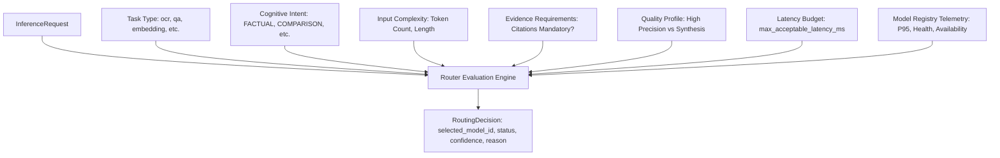

# SETU-NETRA Adaptive Model Router Specification
## Technical Specification of the Model Decision Control Plane

**Document Reference**: SPEC-STAGE5-RTR-001  
**Project**: SETU-NETRA (Bridge-Eye)  
**Date**: November 2026  
**Status**: APPROVED & IMPLEMENTED  

---

## 1. Objective & Scope

The **Adaptive Model Router** (`AdaptiveModelRouter` in `src/setu_netra/routing/router.py`) serves as the semantic and operational decision engine of SETU-NETRA. Its sole responsibility is to evaluate an incoming `InferenceRequest` and determine the most appropriate registered AI model to fulfill the task. 

It evaluates cognitive requirements, provenance constraints, latency budgets, and real-time model telemetry, operating strictly above the worker scheduling layer.

---

## 2. Decision Inputs

The router ingests a rich set of multi-dimensional parameters for every routing decision:



### Input Definitions:
1. **`task_type`**: Primary functional category (`ocr`, `embedding`, `classification`, `extractive_qa`, `generative_qa`, `summarization`, `reasoning`).
2. **`question_intent`**: Extracted via `classify_question_intent()`:
   - `FACTUAL`: Seeking specific dates, entities, numbers, names.
   - `DEFINITION`: Seeking semantic definitions or terminology explanations.
   - `PROCEDURAL`: Seeking steps, sequences, workflows, instructions.
   - `COMPARISON`: Seeking trade-offs, contrasts, similarities between entities.
   - `EVALUATIVE`: Seeking critical analysis, assessment, critique.
   - `MCQ`: Multiple-choice question options evaluation.
3. **`input_complexity`**: Estimated token count $T = \max(1, \text{len}(\text{payload}) // 4)$ and presence of multi-hop deductive indicators.
4. **`evidence_requirements`** (`EvidenceRequirement`):
   - `REQUIRE_VERIFIED_CITATIONS`: Mandatory exact document, page, and bounding box citations.
   - `SYNTHESIS_ALLOWED`: Paraphrasing and abstractive reasoning acceptable.
   - `NO_EVIDENCE_NEEDED`: Open classification or general text.
5. **`required_quality`** (`QualityRequirement`):
   - `HIGH_PRECISION`: Zero-hallucination tolerance.
   - `BALANCED`: Grounded evidence with conversational fluency.
   - `CREATIVE_SYNTHESIS`: Conceptual restructuring and narrative expansion.
6. **`max_acceptable_latency_ms`**: Extracted from `timeout_ms` or `timeout`. Sets the upper bound for the model's expected execution SLA.
7. **`model_availability` & `health`**: Read dynamically from `ModelRegistry`.

---

## 3. Deterministic Routing Policies

### Policy 1: Vision / OCR Recognition
- **Criteria**: `task_type in ('ocr', 'text_extraction', 'image_ocr')`.
- **Target**: Available model supporting `ocr` (e.g. `easyocr-craft-crnn`).
- **Rejection**: If no healthy OCR adapter is available $\to$ `status="REJECTED"`, `reason="No healthy OCR model adapter registered"`.

### Policy 2: Semantic Dense Embeddings
- **Criteria**: `task_type in ('embedding', 'similarity', 'vectorization')`.
- **Target**: Prioritizes 384-dimensional dense neural embeddings (`all-minilm-l6-v2`); falls back to 512-dimensional deterministic hash embeddings (`offline-hash-embedder`).

### Policy 3: Academic Classification & Intent Detection
- **Criteria**: `task_type in ('classification', 'domain_detection', 'intent_classification')`.
- **Target**: `academic-domain-classifier-v1` (`OpenVocabularyDomainClassifier`).

### Policy 4: Strict Evidence Grounding & Extractive QA
- **Criteria**: `task_type == 'extractive_qa'` OR `evidence_requirements == REQUIRE_VERIFIED_CITATIONS` OR `quality_req == HIGH_PRECISION` OR `intent in ('FACTUAL', 'DEFINITION', 'MCQ')`.
- **Target**: `grounded-extractive-qa-v1`.
- **Justification**:
  - Extractive QA provides 100% precision, zero hallucination, and exact bounding-box provenance.
  - Native CPU execution latency is ~1.1 ms (compared to ~2,700 ms for generative SLM).
- **Fallback**: If extractive engine is unavailable, falls back to `smollm2-135m-instruct` with a clear epistemic warning.

### Policy 5: Natural Language Synthesis & Summarization
- **Criteria**: `task_type in ('generative_qa', 'summarization')` OR `intent in ('COMPARISON', 'PROCEDURAL', 'EVALUATIVE')` when synthesis is permitted.
- **Latency Guard**: Local SLM requires $\approx 2,500$ ms on CPU for a 40-token answer.
  - If `max_acceptable_latency_ms < 1,500 ms`: Generative SLM is disqualified due to SLA impossibility. Falls back to fast extractive QA (`grounded-extractive-qa-v1`) or rejects if synthesis is strictly required.
- **Target**: `smollm2-135m-instruct`.

### Policy 6: Reasoning Tasks
- **Criteria**: `task_type == 'reasoning'`.
- **Constraint Handling**: In accordance with project rules, small generative models (< 150M parameters) are evaluated for light comparative reasoning. For factual deductions, the router pairs or falls back to extractive verification.

### Policy 7: Direct Explicit Model Pinning
- **Criteria**: `request.model_id` specifies a known registered ID.
- **Verification**: Checks if requested model is registered and healthy. If healthy $\to$ routes directly. If unhealthy $\to$ discovers fallback model for that task.

---

## 4. Rejection and Error Policies

The router issues an explicit `RoutingDecision(status="REJECTED")` under the following conditions:
1. **Unsupported Task**: `task_type` is unknown and no registered model claims support.
2. **Total Model Outage**: All models compatible with the requested task are in `UNAVAILABLE` or `UNHEALTHY` states.
3. **Unachievable SLA**: The latency budget requested is mathematically incapable of being satisfied by any available eligible model (e.g., 200 ms budget for an LLM that requires 2,500 ms).
4. **Missing Explicit Model**: A pinned `model_id` does not exist in the registry.

---

## 5. Output Data Contract: `RoutingDecision`

```python
@dataclass
class RoutingDecision:
    selected_model_id: Optional[str]           # Model ID selected for execution
    task_type: str                             # Resolved task type
    confidence: float                          # 0.0 to 1.0 confidence score
    reason: str                                # Traceable justification string
    fallback_model_id: Optional[str] = None    # Secondary candidate if primary fails
    status: str = "ROUTED"                     # 'ROUTED', 'REJECTED', 'FALLBACK'
    metadata: Dict[str, Any] = ...             # Intent, epistemic notes, latency warnings
```
