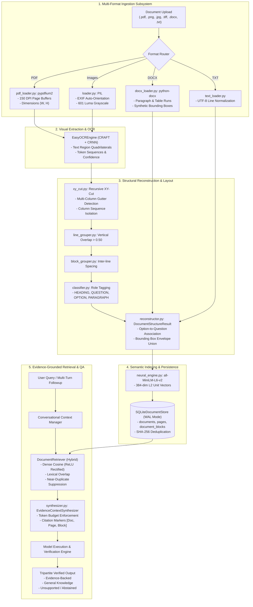

# SETU-NETRA: Document Intelligence Engine Architecture Specification

**Report ID:** SETU-DOC-ARCH-003  
**Date:** November 9, 2026  
**Audience:** System Architects, Core Developers, Evaluators  
**Scope:** Multi-format Ingestion, Structural Extraction, Evidence-Grounded Q&A, and Citation Auditing  

---

## 1. Executive Vision & System Workflow

The Document Intelligence Engine in SETU-NETRA is engineered to transform unstructured, multi-format documents (photographs, scanned exams, PDFs, DOCX files, plain text) into an **evidence-grounded, semantically indexed structural knowledge graph**.

Unlike conventional "PDF Chatbots" that treat documents as flat, unindexed text strings dumped into naive vector databases, SETU-NETRA guarantees **complete spatial provenance**: every answer generated by downstream AI models is directly traceable to an exact document name, page number, structural block, and bounding-box coordinates on the original page canvas.



---

## 2. Multi-Format Ingestion Specification

| File Type | Ingestion Engine | Page / Canvas Geometry | Provenance Representation |
| :--- | :--- | :--- | :--- |
| **PDF** | `pypdfium2` (PDFium) | Rendered at $150\text{ DPI}$ ($1240 \times 1754\text{ px}$ for A4). | Page number ($1, 2, \dots$), pixel bounding box, normalized coordinates $[0.0, 1.0]$. |
| **Raster Images** (`.png`, `.jpg`, `.tiff`, `.webp`) | PIL / `ImageOps.exif_transpose` | Native image dimensions ($W, H$). Grayscale converted via ITU-R 601 luma ($0.299R + 0.587G + 0.114B$). | Single-page document, absolute pixel coordinates, normalized coordinates. |
| **DOCX** | `python-docx` | Synthesized page boundaries based on standard page margins ($72\text{ pt}$ margins). | Synthesized page numbers, paragraph/table indices, synthetic layout bounding boxes. |
| **Plain Text** (`.txt`) | UTF-8 Stream Parser | Fixed-line layout pagination ($60\text{ lines/page}$). | Line-number ranges, character byte offsets. |

---

## 3. Spatial Layout & Multi-Column Recursive XY-Cut

In real-world academic exams and research papers, text is frequently formatted in two-column or three-column layouts. A major vulnerability identified in the baseline audit was cross-column line merging: `line_grouper.py` grouped text horizontally across the central gutter whenever vertical bands overlapped.

### The Recursive XY-Cut Algorithm Formulation:
1. **Projection Profiling:** Let $B = \{b_1, b_2, \dots, b_n\}$ be the bounding boxes of detected words on page $P(W, H)$.
2. **Vertical Cut Detection:** Compute horizontal projection histogram $H_{\text{proj}}(x)$ across column $x \in [0, W]$:
   $$H_{\text{proj}}(x) = \sum_{i=1}^n \mathbb{I}(x_{i,\text{left}} \le x \le x_{i,\text{right}})$$
   A vertical cut (gutter) is identified where $H_{\text{proj}}(x) == 0$ over a width $\Delta x \ge \text{gutter\_min\_width}$ (e.g. $15\text{ pixels}$).
3. **Recursive Partitioning:**
   - If a valid vertical gutter splits the page into $K$ columns, partition the boxes into subsets $B_{\text{col}, 1}, \dots, B_{\text{col}, K}$.
   - Sort columns in primary reading order (left-to-right).
   - Within each column, apply horizontal projection profiling $V_{\text{proj}}(y)$ to isolate paragraph blocks and line baselines.
4. **Line Grouping within Column Boundary:**
   `line_grouper.py` is invoked strictly *within* isolated column boundaries, eliminating cross-gutter text corruption.

---

## 4. Question-Answer Parsing & Hierarchy Assembly

The structural classifier (`classifier.py` and `reconstructor.py`) converts flattened OCR boxes into hierarchical academic entities:

```
DocumentStructureResult
├── DocumentMetadata (doc_id, total_pages, file_hash)
└── Pages [1 .. N]
    ├── Headings (Exam title, section headers, instructions)
    ├── QuestionBlocks
    │   ├── Question 1 (Prompt text, spatial box, confidence)
    │   │   ├── Option (A) [Text, Box, Confidence]
    │   │   ├── Option (B) [Text, Box, Confidence]
    │   │   ├── Option (C) [Text, Box, Confidence]
    │   │   └── Option (D) [Text, Box, Confidence]
    │   └── Question 2 ...
    ├── Tables (Row/column grid cells, Markdown serialization)
    └── Paragraphs (General prose, footnotes, marginalia)
```

### MCQ Spatial Association Rule:
An `OPTION` block $O_k$ is associated with a preceding `QUESTION` block $Q_m$ if and only if:
1. $y_{\text{top}}(O_k) > y_{\text{top}}(Q_m)$ (spatially below the question on the same page).
2. No intervening `QUESTION` block $Q_{m+1}$ exists between $Q_m$ and $O_k$.
3. The option prefix matches the expected sequence (e.g. `(B)` following `(A)`). If non-consecutive options appear (e.g. `(A)` followed immediately by `(C)`), an integrity warning flag is raised.

---

## 5. Conversational Context & Multi-Turn Tracking

To support interactive document exploration, the engine maintains conversational state:
* **Session Memory:** Stores the active document context (`active_doc_id`), current page focus, and recent user queries.
* **Coreference Resolution:** When a user asks a follow-up (e.g. *"Why is option B incorrect?"*), the conversational manager expands the query using the antecedent question from turn $t-1$:
  $$Q_{\text{expanded}} = \text{ResolveCoreference}(Q_t, \text{History}_{t-1})$$
* **Grounded Filtering:** Retrieval for follow-up questions prioritizes the active document and page before expanding across the entire corpus.

---

## 6. The Tripartite Verification Taxonomy

To eliminate hallucinations and prevent model overconfidence, every response generated by the system is classified into one of three rigorous epistemic states:

```
                                  +---------------------------------------+
                                  |     Candidate Generation from LLM     |
                                  +---------------------------------------+
                                                      |
                                                      v
                                        Does generation assert facts?
                                                      |
                                     +----------------+----------------+
                                     |                                 |
                                    YES                                NO
                                     |                                 |
                                     v                                 v
                     Are facts backed by retrieved context      "I cannot verify this from
                       blocks with valid citations?             the provided documents."
                                     |                         (3. UNSUPPORTED / ABSTAINED)
                      +--------------+--------------+
                      |                             |
                     YES                            NO
                      |                             |
                      v                             v
           Strict Citation Format        Is information marked as
        [Doc: <d>, Page: <p>, Block: <b>]  general external knowledge?
          (1. EVIDENCE-BACKED ANSWER)               |
                                                    v
                                           Explicit Disclaimer:
                                        "Based on general AI knowledge,
                                         not found in document."
                                        (2. GENERAL MODEL KNOWLEDGE)
```

1. **Category 1: Evidence-Backed Answer**
   * Every claim made is supported by a cited passage in the retrieved context.
   * Format: `"Main memory utilizes Dynamic RAM [Doc: exam.pdf, Page: 2, Block: 4]."`
   * The system cross-verifies that the cited block actually contains the asserted tokens.
2. **Category 2: General Model Knowledge**
   * The user asks a concept question not explicitly answered in the document.
   * The system provides the answer but prepends a mandatory warning:
     > *"⚠️ General Knowledge: This information is derived from external model knowledge and is not verified by the uploaded document."*
3. **Category 3: Unsupported / Abstained Response**
   * If retrieved passages have hybrid similarity scores below threshold ($\text{score} < 0.20$), or if the document explicitly contradicts the prompt premise:
   * The system strictly abstains:
     > *"The uploaded document does not contain sufficient verified evidence to answer this question."*

---

## 7. Dual-Coordinate Space & UI Visual Grounding

To enable interactive UI highlighting on both raw scans and rendered PDFs:

$$\text{Absolute Pixel Coordinates: } (x_1, y_1, x_2, y_2)_{\text{pixel}} \in [0, W] \times [0, H]$$

$$\text{Normalized Unit Coordinates: } \left( \frac{x_1}{W}, \frac{y_1}{H}, \frac{x_2}{W}, \frac{y_2}{H} \right) \in [0.0, 1.0]^4$$

$$\text{PDF Point Coordinates: } (x, y)_{\text{point}} = (x, y)_{\text{pixel}} \times \frac{72}{\text{DPI}} = (x, y)_{\text{pixel}} \times 0.48 \quad (\text{at } 150\text{ DPI})$$

By storing both normalized unit coordinates and rendering DPI in SQLite, the frontend UI can highlight exact text bounding boxes on any viewport resolution or zoom factor without distortion.
