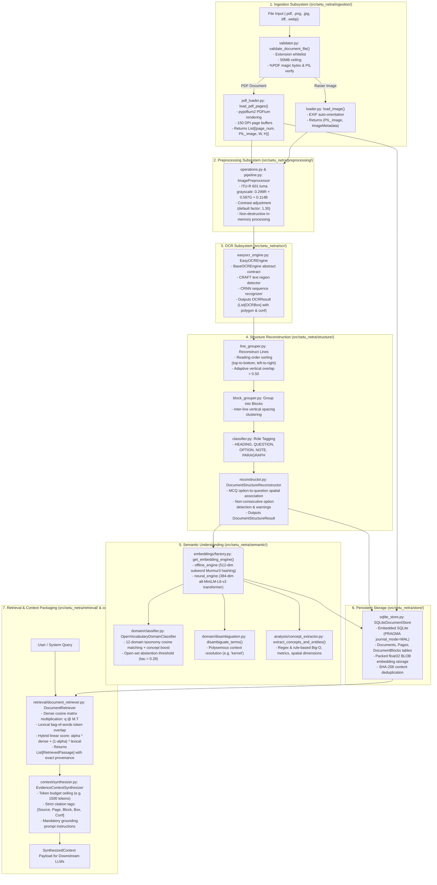

# SETU-NETRA: Milestone 5 Implementation Audit Report

**Report ID:** SETU-AUDIT-M5-001  
**Audit Date:** November 3, 2026  
**Status:** Empirically Verified via Code Inspection & Test Execution  
**Target Environment:** Local Workspace (`D:\Projects\Setu-Netra`), Windows, Python 3.14 / PyTorch 2.15 CPU  

---

## 1. Executive Summary

Milestone 5 expanded SETU-NETRA from a single-image academic proof-of-concept into a multi-page document intelligence and persistent context retrieval system.

This audit evaluates the codebase strictly based on actual source code, test execution, and empirical benchmarks. It determines what functionality is genuinely implemented, what remains mocked or hardcoded, and the architectural boundaries of the system.

### Core Verdict
* **Test Suite Verification:** All **69 unit and integration tests** pass in `54.55s` (`unittest discover -s tests`).
* **Genuine Implementations:** Multi-format validation, multi-page PDF decomposition via PDFium, CRAFT+CRNN OCR, deterministic geometric structure reconstruction, dual semantic embeddings (512-dim subword hashing and 384-dim `all-MiniLM-L6-v2`), SQLite persistence with WAL mode, SHA-256 content deduplication, dense cosine vector retrieval, and token-budgeted prompt synthesis with provenance markers.
* **Mocked / Legacy Stubs Remaining:** `src/setu_netra/semantic/retrieval/local_knowledge.py` contains 4 hardcoded textbook tuples (superseded by `DocumentRetriever`), and `MockOCREngine` remains as a deterministic unit test fixture.
* **Key Limitations:** Inability to handle rotated/skewed pages, cross-gutter column merging in multi-column layouts, table flattening into paragraph strings, and English-only OCR hardcoding (`lang_list=['en']`).

---

## 2. Complete Repository Architecture & Data Flow

---

## 3. Detailed Audit of the 12 Milestone Capabilities

### 1. Document Ingestion
* **Location:** `src/setu_netra/ingestion/validator.py` (`validate_document_file`), `loader.py` (`load_image`)
* **Status:** **Fully Implemented.**
* **Supported Formats:** `.pdf`, `.png`, `.jpg`, `.jpeg`, `.bmp`, `.tiff`, `.tif`, `.webp`.
* **Defensive Controls:** 50MB file size ceiling (`MAX_FILE_SIZE_BYTES`), path existence check, empty file check (0 bytes), and file header verification.
* **Limitations:** Does not support office formats (`.docx`, `.pptx`, `.xlsx`) or raw text files (`.txt`, `.md`).

### 2. PDF Validation and Decomposition
* **Location:** `src/setu_netra/ingestion/pdf_loader.py` (`load_pdf_pages`, `get_pdf_page_count`)
* **Status:** **Fully Implemented.**
* **Mechanism:** Uses `pypdfium2` (Google PDFium wrapper). Renders each PDF page at 150 DPI (`scale = 150.0 / 72.0`). Returns sequential list of `(page_number, PIL_Image, width, height)`.
* **Integrity:** `validator.py` verifies `%PDF` magic bytes at offset 0–1024 before attempting decoding.

### 3. OCR and Text Extraction
* **Location:** `src/setu_netra/ocr/base.py` (`BaseOCREngine`), `easyocr_engine.py` (`EasyOCREngine`), `mock_engine.py` (`MockOCREngine`)
* **Status:** **Fully Implemented.**
* **Mechanism:** EasyOCR uses CRAFT (Character Region Awareness for Text Detection) for bounding polygon detection and CRNN (Convolutional Recurrent Neural Network with CTC loss) for text recognition.
* **Output:** `OCRResult` with `boxes: List[OCRBox]` where each box contains a 4-point polygon `((x1,y1), (x2,y1), (x2,y2), (x1,y2))` and confidence score $\in [0.0, 1.0]$.
* **Mock Status:** `MockOCREngine` is preserved exclusively for fast unit testing. `EasyOCREngine` is active during real CLI and pipeline execution.

### 4. Document Structure Reconstruction
* **Location:** `src/setu_netra/structure/` (`line_grouper.py`, `block_grouper.py`, `classifier.py`, `reconstructor.py`)
* **Status:** **Fully Implemented (Deterministic Geometry).**
* **Mechanism:** Pure CPU computational geometry ($O(N \log N)$), no neural network or LLM.
  - Line grouping: Overlap ratio $> 0.50$ between vertical spans:
    $$\text{Overlap} = \frac{\min(y_{1,\max}, y_{2,\max}) - \max(y_{1,\min}, y_{2,\min})}{\min(h_1, h_2)}$$
  - Block grouping: Inter-line vertical distance clustering based on page median line height.
  - Role classification: Regex and position heuristics classify blocks into `HEADING`, `QUESTION`, `OPTION`, `PARAGRAPH`, `NOTE`, `UNCLASSIFIED`.
  - Question-Option association: Links subsequent option blocks to their preceding question block, checks label continuity, and raises explicit warnings for missing labels (e.g. missing option B).

### 5. Semantic Embeddings
* **Location:** `src/setu_netra/semantic/embeddings/` (`base.py`, `offline_engine.py`, `neural_engine.py`, `factory.py`)
* **Status:** **Fully Implemented (Dual Architecture).**
* **Offline Engine:** 512-dimensional subword character n-gram hashing ($n=3,4,5$) using Murmur3 hash, $L_2$ normalized. Latency: ~1.1 ms/query.
* **Neural Engine:** 384-dimensional dense embeddings using `sentence-transformers/all-MiniLM-L6-v2` with mean pooling and native $L_2$ normalization. Latency: ~21 ms/query on CPU.
* **Factory:** Automatically selects `neural` if weights and torch/transformers are present; falls back to `offline` seamlessly.

### 6. SQLite Persistence
* **Location:** `src/setu_netra/store/sqlite_store.py` (`SQLiteDocumentStore`)
* **Status:** **Fully Implemented.**
* **Configuration:** SQLite with Write-Ahead Logging (`PRAGMA journal_mode = WAL;`), `PRAGMA synchronous = NORMAL;`, and `PRAGMA foreign_keys = ON;`.
* **Schema:**
  - `documents`: Primary record (`doc_id`, `file_path`, `file_name`, `file_hash`, `file_type`, `page_count`, `created_at`, `status`, `metadata_json`).
  - `pages`: Page record (`page_id`, `doc_id`, `page_number`, `width`, `height`, `metadata_json`).
  - `document_blocks`: Block record (`block_pk`, `doc_id`, `page_number`, `block_id`, `block_type`, `text`, `confidence`, `bbox_json`, `embedding_blob`, `embedding_dim`, `embedding_engine`).
* **Vector Storage:** Packed binary `float32` arrays stored as `BLOB`. Unpacked via `np.frombuffer(blob, dtype=np.float32)`.

### 7. Content Deduplication
* **Location:** `src/setu_netra/store/sqlite_store.py` (`compute_file_sha256`, `get_document_by_hash`)
* **Status:** **Fully Implemented.**
* **Mechanism:** Reads file in 64KB chunks to calculate cryptographic SHA-256 hash. If `store.get_document_by_hash(file_hash)` matches, repeat ingestion is skipped and existing record is returned unless `force_reprocess=True`.

### 8. Dense Retrieval
* **Location:** `src/setu_netra/retrieval/document_retriever.py` (`DocumentRetriever`)
* **Status:** **Fully Implemented.**
* **Mechanism:** Embeds query text into vector $q \in \mathbb{R}^D$, unpacks document block matrix $M \in \mathbb{R}^{N \times D}$, and computes dot product $S_{\text{dense}} = q \cdot M^T$. Since vectors are $L_2$-normalized, this equals cosine similarity.

### 9. Lexical Retrieval
* **Location:** `src/setu_netra/retrieval/document_retriever.py` (`tokenize_text`, `DocumentRetriever`)
* **Status:** **Fully Implemented.**
* **Mechanism:** Tokenizes query and blocks into alphanumeric terms ($\ge 2$ chars). Computes Cosine token overlap coefficient:
  $$S_{\text{lexical}} = \frac{|Q \cap B|}{\sqrt{|Q| \cdot |B|}}$$

### 10. Hybrid Retrieval
* **Location:** `src/setu_netra/retrieval/document_retriever.py`
* **Status:** **Fully Implemented.**
* **Mechanism:** Combines dense cosine and lexical overlap via linear weighting:
  $$S_{\text{hybrid}} = \alpha \cdot S_{\text{dense}} + (1 - \alpha) \cdot S_{\text{lexical}} \quad (\text{default } \alpha = 0.70)$$
  Filters out candidates below threshold (default $\tau = 0.20$), sorts descending, and returns top-$K$.

### 11. Provenance Preservation
* **Location:** `src/setu_netra/core/contracts.py` (`RetrievedPassage`), `sqlite_store.py`, `document_retriever.py`
* **Status:** **Fully Implemented for Single Coordinate Systems.**
* **Guaranteed Fields:** Every `RetrievedPassage` object contains non-null `doc_id`, `document_name`, `page_number`, `block_id`, `block_type`, `bounding_box: (xmin, ymin, xmax, ymax)`, and `confidence`.

### 12. Context Synthesis
* **Location:** `src/setu_netra/context/synthesizer.py` (`EvidenceContextSynthesizer`)
* **Status:** **Fully Implemented.**
* **Mechanism:** Formats top passages into prompt context. Computes token count estimates (character and word upper-bounds). If adding a passage exceeds `max_budget_tokens`, halts and flags `truncated=True`. Injects explicit provenance headers and grounding instructions.

---

## 4. Mocked Components, Hardcoded Values & Legacy Stubs

| Component | Source File | Exact Nature of Mock / Hardcoded State | Status & Impact |
| :--- | :--- | :--- | :--- |
| **`MockOCREngine`** | `src/setu_netra/ocr/mock_engine.py` | Emits 8 deterministic synthetic OCR detections mapped to image geometry when called. | **Preserved for Testing.** Used in unit tests (`test_ocr.py`, `test_milestone5.py`). Not used in production CLI. |
| **`LocalKnowledgeRetriever`** | `src/setu_netra/semantic/retrieval/local_knowledge.py` | Contains `LOCAL_KNOWLEDGE_ENTRIES`: 4 hardcoded static reference tuples (Gonzalez & Woods, Kurose & Ross, CLRS, Indian Constitution). | **Legacy Stub.** Superseded by `DocumentRetriever` in Milestone 5. Kept for backward compatibility with `SemanticUnderstandingEngine`. |
| **Domain Taxonomy** | `src/setu_netra/semantic/domain/taxonomy.py` | 12 handcrafted CS/STEM domains with static natural language descriptions and curated keyword seeds. | **Domain Limitation.** Does not generalize to non-STEM fields (humanities, law, business, medicine) without manual additions. |
| **Polysemy Disambiguation** | `src/setu_netra/semantic/domain/disambiguation.py` | Handcrafted keyword co-occurrence lists for terms `"kernel"`, `"tree"`, `"graph"`, `"network"`, `"thread"`, `"pipeline"`, `"register"`, `"model"`. | **Rule-Based Limitation.** Does not dynamically discover new polysemous words. |
| **Concept & Entity Extractor** | `src/setu_netra/semantic/analysis/concept_extractor.py` | Regular expressions matching Big-O notation (`O(...)`), dimensional shapes (`HxW`, `KxK`), and hardcoded metric names. | **Rule-Based Limitation.** Misses concepts that do not match predefined regex patterns. |

---

## 5. Summary Findings for Milestone 5

1. **System Is Operationally Functional:** The pipeline successfully ingests multi-page PDFs and images, decomposes pages, runs OCR, reconstructs structure, computes embeddings, saves to SQLite, and performs hybrid retrieval with token-budgeted synthesis.
2. **Codebase Is Verified by 69 Passing Tests:** No failing unit tests exist. Test coverage spans all five milestones.
3. **Primary Gaps to Address in Milestone 6:**
   - Multi-column reading order unscrambling.
   - Coordinate normalization ($[0.0, 1.0]$ unit space vs DPI-dependent pixel space).
   - Robust score normalization for hybrid retrieval (e.g. BM25 + min-max dense clipping).
   - Multi-language OCR configuration.
   - Deskew and rotation normalization for rotated scans.
