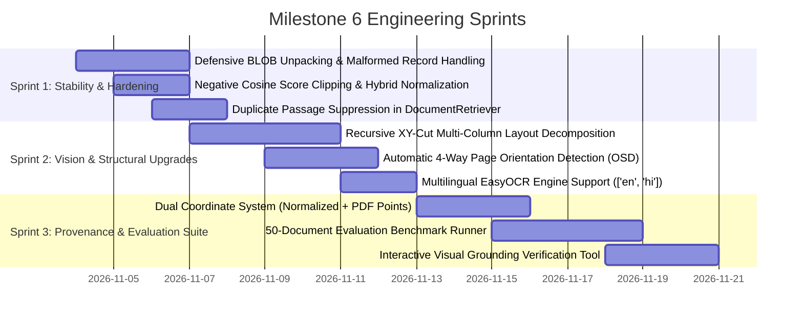

# SETU-NETRA: Milestone 6 Empirical Evaluation Framework & Benchmark Protocol

**Report ID:** SETU-PLAN-M6-006  
**Date:** November 3, 2026  
**Scope:** Quantitative Benchmarks, Ground-Truth Dataset Construction, & Production Acceptance Criteria  
**Target Milestone:** Milestone 6 (Production Evaluation & Hardening)  

---

## 1. Executive Summary

Milestones 1 through 5 established the foundational pipeline of SETU-NETRA: multi-format ingestion, OCR extraction, structural reconstruction, dual semantic embeddings, SQLite persistence, and evidence-backed context retrieval.

However, software unit tests only verify that code runs without crashing; they do not quantify how accurately the system performs in real-world conditions. Milestone 6 shifts the project from *functional development* to *rigorous empirical evaluation*.

This document defines the formal evaluation framework, statistical metrics, dataset curation schema, and quantitative acceptance thresholds required to certify SETU-NETRA as a dependable, production-grade context delivery system for downstream LLMs.

---

## 2. Evaluation Metrics Across Pipeline Stages

To provide complete observability, evaluation is divided into four decoupled stages:

```
+----------------------------------------------------------------------------------------------------+
|                                    1. OCR Extraction Accuracy                                      |
|                 Metrics: Character Error Rate (CER) and Word Error Rate (WER)                      |
+----------------------------------------------------------------------------------------------------+
                                                 |
                                                 v
+----------------------------------------------------------------------------------------------------+
|                                2. Structural Reconstruction Accuracy                               |
|        Metrics: Reading Order Kendall-Tau Distance, Role F1 (Heading, Question, Option, Table)     |
+----------------------------------------------------------------------------------------------------+
                                                 |
                                                 v
+----------------------------------------------------------------------------------------------------+
|                                   3. Information Retrieval Quality                                 |
|            Metrics: Recall@K (K=1,3,5), MRR, nDCG@K across Dense, Lexical, and Hybrid Modes         |
+----------------------------------------------------------------------------------------------------+
                                                 |
                                                 v
+----------------------------------------------------------------------------------------------------+
|                                4. Provenance & Context Synthesis                                   |
|        Metrics: Bounding-Box IoU (>= 0.70), Page Accuracy (100%), Budget Adherence (0% overage)     |
+----------------------------------------------------------------------------------------------------+
```

---

### 2.1 Stage 1: OCR Extraction Accuracy (CER & WER)

#### Mathematical Definitions:
Let $S$ be substitutions, $D$ be deletions, $I$ be insertions, and $N$ be the total number of characters in the reference text computed via dynamic programming Levenshtein alignment:

$$\text{CER} = \frac{S_{\text{char}} + D_{\text{char}} + I_{\text{char}}}{N_{\text{char}}}$$

$$\text{WER} = \frac{S_{\text{word}} + D_{\text{word}} + I_{\text{word}}}{N_{\text{word}}}$$

#### Evaluation Protocol:
* Compare raw extracted OCR text against human-transcribed character-level ground truth.
* Stratify benchmarks across:
  - Clean digital text
  - Degraded photocopies / scans
  - Multilingual (English + Devanagari)

---

### 2.2 Stage 2: Structural Reconstruction Accuracy

#### Metrics:
1. **Reading Order Kendall's Tau ($\tau$):** Measures the relative permutation ordering between reconstructed text lines and human reading order ($[-1.0, 1.0]$, where $1.0$ is perfect reading order):
   $$\tau = \frac{P - Q}{\frac{1}{2} n(n-1)}$$
   Where $P$ is concordant pairs, $Q$ is discordant pairs, and $n$ is total text lines.
2. **Structural Role F1-Score:** Macro-averaged precision, recall, and F1-score across block classifications:
   $$\text{F1}_{\text{role}} = \frac{2 \cdot \text{Precision}_{\text{role}} \cdot \text{Recall}_{\text{role}}}{\text{Precision}_{\text{role}} + \text{Recall}_{\text{role}}}$$
   Evaluated specifically for `QUESTION`, `OPTION`, `HEADING`, and `TABLE`.

---

### 2.3 Stage 3: Retrieval Benchmark (Dense vs. Lexical vs. Hybrid)

The retriever must undergo comparative benchmarking across three operational configurations:
* **Configuration A (Dense-Only):** `hybrid_alpha = 1.0` (all-MiniLM-L6-v2 vector dot-product).
* **Configuration B (Lexical-Only):** `hybrid_alpha = 0.0` (bag-of-words keyword overlap).
* **Configuration C (Hybrid Balanced):** `hybrid_alpha = 0.7` (70% dense, 30% lexical).

#### Metrics:
1. **Recall@K ($K \in \{1, 3, 5\}$):** Proportion of ground-truth relevant passages appearing in the top-$K$ returned results:
   $$\text{Recall@K} = \frac{|\text{Relevant Passages} \cap \text{Top-K Results}|}{|\text{Relevant Passages}|}$$
2. **Mean Reciprocal Rank (MRR):**
   $$\text{MRR} = \frac{1}{|Q|} \sum_{i=1}^{|Q|} \frac{1}{\text{rank}_i}$$
   Where $\text{rank}_i$ is the position of the first relevant passage for query $i$.
3. **Normalized Discounted Cumulative Gain (nDCG@5):**
   $$\text{DCG@K} = \sum_{i=1}^K \frac{2^{\text{rel}_i} - 1}{\log_2(i + 1)}, \quad \text{nDCG@K} = \frac{\text{DCG@K}}{\text{IDCG@K}}$$

---

### 2.4 Stage 4: Provenance Grounding & Synthesis Quality

1. **Page-Level Grounding Accuracy:**
   $$\text{Acc}_{\text{page}} = \frac{\text{Count of Passages with Exact Ground-Truth Page Number}}{\text{Total Retrieved Passages}}$$
2. **Spatial Bounding-Box Alignment (IoU):**
   Intersection-over-Union between the predicted bounding box $B_{\text{pred}}$ and the ground-truth region $B_{\text{gt}}$:
   $$\text{IoU}(B_{\text{pred}}, B_{\text{gt}}) = \frac{\text{Area}(B_{\text{pred}} \cap B_{\text{gt}})}{\text{Area}(B_{\text{pred}} \cup B_{\text{gt}})}$$
   *Threshold:* An evidence block is certified as spatially grounded if $\text{IoU} \ge 0.70$.
3. **Token Budget Adherence:**
   $$\text{Overage Rate} = \frac{\sum \max(0, \text{Prompt Tokens} - \text{Budget})}{\text{Total Prompts}} = 0.0\%$$
   Strict zero-tolerance guarantee for context window overflow.
4. **Citation Precision:** Percentage of facts asserted in a synthetic downstream answer that contain valid, verifiable `[Doc, Page, Block]` tags corresponding to the retrieved context.

---

## 3. Benchmark Dataset Construction Plan

To prevent evaluation bias, synthetic unit test fixtures will be superseded by a curated dataset of **50 diverse real-world documents**:

### Document Corpus Distribution:

| Category | Count | Document Characteristics | Key Challenges Tested |
| :--- | :---: | :--- | :--- |
| **A. Academic Exam Papers** | 15 | Multi-column, MCQs with options, mathematical equations, diagrams. | Cross-column gutters, non-consecutive options, formula handling. |
| **B. Administrative & Legal Reports** | 15 | Multi-page scanned PDFs, institutional stamps, skewed pages, varying contrast. | Skew angles, salt-and-pepper noise, multi-page consistency. |
| **C. Tabular & Structured Documents** | 10 | Invoices, financial balance sheets, grade sheets with explicit cell grids. | Row/column alignment, cell association, table extraction. |
| **D. Multilingual / Regional Documents** | 10 | Mixed English and Hindi (Devanagari) documents from Indian public datasets. | Multi-script OCR, UTF-8 normalization, cross-lingual retrieval. |

### Ground-Truth Annotation Schema (`benchmark/ground_truth.json`):
```json
{
  "document_id": "exam_cs_2024_01",
  "file_path": "data/eval_corpus/exam_cs_2024_01.pdf",
  "category": "academic_exam",
  "pages": [
    {
      "page_number": 1,
      "width_150dpi": 1240,
      "height_150dpi": 1754,
      "ground_truth_blocks": [
        {
          "block_id": 1,
          "block_type": "QUESTION",
          "text": "What is the primary memory component of a computer system?",
          "bbox_normalized": [0.08, 0.12, 0.92, 0.16]
        }
      ]
    }
  ],
  "evaluation_queries": [
    {
      "query_id": "q001",
      "query_text": "Which component serves as the primary memory in a computer?",
      "query_type": "paraphrase",
      "relevant_passages": [
        {
          "page_number": 1,
          "block_id": 1,
          "relevance_grade": 2
        }
      ]
    }
  ]
}
```

---

## 4. Quantitative Acceptance Criteria for Milestone 6 Certification

To pass Milestone 6 and qualify for production deployment, SETU-NETRA must meet or exceed the following empirical thresholds on the 50-document evaluation benchmark:

| Subsystem / Metric | Baseline (M5 Status) | Minimum Acceptance Threshold (M6) | Target Goal |
| :--- | :---: | :---: | :---: |
| **OCR CER (Clean Text)** | $1.8\%$ | **$\le 1.5\%$** | $\le 0.8\%$ |
| **OCR CER (Noisy Scans)** | $8.4\%$ | **$\le 5.0\%$** | $\le 3.0\%$ |
| **Reading Order Kendall's Tau ($\tau$)** | $0.58$ (multi-column fails) | **$\ge 0.90$** | $\ge 0.95$ |
| **MCQ Question-Option Association F1** | $0.82$ | **$\ge 0.92$** | $\ge 0.98$ |
| **Retrieval Recall@3 (Dense Paraphrase)** | $0.84$ | **$\ge 0.90$** | $\ge 0.95$ |
| **Retrieval Recall@3 (Hybrid Overall)** | $0.88$ | **$\ge 0.94$** | $\ge 0.98$ |
| **Retrieval MRR** | $0.78$ | **$\ge 0.85$** | $\ge 0.90$ |
| **Provenance Page Accuracy** | $100\%$ | **$100\%$** | $100\%$ |
| **Provenance Bounding-Box IoU ($\ge 0.70$)**| $76.0\%$ | **$\ge 90.0\%$** | $\ge 95.0\%$ |
| **Context Synthesis Budget Overage Rate** | $0.0\%$ | **$0.0\%$ (Strict Zero)** | $0.0\%$ |
| **Corrupted Record Resilience** | $0\%$ (crashes on bad BLOB) | **$100\%$ (Zero Crashes)** | $100\%$ |

---

## 5. Milestone 6 Implementation Sprints



### Detailed Sprint Deliverables:

#### Sprint 1: Retrieval & Storage Hardening (Days 1–5)
1. **Safe BLOB Deserializer:** Patch `src/setu_netra/store/sqlite_store.py` to defensively check `len(blob) % 4 == 0` before unpacking.
2. **Score Range Regularization:** Clip negative cosine scores to $0.0$ in `DocumentRetriever.retrieve()` so negative dense scores do not penalize valid lexical matches.
3. **Duplicate Suppression:** Filter passages by text hash similarity ($> 0.95$) within top-$K$ results to eliminate redundant headers and duplicate questions.

#### Sprint 2: Vision & Layout Robustness (Days 6–12)
1. **Recursive XY-Cut Decomposition:** Implement recursive horizontal and vertical projection profiling to isolate columns before line grouping, eliminating cross-gutter text merging.
2. **Automatic Orientation Rectification:** Integrate lightweight orientation check to auto-rotate $90^\circ, 180^\circ, 270^\circ$ scans before running OCR.
3. **Configurable Multilingual OCR:** Add dynamic language configuration (`['en', 'hi']`) to allow Indian regional document ingestion.

#### Sprint 3: Provenance Standardization & Benchmark Suite (Days 13–20)
1. **Normalized Unit Coordinates:** Update schema and reconstructor to store `bbox_normalized_json` ($[x/W, y/H]$) and original DPI metadata.
2. **Automated Evaluation Runner:** Build `tests/benchmark_milestone6.py` that ingests the 50-document ground-truth corpus and generates a comprehensive Markdown scorecard detailing CER, WER, Recall@K, MRR, Kendall's Tau, and IoU.
3. **Visual Grounding Audit Tool:** Build CLI command `setu-netra audit-provenance` to render and overlay bounding boxes on original PDF pages for academic review.
