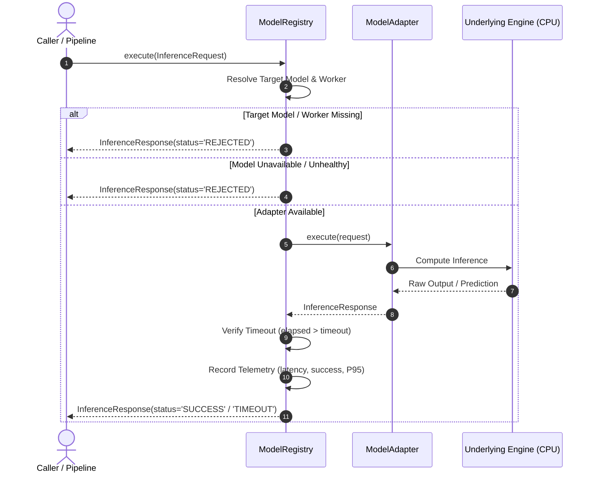

# SETU-NETRA Model Registry Specification
## Technical Specification of the Centralized Model Registry and Control Plane

**Document Reference**: SPEC-STAGE4-REG-001  
**Project**: SETU-NETRA (Bridge-Eye)  
**Date**: November 2026  
**Status**: APPROVED & IMPLEMENTED  

---

## 1. Scope & Objective

The **SETU-NETRA Model Registry** provides a thread-safe, centralized catalog and execution hub for all neural and deterministic AI models operating within the document intelligence and context delivery pipeline. It abstracts heterogeneous model implementations behind a uniform contract, tracks operational health, aggregates real-time performance telemetry, and facilitates capacity-aware routing across local and remote workers.

---

## 2. Model Metadata Schema

Every model registered in SETU-NETRA is represented by an immutable `ModelMetadata` descriptor:

```python
@dataclass
class ModelMetadata:
    model_id: str                              # Unique model identifier (e.g. 'grounded-extractive-qa-v1')
    model_name: str                            # Human-readable descriptive name
    model_type: str                            # Architectural category (ModelCategory)
    supported_tasks: List[str]                 # Capabilities: ['qa', 'extractive_qa', 'ocr', ...]
    provider: str                              # 'SETU-NETRA Native', 'HuggingFaceTB', etc.
    execution_backend: str                     # 'LOCAL_PYTHON', 'CPU_PYTORCH', 'ONNX', etc.
    memory_requirement: Dict[str, Any]         # {'min_ram_mb': 50, 'recommended_ram_mb': 150}
    context_length: int                        # Maximum token / character context window
    availability: str = "AVAILABLE"            # 'AVAILABLE', 'UNAVAILABLE', 'DEGRADED', 'LOADING'
    health_status: str = "HEALTHY"             # 'HEALTHY', 'UNHEALTHY', 'DEGRADED', 'UNKNOWN'
    measured_latency: Dict[str, float] = ...   # {'mean_ms': ..., 'p95_ms': ..., 'last_ms': ...}
    throughput: float = 0.0                    # Estimated queries/second or tokens/second
    model_quality_metadata: Dict[str, Any]     # {'precision': 1.0, 'hallucination_rate': 0.0}
    worker_id: Optional[str] = None            # Associated worker identifier
    created_at: float = ...                    # Epoch timestamp
```

### 2.1 Supported Model Categories (`ModelCategory`)
1. **`OCR`**: Optical Character Recognition, bounding box detection, and character transcription (`easyocr-craft-crnn`).
2. **`Embedding`**: Dense semantic vector embeddings (`all-minilm-l6-v2`, `offline-hash-embedder`).
3. **`Classification`**: Document domain categorization and question cognitive intent detection (`academic-domain-classifier-v1`).
4. **`Extractive QA`**: Zero-hallucination evidence extraction directly from retrieved document passages (`grounded-extractive-qa-v1`).
5. **`Generative QA`**: Natural language synthesis, contextual answering, and narrative elaboration (`smollm2-135m-instruct`).
6. **`Summarization`**: Multi-passage text condensation and executive summaries.
7. **`Reasoning`**: Multi-hop deduction, comparative analysis, and logical evaluation.

### 2.2 Operational States
- **`ModelAvailability`**: `AVAILABLE`, `UNAVAILABLE`, `DEGRADED`, `LOADING`.
- **`ModelHealth`**: `HEALTHY`, `UNHEALTHY`, `DEGRADED`, `UNKNOWN`.

---

## 3. Concurrency and Thread-Safety Architecture

### 3.1 Lock Architecture
The registry maintains state using internal dictionaries:
- `_adapters`: `Dict[str, BaseModelAdapter]`
- `_workers`: `Dict[str, List[BaseModelAdapter]]`
- `_metadata`: `Dict[str, ModelMetadata]`
- `_telemetry`: `Dict[str, Dict[str, Any]]`
- `_worker_indices`: `Dict[str, int]`

To ensure total isolation and prevent data races across multi-threaded request handlers (e.g. FastAPI / Uvicorn worker threads), all dictionary reads, writes, and worker index increments are synchronized via a **Recursive Lock (`threading.RLock`)**. Reentrancy allows internal registry methods to call sibling methods without deadlock.

---

## 4. Worker Management & Routing Policies

### 4.1 Multi-Worker Pooling
A single logical model (e.g., `smollm2-135m-instruct`) may have multiple worker replicas running across CPU cores or background processes.
- Each worker adapter has a unique `worker_id` (e.g. `smollm2-135m-instruct_w1`, `smollm2-135m-instruct_w2`).
- The registry aggregates all worker instances under `_workers[model_id]`.

### 4.2 Load Distribution Policy
When an inference request is routed to a `model_id` without specifying a `worker_id`:
1. The registry retrieves the list of workers for that model.
2. It filters for available workers (`w.is_available()`).
3. It selects the next worker using **Round-Robin Scheduling**:
   $$i_{\text{selected}} = \text{index} \pmod N$$
   where $N$ is the number of available workers.
4. The worker pointer is atomically incremented.

### 4.3 Direct Worker Dispatch
If `worker_id` is supplied in `InferenceRequest`, the registry bypasses round-robin and routes directly to the requested worker instance. If the worker does not exist or is unhealthy, a `REJECTED` status is returned.

### 4.4 Duplicate Registration Policy
- If an adapter is registered with an existing `(model_id, worker_id)` pair and `allow_override=False`, the registry raises `ValueError`.
- If `allow_override=True` (or `override=True`), the existing worker adapter is replaced, while historic telemetry is preserved.

---

## 5. Telemetry & Performance Monitoring

### 5.1 Real-Time Metrics Aggregation
After every execution through `registry.execute(request)`, the registry updates the model's telemetry:
- `total_calls`: Running counter of total inference requests.
- `success_count`: Total requests returning `status="SUCCESS"`.
- `failure_count`: Total exceptions or adapter failures.
- `timeout_count`: Requests exceeding timeout thresholds.
- `total_latency_ms`: Cumulative latency in milliseconds.
- `latencies_ms`: Sliding window of the last 100 request latencies.

### 5.2 Latency Percentile Calculation
From the rolling window of latencies $L = \{l_1, l_2, \dots, l_k\}$ ($k \le 100$):
$$\mu_{\text{latency}} = \frac{1}{k} \sum_{i=1}^k l_i$$
$$P_{95} = \text{Sorted}(L)\left[\min\left(\lfloor 0.95 \cdot k \rfloor, k - 1\right)\right]$$
These values are synchronized into `ModelMetadata.measured_latency` and exposed via `get_model_metadata(model_id)`.

---

## 6. Execution Lifecycle and Error Containment



### 6.1 Timeout Enforcement
Every `InferenceRequest` specifies an execution timeout (`timeout` in seconds, or `timeout_ms` in milliseconds). If execution latency exceeds this limit:
- The registry catches the condition.
- It returns an `InferenceResponse` with `status="TIMEOUT"`.
- The timeout counter is incremented in telemetry.

### 6.2 Defensive Exception Containment
Any unhandled exception raised inside an adapter is caught at the registry boundary:
- The exception is logged.
- An `InferenceResponse` with `status="FAILED"`, `error=str(err)`, and the exact elapsed time is returned.
- The registry itself never crashes or becomes inconsistent due to worker failures.
