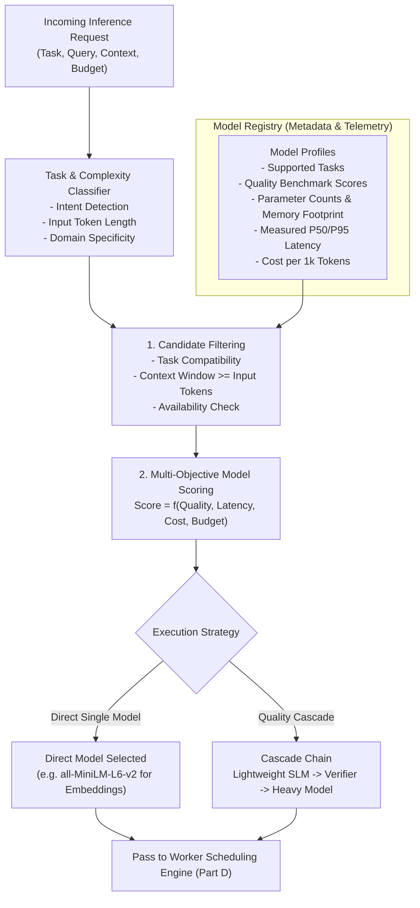
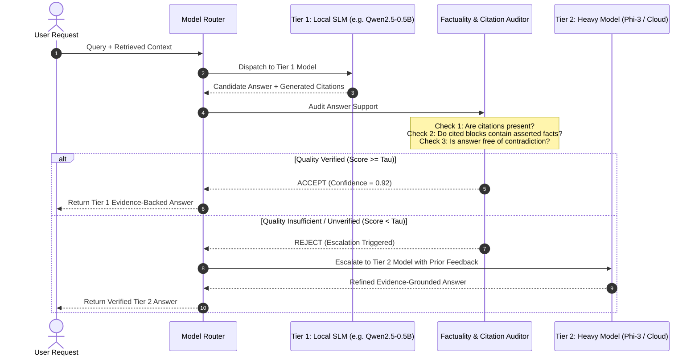

# SETU-NETRA: Adaptive Model Routing & Cascading Engine Design

**Report ID:** SETU-ROUTER-DESIGN-004  
**Date:** November 9, 2026  
**Audience:** System Architects, Core Developers, Evaluators  
**Scope:** Model Registry, Unified Inference Interface, Quality-Aware Selection, and Cascading  

---

## 1. Executive Summary

A core architectural principle of SETU-NETRA is the **strict separation between Model Selection (Which model should handle a request?) and Worker Scheduling (Which physical worker/hardware resource should execute the inference?)**.

The **Adaptive Model Routing Engine** is responsible for inspecting incoming requests (task type, input prompt length, domain complexity, latency budget, quality threshold) and selecting the Pareto-optimal model or cascade sequence from a centralized **Model Registry**. It abstracts all underlying model implementations behind a **Unified Model Interface**, ensuring that local small language models (SLMs), specialized vision models, embedding transformers, or external foundation models can be hot-swapped without altering application logic.

---

## 2. Decoupled Routing & Orchestration Architecture



---

## 3. Centralized Model Registry Specification

The Model Registry maintains the definitive metadata, hardware requirements, and historical performance metrics for every integrated model:

### 3.1 Registry Schema (`ModelProfile`)
```python
@dataclass
class ModelProfile:
    model_id: str                      # Unique identifier (e.g. 'all-minilm-l6-v2', 'smollm-360m')
    family: str                        # Architecture family ('transformer-encoder', 'crnn', 'llama', 'qwen')
    task_types: List[str]              # ['ocr', 'embedding', 'classification', 'summarization', 'qa', 'reasoning']
    context_length: int                # Maximum input context window (tokens)
    parameters: int                    # Total parameter count (e.g. 22_700_000, 360_000_000)
    memory_footprint_mb: float         # RAM / VRAM required when resident in memory
    hardware_target: str               # 'cpu-only', 'cuda-recommended', 'cuda-required'
    quantization: str                  # 'none-fp32', 'fp16', 'int8', 'int4-gguf'
    quality_benchmark_score: float     # Standardized benchmark score in [0.0, 1.0] (MMLU / GSM8k / ExactMatch)
    measured_p50_latency_ms: float     # Historical median inference latency
    measured_p95_latency_ms: float     # Historical 95th percentile latency
    cost_per_1k_tokens: float          # Monetary cost ($0.0 for local models, API rate for cloud)
    is_available: bool                 # Active runtime availability status
```

### 3.2 Canonical Model Registry Catalog for SETU-NETRA:

| Model ID | Family | Supported Tasks | Params | Memory (MB) | Quantization | Target Hardware | Quality Score | Cost / 1k Tok |
| :--- | :--- | :--- | :---: | :---: | :---: | :---: | :---: | :---: |
| **`easyocr-craft-crnn`** | Vision-CRNN | `ocr`, `text-extraction` | 21M | 350 MB | FP32 | Local CPU | 0.88 | $0.00 |
| **`offline-subword-hash`** | Feature-Hash | `embedding`, `domain-class` | 0 | 5 MB | None | Local CPU | 0.65 | $0.00 |
| **`all-minilm-l6-v2`** | MiniLM | `embedding`, `dense-retrieval` | 22.7M | 90 MB | FP32 | Local CPU | 0.85 | $0.00 |
| **`smollm-135m-q4`** | LLaMA | `qa`, `summarization`, `verify` | 135M | 120 MB | INT4 GGUF | Local CPU | 0.72 | $0.00 |
| **`qwen2.5-0.5b-q4`** | Qwen | `qa`, `extraction`, `summarize` | 490M | 380 MB | INT4 GGUF | Local CPU | 0.79 | $0.00 |
| **`phi-3-mini-3.8b-q4`** | Phi | `qa`, `reasoning`, `synthesis` | 3.8B | 2,400 MB | INT4 GGUF | Local CPU | 0.89 | $0.00 |
| **`cloud-llm-fallback`** | Foundation | `reasoning`, `complex-qa` | >70B | Cloud API | Remote API | Remote HTTPS | 0.96 | $0.0015 |

---

## 4. Unified Model Inference Interface

To ensure zero vendor lock-in and seamless hot-swapping between local PyTorch, GGUF runtimes (`llama.cpp`), and remote endpoints, all models implement `UnifiedModelInterface`:

```python
class UnifiedModelInterface(ABC):
    """Abstract inference contract for all SETU-NETRA model adapters."""

    @property
    @abstractmethod
    def profile(self) -> ModelProfile:
        """Return the model's static and dynamic profile."""
        pass

    @abstractmethod
    def health_check(self) -> bool:
        """Verify model readiness and operational health."""
        pass

    @abstractmethod
    def execute(self, payload: Dict[str, Any]) -> Dict[str, Any]:
        """Execute inference synchronously.
        
        Payload:
            {
                'task': 'qa' | 'embedding' | 'ocr',
                'inputs': Union[str, List[str], Image.Image],
                'parameters': Dict[str, Any]  # max_tokens, temperature, top_k
            }
        Returns:
            {
                'output': Any,
                'latency_ms': float,
                'tokens_generated': int,
                'confidence': Optional[float],
                'model_id': str
            }
        """
        pass
```

---

## 5. Multi-Objective Model Selection Formulation

Given an incoming request $r = \langle \text{task}, \text{query}, \text{budget}_{\text{latency}}, \text{budget}_{\text{cost}}, \text{min\_quality} \rangle$:

1. **Hard Filtering:** Filter registry models where:
   $$\mathcal{M}_{\text{cand}} = \{ m \in \mathcal{M} \mid \text{task} \in m.\text{tasks} \land m.\text{is\_available} \land m.\text{context} \ge |r.\text{inputs}| \}$$
   If $\mathcal{M}_{\text{cand}} = \emptyset$, raise an explicit `NoCompatibleModelError`.

2. **Utility Scoring:** For each candidate model $m \in \mathcal{M}_{\text{cand}}$, calculate utility $U(m, r) \in [0.0, 1.0]$:
   $$U(m, r) = w_q \cdot m.\text{quality} - w_l \cdot \min\left(1.0, \frac{m.\text{latency}}{r.\text{budget}_{\text{latency}}}\right) - w_c \cdot \min\left(1.0, \frac{m.\text{cost}}{r.\text{budget}_{\text{cost}}}\right)$$
   Where $w_q + w_l + w_c = 1.0$ are user/system policy weights (e.g. $w_q = 0.50, w_l = 0.30, w_c = 0.20$).

3. **Optimal Selection:**
   $$m^* = \arg\max_{m \in \mathcal{M}_{\text{cand}}} U(m, r)$$

---

## 6. Model Cascading & Quality-Aware Verification (FrugalGPT + Grounding)

Rather than always invoking the heaviest model, SETU-NETRA implements an **Evidence-Grounded Cascading Chain**:



### Addressing Model-Reported Confidence (Calibration Rule):
* **Strict Rule:** Raw model softmax logits (or self-reported confidence like *"I am 95% sure"*) are **never** treated as true Bayesian probabilities without calibration.
* **Empirical Verification Metric:** Instead of raw softmax scores, our cascade verifier scores quality using **Citation Grounding Overlap**:
  $$\text{Grounding Score } G(A, C) = \frac{|\text{Key Entities}(A) \cap \text{Key Entities}(C_{\text{cited}})|}{|\text{Key Entities}(A)|}$$
  Where $A$ is the generated answer and $C_{\text{cited}}$ is the exact text of the cited document blocks.
  * If $G(A, C) \ge 0.80$ and citations match valid `block_id`s in SQLite, the lightweight answer is certified as **Evidence-Backed** and returned immediately.
  * If $G(A, C) < 0.80$ (indicating hallucination or missing evidence), the cascade escalates to the Tier 2 model.
