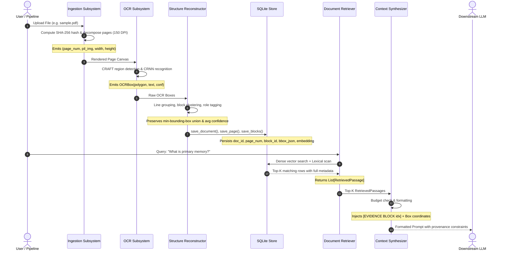

# SETU-NETRA: Provenance & Attribution Subsystem Technical Audit

**Report ID:** SETU-AUDIT-PROV-003  
**Audit Date:** November 3, 2026  
**Audited Subsystems:** Ingestion, OCR, Structure Reconstruction, Store, Retrieval, Context Synthesis  
**Status:** Empirically & Mathematically Audited  

---

## 1. Executive Summary

Provenance is the foundational guarantee of SETU-NETRA: downstream AI models must never receive disconnected, unverified text strings. Every piece of context delivered to an LLM must be traceable to an exact document, page number, structural block, spatial bounding box, and OCR confidence score.

This audit evaluates the end-to-end lifecycle of provenance across all six pipeline subsystems. It identifies what information is rigorously preserved, what is discarded or distorted during transformations, and the specific coordinate space discrepancies that affect spatial verification.

### Core Audit Findings
1. **Provenance Preservation:** Genuinely implemented. All 5 fundamental provenance pillars (`doc_id`, `page_number`, `block_id`, `bounding_box`, `confidence`) are tracked from OCR through structural reconstruction, SQLite persistence, vector retrieval, and context synthesis.
2. **Citation Injection in LLM Prompts:** Genuinely implemented. `EvidenceContextSynthesizer` formats each retrieved evidence block with source metadata and inserts explicit citation requirements (`[Doc: <name>, Page: <p>, Block: <b>]`) into the system prompt.
3. **Coordinate Space Discrepancy (PDF 150 DPI vs 72 DPI):** Critical discrepancy. `load_pdf_pages()` renders pages at 150 DPI. The bounding boxes generated by OCR and persisted in SQLite are in 150 DPI pixel space ($W_{150}, H_{150}$). Standard PDF viewers (PDF.js, PyPDFium2, Acrobat) operate in 72 DPI PostScript point space ($W_{72}, H_{72}$). Attempting to plot the stored bounding box on an original PDF without scaling causes a $2.0833\times$ spatial offset.
4. **Coordinate Space Discrepancy (Image Downscaling):** When `resize_keep_aspect_ratio()` downscales high-resolution images (e.g. $> 1600\text{ px}$), the resulting bounding boxes exist in resized pixel space without recording the inverse transformation matrix back to original image dimensions.
5. **Absence of Normalized $[0.0, 1.0]$ Coordinates:** Bounding boxes are stored strictly as absolute pixel coordinates `(x1, y1, x2, y2)`. Storing normalized unit coordinates is essential for display-agnostic UI highlighting.

---

## 2. The Five Provenance Pillars

| Pillar | Type | Source Module | Stored Representation | Downstream Verification Role |
| :--- | :--- | :--- | :--- | :--- |
| **1. `doc_id`** | String (`TEXT`) | `document_pipeline.py` | Foreign key referencing `documents(doc_id)` | Identifies the physical file, cryptographic SHA-256 hash, and file metadata. |
| **2. `page_number`** | Integer (`INTEGER`) | `pdf_loader.py` | 1-based index in `pages` and `document_blocks` | Pinpoints the exact sheet or page within multi-page documents. |
| **3. `block_id`** | Integer (`INTEGER`) | `reconstructor.py` | 1-based sequential index per page | Identifies the structural unit (Heading, Question, Option, Paragraph). |
| **4. `bounding_box`** | Tuple of 4 floats | `easyocr_engine.py` / `line_grouper.py` | JSON array `"[x1, y1, x2, y2]"` in `bbox_json` | Spatial envelope enclosing the text on the rendered page canvas. |
| **5. `confidence`** | Float (`REAL`) | `easyocr_engine.py` | Arithmetic mean of character/token confidence | Quantifies extraction certainty for hallucination prevention ($[0.0, 1.0]$). |

---

## 3. End-to-End Provenance Lifecycle Trace



### Detailed Trace Through Subsystems:

#### Step 1: Ingestion (`src/setu_netra/ingestion/`)
* **Hash Computation:** `validator.py` hashes the raw binary using `hashlib.sha256()`. This forms the immutable content signature.
* **Page Deconstruction:** `load_pdf_pages()` in `pdf_loader.py` assigns sequential 1-based `page_number` values ($1, 2, \dots, N$) and captures rendered pixel dimensions `(width, height)`.

#### Step 2: OCR (`src/setu_netra/ocr/`)
* Each detected word/phrase receives a 4-point quadrilateral polygon:
  $$\text{polygon} = [[x_{\text{tl}}, y_{\text{tl}}], [x_{\text{tr}}, y_{\text{tr}}], [x_{\text{br}}, y_{\text{br}}], [x_{\text{bl}}, y_{\text{bl}}]]$$
* Character confidence is computed by EasyOCR's CRNN recognizer.

#### Step 3: Structural Reconstruction (`src/setu_netra/structure/`)
* `line_grouper.py` takes raw `OCRBox` objects and merges horizontally overlapping boxes into coherent lines.
* Bounding boxes are aggregated via envelope union:
  $$x_1 = \min(x_{\text{all}}), \quad y_1 = \min(y_{\text{all}}), \quad x_2 = \max(x_{\text{all}}), \quad y_2 = \max(y_{\text{all}})$$
* Confidence is aggregated using length-weighted or arithmetic averaging:
  $$\bar{C} = \frac{1}{\sum L_i} \sum_{i=1}^M L_i \cdot c_i$$
* `reconstructor.py` tags each block with its semantic role (`HEADING`, `QUESTION`, `OPTION`, `PARAGRAPH`) and retains the list of source detection indices (`source_detection_indices`).

#### Step 4: Storage (`src/setu_netra/store/sqlite_store.py`)
* The page record stores `(width, height)` in `pages`.
* The block record stores `(doc_id, page_number, block_id, block_type, text, confidence, bbox_json, source_detection_indices_json)`.
* Referential integrity is enforced: `FOREIGN KEY (doc_id) REFERENCES documents(doc_id) ON DELETE CASCADE`.

#### Step 5: Retrieval (`src/setu_netra/retrieval/document_retriever.py`)
* When top-$K$ passages are retrieved, the retriever constructs `RetrievedPassage` data objects populated directly from the SQLite row. Bounding box and confidence are preserved without truncation or rounding.

#### Step 6: Context Synthesis (`src/setu_netra/context/synthesizer.py`)
* Formats evidence blocks with full metadata:
  ```text
  [EVIDENCE BLOCK 1]
  Source: sample_exam.pdf | Page: 1 | Block: 2 | Type: QUESTION | Conf: 94.8% | Box: (54.0, 120.0, 750.0, 162.0)
  Content:
  Q1: What is the primary memory component of a computer system?
  ----------------------------------------------------------------------
  ```
* Appends explicit instruction:
  ```text
  Every assertion must cite its source in the exact format [Doc: <name>, Page: <p>, Block: <b>].
  ```

---

## 4. Coordinate Space Discrepancy Analysis

### 4.1 The PDF 150 DPI vs 72 DPI Offset

Standard PDF documents define page geometry in PostScript points:
$$1 \text{ point} = \frac{1}{72} \text{ inch}$$

For an A4 page ($8.27 \times 11.69\text{ inches}$):
* **PDF Points (72 DPI):** $595 \times 842\text{ points}$
* **Rendered Pixels (150 DPI):** $1240 \times 1754\text{ pixels}$

Scale factor:
$$S = \frac{150}{72} \approx 2.08333$$

#### Spatial Distortion Problem
When `EasyOCREngine` runs on the rendered page, it detects text at pixel coordinates:
$$x_{\text{pixel}} \in [0, 1240], \quad y_{\text{pixel}} \in [0, 1754]$$
These pixel coordinates are written directly into `bbox_json`.

If an external application (such as an academic PDF viewer, PDF.js, PyMuPDF, or Acrobat) attempts to highlight the bounding box directly onto the PDF file using the stored values:
* The highlighted box will appear **$2.08\times$ too large** and **shifted outside the page boundary**.
* **Mathematical conversion required:**
  $$x_{\text{pdf\_point}} = x_{\text{pixel}} \times \frac{72}{\text{DPI}} = x_{\text{pixel}} \times \frac{72}{150} = x_{\text{pixel}} \times 0.48$$
  $$y_{\text{pdf\_point}} = y_{\text{pixel}} \times 0.48$$

Currently, neither the rendering DPI ($150$) nor the conversion factor is explicitly stored in `document_blocks`.

---

### 4.2 Image Downscaling Coordinate Distortion

In `src/setu_netra/preprocessing/operations.py`:
```python
def resize_keep_aspect_ratio(image: Image.Image, max_dimension: int = 1600) -> Image.Image:
    w, h = image.size
    if max(w, h) <= max_dimension:
        return image
    scale = max_dimension / float(max(w, h))
    new_w = int(round(w * scale))
    new_h = int(round(h * scale))
    return image.resize((new_w, new_h), resample=Image.Resampling.LANCZOS)
```

#### Distortion Problem:
* A high-resolution camera photograph of a document ($3024 \times 4032\text{ px}$) is downscaled by $S = \frac{1600}{4032} \approx 0.3968$ to $1200 \times 1600\text{ px}$.
* OCR detects blocks in the downscaled coordinate space ($[0, 1200] \times [0, 1600]$).
* When stored in SQLite, the bounding boxes reflect the downscaled dimensions.
* If a user tries to visualize the bounding box overlay on the **original high-resolution image**, the box targets only the top-left $15\%$ of the original image area unless scaled up by $1 / 0.3968 = 2.52\times$.
* `ImageMetadata` captures original width and height, but this scaling ratio is not attached to individual `document_blocks`.

---

## 5. Visual Grounding & Academic Evaluator Verification

An academic evaluator or enterprise compliance auditor needs to verify:
> *"Did the model answer based on the real document, and is the cited bounding box accurate?"*

### Current System Verification Capability:
* **Possible Today:** An evaluator can inspect the database row for `block_pk`, read `bbox_json`, open the cached 150 DPI raster image, and draw a rectangle around `(x1, y1, x2, y2)`. The text inside the rectangle matches the extracted text.
* **Fails Today:** An evaluator cannot take the bounding box and directly query the original unrendered PDF using standard PDF tools without applying manual coordinate scaling ($0.48\times$).

---

## 6. Identified Vulnerabilities & Deficiencies

1. **Lack of Normalized Coordinates:**
   Storing absolute pixel coordinates makes bounding boxes viewport-dependent. Without normalized coordinates ($x/W, y/H \in [0.0, 1.0]$), responsive UI viewers cannot render highlights across different display densities.
2. **Missing Source Coordinate System Tag:**
   The `document_blocks` table does not declare whether `bbox_json` is in `PIXEL_150DPI`, `PIXEL_RESIZED`, or `PDF_POINTS`.
3. **Loss of Fine-Grained Word Polygons:**
   Line grouping and block grouping merge word quadrilaterals into a single bounding box envelope. Rotated text boxes or skewed baselines are converted into axis-aligned bounding boxes (AABB), introducing empty background space into the box.

---

## 7. Concrete Milestone 6 Resolution Plan

To achieve enterprise-grade provenance and zero-defect visual grounding, Milestone 6 will implement:

### 1. Dual Coordinate Storage Schema
Update `document_blocks` to store both absolute rendering coordinates and normalized unit coordinates:
```sql
ALTER TABLE document_blocks ADD COLUMN bbox_normalized_json TEXT DEFAULT '[0.0, 0.0, 0.0, 0.0]';
ALTER TABLE document_blocks ADD COLUMN coord_system TEXT DEFAULT 'PIXEL_150DPI';
```
Where:
$$x_{\text{norm}} = \frac{x_{\text{pixel}}}{W_{\text{page}}}, \quad y_{\text{norm}} = \frac{y_{\text{pixel}}}{H_{\text{page}}}$$

### 2. Point Space Converter Utility
Provide an explicit converter in `src/setu_netra/utils/coordinates.py`:
```python
def pixel_to_pdf_points(bbox: Tuple[float, float, float, float], dpi: int = 150) -> Tuple[float, float, float, float]:
    factor = 72.0 / float(dpi)
    return (bbox[0] * factor, bbox[1] * factor, bbox[2] * factor, bbox[3] * factor)
```

### 3. Visual Verification Overlay CLI
Implement an interactive command `setu-netra verify-box --doc-id <ID> --page <P> --block <B>` that automatically crops and displays the exact image snippet alongside the extracted text and confidence score for instant auditability.
