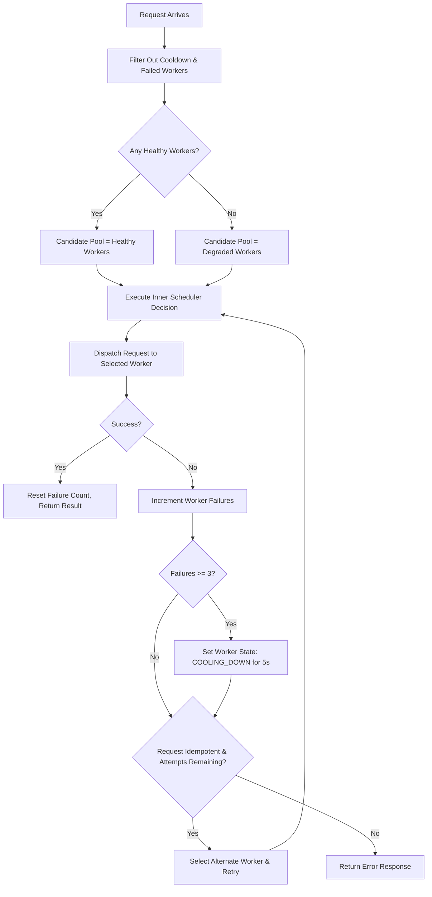

# SETU-NETRA Scheduling Algorithm Analysis
## Mathematical Formulation, Normalization, and Comparative Analysis

**Document Reference**: ANALYS-STAGE5-SCHED-001  
**Project**: SETU-NETRA (Bridge-Eye)  
**Date**: November 2026  
**Status**: APPROVED & IMPLEMENTED  

---

## 1. Scope & Objective

This report provides the mathematical formulations, normalization criteria, and comparative algorithmic analysis of the 6 traffic scheduling strategies implemented in SETU-NETRA Stage 5.

To prevent erratic scheduling, SETU-NETRA strictly prohibits arbitrary weighted sums of unnormalized variables (e.g., adding raw millisecond latency to raw request counts and percentage CPU). Every input metric is formally mapped to the closed interval $[0, 1]$ before multi-criteria evaluation.

---

## 2. Mathematical Formulations & Normalization

### 2.1 Baseline Schedulers

#### 1. Round-Robin Scheduler (`RoundRobinScheduler`)
Cyclic sequential selection over available candidate workers $\mathcal{W} = \{w_0, w_1, \dots, w_{N-1}\}$:
$$w^* = w_{i}, \quad i = \left(\text{pointer} \pmod N\right)$$
$$\text{pointer} \leftarrow \text{pointer} + 1$$
- **Overhead**: $\mathcal{O}(1)$ time, minimal lock acquisition.
- **Limitation**: Ignores heterogeneous worker execution speeds and varying request lengths.

#### 2. Random Scheduler (`RandomScheduler`)
Uniform stochastic selection:
$$w^* \sim \text{Uniform}(\mathcal{W})$$
- **Overhead**: $\mathcal{O}(1)$ time, zero shared pointer state.
- **Limitation**: Suffers from stochastic clustering under burst traffic.

#### 3. Least Outstanding Requests (`LeastOutstandingRequestsScheduler`)
Selects the worker with the minimum instantaneous outstanding requests:
$$w^* = \arg\min_{w \in \mathcal{W}} \left( A_w + Q_w \right)$$
Where:
- $A_w$: Count of active requests currently executing on worker $w$.
- $Q_w$: Count of requests waiting in worker $w$'s FIFO queue.
- **Tie-Breaking Rule**: When two workers have identical backlog, the tie is broken by lower EWMA latency ($\hat{S}_w$).

---

### 2.2 Predictive Scheduling: Shortest Estimated Completion Time (SECT)

The **SECT Scheduler** (`ShortestEstimatedCompletionTimeScheduler`) optimizes user-perceived turnaround time by estimating total completion time (queue waiting time + execution service time):

$$\text{ECT}(w, r) = T_{\text{wait}}(w) + T_{\text{exec}}(w, r)$$

#### 1. Queue Waiting Time Estimation:
$$T_{\text{wait}}(w) = (A_w + Q_w) \times \hat{S}_w$$
Where $\hat{S}_w$ is the Exponentially Weighted Moving Average (EWMA) of recent service times on worker $w$:
$$\hat{S}_{w, t} = \alpha S_{\text{measured}} + (1 - \alpha) \hat{S}_{w, t-1}, \quad \alpha = 0.2$$

#### 2. Execution Service Time Estimation:
$$T_{\text{exec}}(w, r) = \hat{S}_w \times f(\text{Complexity})$$
- For Generative SLMs:
  $$T_{\text{exec}}(w, r) = \frac{\text{Target New Tokens}}{\text{Measured Throughput}_w} \times 1000 \text{ ms}$$
- For Extractive / OCR / Embedding models:
  $$f(\text{Complexity}) = 1.0 + \max\left(0.0, \frac{\text{Tokens}_{\text{in}} - 100}{500}\right)$$

#### 3. Decision Rule:
$$w^* = \arg\min_{w \in \mathcal{W}} \text{ECT}(w, r)$$

---

### 2.3 Capacity-Aware Scheduling (`CapacityAwareScheduler`)

The Capacity-Aware Scheduler evaluates real-time host resource pressure, worker queue saturation, execution latency, and worker health using normalized metrics.

#### Metric 1: Normalized Worker Load Ratio ($L_w \in [0, 1]$)
$$L_w = \min\left(1.0, \frac{A_w + Q_w}{Q_{\max, w}}\right)$$
Where $Q_{\max, w}$ is worker $w$'s maximum queue capacity. If $L_w \ge 1.0$, worker $w$ is saturated and excluded (backpressure).

#### Metric 2: Min-Max Normalized Latency Score ($\tilde{T}_w \in [0, 1]$)
Let $\hat{S}_w$ be the service time of worker $w$. Normalized across all eligible candidate workers in $\mathcal{W}$:
$$\tilde{T}_w = \begin{cases} 
\frac{\hat{S}_w - \min_{v \in \mathcal{W}} \hat{S}_v}{\max_{v \in \mathcal{W}} \hat{S}_v - \min_{v \in \mathcal{W}} \hat{S}_v + \epsilon}, & \text{if } \max \hat{S}_v \neq \min \hat{S}_v \\ 
0.0, & \text{otherwise} 
\end{cases}$$

#### Metric 3: Normalized System Capacity Penalty ($R_{\text{sys}} \in [0, 1]$)
Read directly from the host operating system kernel via `system_telemetry.py`:
$$\text{CPU}_{\text{excess}} = \max\left(0.0, \frac{\text{CPU}\% - \theta_{\text{cpu}}}{100.0 - \theta_{\text{cpu}}}\right), \quad \theta_{\text{cpu}} = 85.0\%$$
$$\text{RAM}_{\text{excess}} = \max\left(0.0, \frac{\text{RAM}\% - \theta_{\text{ram}}}{100.0 - \theta_{\text{ram}}}\right), \quad \theta_{\text{ram}} = 90.0\%$$
$$R_{\text{sys}} = 0.5 \cdot \text{CPU}_{\text{excess}} + 0.5 \cdot \text{RAM}_{\text{excess}}$$

#### Metric 4: Operational Health Multiplier ($H_w \in (0, 1]$)
$$H_w = \begin{cases} 
1.0, & \text{if State} = \text{IDLE or BUSY (Healthy)} \\ 
0.5, & \text{if State} = \text{DEGRADED} \\ 
0.0, & \text{if State} = \text{COOLING\_DOWN, FAILED, or STOPPED (Disqualified)} 
\end{cases}$$

#### Metric 5: Memory Feasibility Guard
$$\text{AvailRAM}_{\text{host}} \ge \text{MinRAM}_{\text{model}}$$
If available host RAM is insufficient, the request is rejected immediately to prevent Out-Of-Memory paging.

#### Unified Cost Function:
With weights $w_L = 0.50$, $w_T = 0.30$, $w_R = 0.20$ ($\sum w_i = 1.0$):
$$\text{Cost}(w, r) = \frac{w_L \cdot L_w + w_T \cdot \tilde{T}_w + w_R \cdot R_{\text{sys}}}{H_w}$$

#### Decision Rule:
$$w^* = \arg\min_{w \in \mathcal{W}, H_w > 0, L_w < 1.0} \text{Cost}(w, r)$$

---

### 2.4 Adaptive Resilient Scheduling (`AdaptiveResilientScheduler`)

The Adaptive Resilient Scheduler wraps underlying dispatching logic with fault-tolerance and self-healing:

#### Key Guarantees:
1. **Circuit Breaking**: Workers failing 3 consecutive requests are quarantined in `COOLING_DOWN` for 5.0 seconds.
2. **Canary Recovery**: After cooldown expires, the worker is probed with a single trial request before receiving full production traffic.
3. **Idempotency Guard**: Non-idempotent operations (`idempotent=False`) are never automatically retried, eliminating duplicate side-effects.

---

## 3. Algorithmic Trade-Offs & Complexity Matrix

| Strategy | Time Complexity | Decision Overhead ($\mu$s) | Burst Robustness | Fault Tolerance | Memory Overhead |
| :--- | :--- | :--- | :--- | :--- | :--- |
| **Round Robin** | $\mathcal{O}(1)$ | ~21 to 49 $\mu$s | Poor (blind cycling) | None (routes to dead workers) | Minimal |
| **Random** | $\mathcal{O}(1)$ | ~23 to 50 $\mu$s | Moderate | None | Zero state |
| **Least Outstanding** | $\mathcal{O}(N)$ | ~14 to 57 $\mu$s | **High (346.3 req/s)** | Poor (idle dead workers attract traffic) | Minimal |
| **SECT** | $\mathcal{O}(N)$ | ~67 to 135 $\mu$s | High | Moderate | Low (EWMA state) |
| **Capacity-Aware** | $\mathcal{O}(N)$ | ~81 to 146 $\mu$s | High | Moderate | Low (System polling) |
| **Adaptive Resilient** | $\mathcal{O}(N \times R)$ | ~1 to 2 $\mu$s | **Very High** | **Exceptional (100% completion in outages)** | Low (Failure state) |
