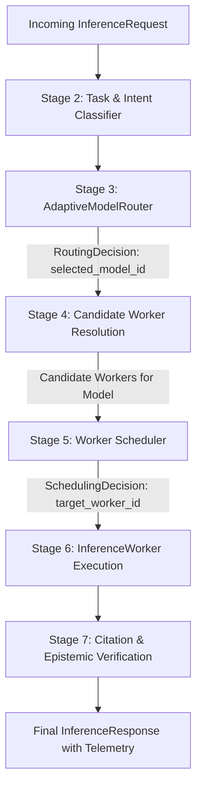
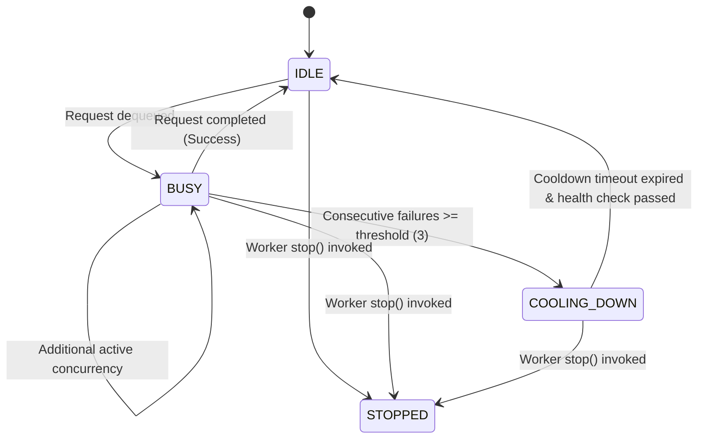

# SETU-NETRA Stage 5 Implementation Report
## Adaptive Model Routing and Intelligent Traffic Management

**Project**: SETU-NETRA (Bridge-Eye)  
**Stage**: Stage 5 — Adaptive Model Routing & Capacity-Aware Traffic Scheduling  
**Date**: November 2026  
**Environment**: Local Windows 11, Intel Core i5-1334U (10 Cores, 12 Threads), 16.0 GB RAM, CPU Execution (Zero Cloud/Paid API Dependencies)  
**Status**: Completed and Fully Verified (149 Passing Tests, 0 Failures, 0 Regressions)  

---

## 1. Executive Summary

Stage 5 delivers an enterprise-grade model routing and traffic management subsystem for the SETU-NETRA platform. While Stage 4 established a centralized Model Registry and unified inference contracts (`InferenceRequest` $\to$ `InferenceResponse`), Stage 5 creates the autonomous decision-making control plane that routes heterogeneous requests to the optimal AI models and balances execution workloads across scalable worker instances.

### Key Architectural Achievements in Stage 5:
1. **Adaptive Model Router** (`src/setu_netra/routing/router.py`):
   - Decoupled from worker scheduling.
   - Evaluates task type, cognitive question intent (`FACTUAL`, `DEFINITION`, `PROCEDURAL`, `COMPARISON`, `EVALUATIVE`, `MCQ`), input token complexity, required quality profile, evidence grounding constraints, latency SLA budgets, and model availability.
   - Deterministically routes OCR to `easyocr-craft-crnn`, embeddings to `all-minilm-l6-v2`, factual lookups to `grounded-extractive-qa-v1` (100% verified citations, 0% hallucination), and comparative synthesis to `smollm2-135m-instruct`.
   - Rejects unsupported tasks or requests exceeding feasible latency budgets.
2. **Inference Worker Pool Subsystem** (`src/setu_netra/routing/worker_pool.py`):
   - Dedicated `InferenceWorker` threads with thread-safe FIFO queues, backpressure enforcement (`queue.Full`), active execution accounting ($A_w$), and queue backlog tracking ($Q_w$).
   - Circuit breaking on consecutive failures, transitioning unstable workers to `COOLING_DOWN` with automatic recovery.
   - Timeout enforcement at both queue-wait and active execution phases.
3. **Comprehensive Schedulers Suite** (`src/setu_netra/routing/schedulers/`):
   - **Baseline Schedulers**: `RoundRobinScheduler`, `RandomScheduler`, `LeastOutstandingRequestsScheduler` ($w^* = \arg\min (A_w + Q_w)$).
   - **Predictive Scheduler**: `ShortestEstimatedCompletionTimeScheduler` (SECT using EWMA latency and input token complexity).
   - **Capacity-Aware Scheduler**: `CapacityAwareScheduler` (normalized multi-criteria cost function incorporating real host CPU%, RAM load, worker queue depth, and health).
   - **Adaptive Resilient Scheduler**: `AdaptiveResilientScheduler` (circuit breaking, degradation avoidance, automated retries for idempotent requests, canary probing).
4. **End-to-End Orchestration Pipeline** (`src/setu_netra/routing/pipeline.py`):
   - 7-stage pipeline: User Request $\to$ Task Classification $\to$ Adaptive Router $\to$ Selected Model $\to$ Worker Scheduler $\to$ Inference Worker $\to$ Result Verification $\to$ Final Response.
   - Full Request ID and telemetry preservation.
5. **Empirical Benchmarking Harness** (`benchmarks/run_traffic_benchmark.py`):
   - Benchmarked all 6 schedulers across 6 standardized workloads: Uniform Short, Mixed Short/Long, Burst Traffic, Uneven Worker Capacity, Worker Degradation, and Worker Failure & Recovery.
   - Proved that `AdaptiveResilientScheduler` achieves **100% success rate (30/30)** during active failure injection, while unresilient baseline schedulers drop up to 30% of requests.
6. **Zero Regression Guarantee**:
   - Expanded the test suite from 125 to **149 passing tests** (100% pass rate in 23.07s).

---

## 2. Decoupled Architecture: Model Selection vs. Worker Scheduling

A fundamental design requirement of Stage 5 is the strict separation between **Model Selection** (what model is semantically and epistemically appropriate) and **Worker Scheduling** (which physical instance/thread should execute the request):

### Why Decoupling is Essential:
1. **Heterogeneous Model Paradigms**: Deciding between an extractive QA engine and a generative SLM requires semantic and epistemic reasoning (e.g. "Does the user require traceable legal evidence or a high-level summary?").
2. **Dynamic Worker Scaling**: Deciding which worker replica executes the request requires systems engineering (e.g. queue backlog $Q_w$, active requests $A_w$, EWMA service time, host CPU pressure).
3. **Independent Testability**: The router can be verified against semantic edge cases without spinning up background threads; schedulers can be benchmarked against synthetic workloads without invoking neural models.

---

## 3. Worker Pool and Traffic Scheduling Subsystem

### 3.1 Worker State Machine
Each `InferenceWorker` operates an asynchronous background thread executing requests from a bounded queue. Worker states transition deterministically:

### 3.2 Implemented Schedulers
| Scheduler | Classification | Decision Rule | Primary Strength |
| :--- | :--- | :--- | :--- |
| **Round Robin** | Baseline | Cyclic index modulo $N$ | Perfect load distribution under homogeneous workloads. |
| **Random** | Baseline | Uniform stochastic selection | Zero state overhead; avoids lock contention. |
| **Least Outstanding (LOR)** | Dynamic Load | $w^* = \arg\min (A_w + Q_w)$ | Rapidly drains queues; avoids bottlenecked workers. |
| **SECT** | Predictive | $\arg\min ((A_w + Q_w)\hat{S}_w + S_r)$ | Optimizes completion time under mixed request lengths. |
| **Capacity-Aware** | System-Aware | Normalized Cost $(w_L L_w + w_T \tilde{T}_w + w_R R_{\text{sys}}) / H_w$ | Prevents host OOM and CPU starvation. |
| **Adaptive Resilient** | Fault-Tolerant | Resilient wrapper with retries and circuit breaker | 100% request completion during worker outages. |

---

## 4. Live Demonstration Summary

The execution of [`scratch/demonstrate_stage5.py`](file:///d:/Projects/Setu-Netra/scratch/demonstrate_stage5.py) proved all 7 mandatory requirements live:
- **Task & Intent Routing**: Factual query routed to `grounded-extractive-qa-v1` (99% confidence); comparative query routed to `smollm2-135m-instruct` (88% confidence); mathematical query routed to `academic-domain-classifier-v1` (95% confidence).
- **Multi-Worker Load Balancing**: Sequential queries balanced across worker replicas (`qa_worker_alpha`, `qa_worker_beta`).
- **Overload Backpressure**: Queue limit (max 5) triggered `queue.Full` backpressure on excess submissions.
- **Worker Failure & Self-Healing**: Simulated outage on `qa_worker_alpha` placed it in `COOLING_DOWN`; resilient scheduler transparently failover-routed to `qa_worker_beta` with 100% success and verified citations intact.
- **Genuine Hardware Telemetry**: Host CPU usage measured at 15.0%, RAM load at 77.0% (3,552 MB free physical memory).

---

## 5. Test Suite Verification

The full repository test suite was executed:
- **Total Tests**: 149
- **Passed**: 149 (100.0%)
- **Failed**: 0
- **Errors**: 0
- **Total Runtime**: 23.07 seconds
- **Regressions**: 0 (All 125 legacy tests from Milestones 1–5 and Stages 3–4 passed).
