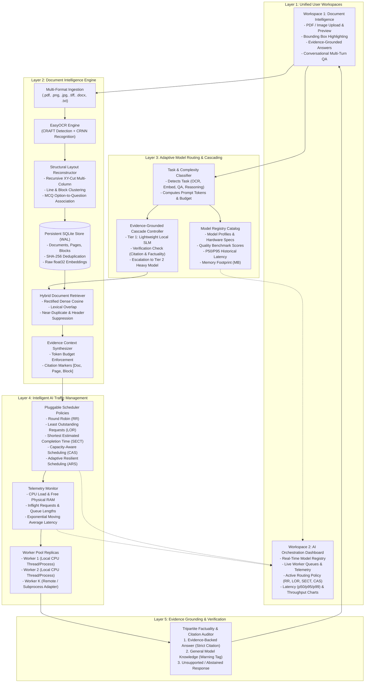
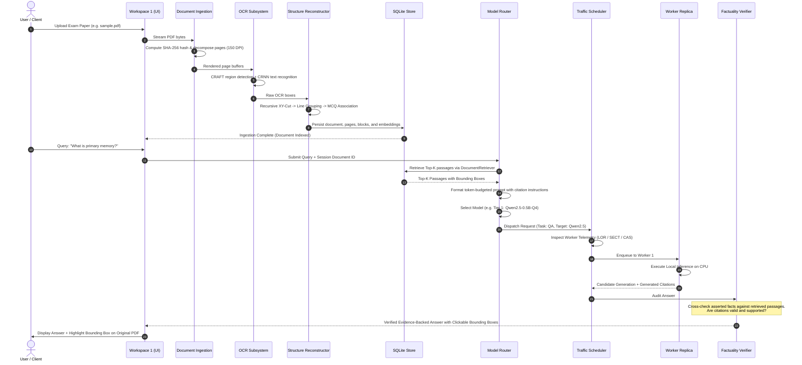

# SETU-NETRA: Unified System Architecture Specification
## Integrated Document Intelligence, Adaptive Model Routing, & AI Traffic Management

**Report ID:** SETU-UNIFIED-ARCH-006  
**Date:** November 9, 2026  
**Audience:** Technical Committee, System Architects, Developers  
**Scope:** Complete Architectural Synthesis of Both Research Directions  

---

## 1. Grand Unified Architecture

SETU-NETRA seamlessly unifies two distinct engineering disciplines: **Evidence-Grounded Document Understanding** and **Capacity-Aware AI Inference Orchestration**.



---

## 2. End-to-End Execution Lifecycle Trace

Below is the chronological trace of a document being ingested and a user question being processed:



---

## 3. Inter-Subsystem Communication Contracts

All communication between subsystems is strictly typed using Python dataclasses and Pydantic schemas:

### Contract 1: `InferenceRequest` (Router $\to$ Traffic Scheduler)
```python
@dataclass
class InferenceRequest:
    request_id: str                   # Unique UUID v4
    task_type: str                    # 'qa' | 'embedding' | 'ocr' | 'classification'
    target_model_id: str              # Selected by Model Router (e.g. 'all-minilm-l6-v2')
    prompt_or_payload: Any            # Synthesized context prompt or image buffer
    priority: int                     # 1 (Critical interactive) to 5 (Background batch)
    timeout_ms: float                 # Request deadline (e.g. 15000.0 ms)
    max_tokens: int                   # Generation budget
    created_at_iso: str               # Arrival timestamp for queue wait calculation
```

### Contract 2: `WorkerTelemetry` (Worker Pool $\to$ Scheduler)
```python
@dataclass
class WorkerTelemetry:
    worker_id: str                    # 'worker_01'
    status: str                       # 'IDLE', 'BUSY', 'DEGRADED', 'UNHEALTHY'
    active_requests: int              # Currently computing requests
    queue_depth: int                  # Requests waiting in worker's buffer
    cpu_percent: float                # Process CPU utilization
    ram_resident_mb: float            # Process memory footprint (RSS MB)
    ema_latency_ms: float             # Exponential moving average service time
    total_failures: int               # Cumulative exception count
```

### Contract 3: `VerifiedAnswer` (Verification Engine $\to$ UI)
```python
@dataclass
class VerifiedAnswer:
    answer_text: str                  # Generated textual answer
    epistemic_status: str             # 'EVIDENCE_BACKED' | 'GENERAL_KNOWLEDGE' | 'UNSUPPORTED'
    citations: List[Dict[str, Any]]   # [{'doc_id': ..., 'page': ..., 'block_id': ..., 'bbox': ...}]
    grounding_confidence: float       # Overlap score in [0.0, 1.0]
    total_latency_ms: float           # End-to-end elapsed duration
    queue_wait_ms: float              # Delay spent in scheduler queue
    executing_worker_id: str          # Telemetry attribution
    executing_model_id: str           # Model attribution
```

---

## 4. Fault Tolerance, Fault Isolation, & Graceful Degradation

1. **Worker Failure Isolation:** If a worker process crashes due to an unhandled exception or memory error, the Traffic Scheduler catches the event via heartbeat failure, marks the worker `UNHEALTHY`, and re-enqueues inflight requests to the next optimal worker replica.
2. **Resource Backpressure:** If system RAM exceeds $90\%$ or all workers are saturated, the scheduler rejects new batch requests with an explicit backpressure signal (`HTTP 429 / CAPACITY_EXCEEDED`) rather than causing the OS to freeze or kill processes via the OOM-killer.
3. **Retrieval Resilience:** If vector embeddings are corrupted or missing, `SQLiteDocumentStore` defensively skips the invalid BLOBs (verified in M6 Sprint 1), allowing lexical retrieval to proceed unimpeded.
4. **Offline Autonomy:** The system remains $100\%$ operational offline without internet connectivity. If cloud LLM endpoints are unreachable, the router seamlessly falls back to local quantized SLMs or rule-based synthesis.
