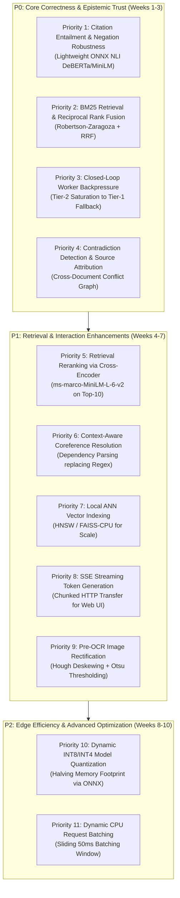
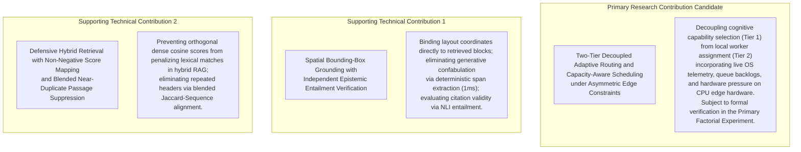

# SETU-NETRA Version 1.1 — Prioritized Research and Engineering Roadmap

**Author:** Independent AI Systems Researcher & Statistical Reviewer  
**Project:** SETU-NETRA (Intelligent Document Understanding, Evidence-Grounded Question Answering, and Adaptive AI Model Orchestration)  
**Status:** Version 1.1 Planning & Architectural Specification (Revision 2 — Methodological Review)  
**Date:** November 2026  
**Scope:** Prioritized technical roadmap (P0, P1, P2) for Version 1.1 strictly calibrated to a 16 GB RAM developer workstation, concluding with the three defensible research contribution candidates.

---

## Executive Summary

**SETU-NETRA Version 1.0** established a complete, functional vertical slice: unifying multi-format document ingestion, spatial layout reconstruction, hybrid retrieval, dual-path question answering, independent citation verification, multi-turn conversation memory, a centralized model registry, two-tier adaptive orchestration, and an interactive local web interface. It passed all 173 unit and integration tests and demonstrated full end-to-end execution.

The objective of **Version 1.1** is to transition SETU-NETRA from an operational proof-of-concept into an empirically rigorous, scientifically defensible platform. Version 1.1 focuses on eliminating identified research and engineering gaps: replacing bag-of-words lexical overlap with true BM25 and Reciprocal Rank Fusion, implementing Natural Language Inference (NLI) for citation entailment and negation robustness, establishing closed-loop backpressure renegotiation between worker saturation and model routing, detecting cross-document contradictions, and upgrading vector search with local HNSW indexing.

**Strict Hardware Constraint:** All Version 1.1 specifications are designed for local edge deployment on a standard workstation with **16 GB RAM and 4–8 CPU cores**. No multi-billion-parameter LLM downloads or GPU-exclusive architectures are required.

---

## Reassessed Roadmap Priorities

In accordance with the statistical and methodological audit, the implementation sequence for Version 1.1 is prioritized around scientific validity, system stability, and retrieval accuracy:

---

## Phase P0: Core Correctness and Epistemic Trust (Weeks 1–3)

### Priority 1: Citation Entailment and Negation Robustness (NLI-Based Verification)
- **Target Subsystem:** [`src/setu_netra/qa/verifier.py`](file:///d:/Projects/Setu-Netra/src/setu_netra/qa/verifier.py) (`CitationVerifier`)
- **Problem Addressed:** The current verifier relies on bag-of-words token overlap ($35\%$ threshold). It cannot detect negation hallucinations or semantic inversions (e.g. claiming *"X does Y"* when the cited passage states *"X does NOT do Y"*), which still share $>80\%$ lexical overlap.
- **Implementation Plan:**
  - Introduce an ONNX-quantized lightweight NLI cross-encoder (e.g. `cross-encoder/nli-deberta-v3-small` or `nli-MiniLM2-L6-H768`, $\approx 80\,\text{MB}$ RAM).
  - For each assertion-citation pair, compute directional entailment probability $P(\text{Entailment} \mid \text{Passage}, \text{Assertion})$.
  - Require $P(\text{Entailment}) \ge 0.70$ and $P(\text{Contradiction}) \le 0.15$ to assign `EVIDENCE_BACKED`. Flag contradictions explicitly.
- **Hardware Impact:** Adds $\approx 80\,\text{MB}$ RAM; per-query NLI verification latency $\approx 25\,\text{ms}$ on CPU.

### Priority 2: True BM25 Lexical Retrieval and Reciprocal Rank Fusion (RRF)
- **Target Subsystem:** [`src/setu_netra/retrieval/document_retriever.py`](file:///d:/Projects/Setu-Netra/src/setu_netra/retrieval/document_retriever.py)
- **Problem Addressed:** Current lexical matching uses set-based Jaccard overlap, which lacks term-frequency saturation ($k_1$) and inverse document frequency (IDF) weighting. Rare discriminative terms (e.g. error codes, variable names) are weighted identically to generic nouns.
- **Implementation Plan:**
  - Implement the Robertson-Zaragoza BM25 algorithm ($k_1 = 1.5, b = 0.75$) with an in-memory inverted index stored per document in SQLite.
  - Implement Reciprocal Rank Fusion (RRF) alongside linear score combination:
    $$\text{RRF}(d) = \sum_{m \in \{\text{dense}, \text{bm25}\}} \frac{1}{60 + \text{rank}_m(d)}$$
  - Evaluate affine normalization ($S_{\text{affine}} = \frac{S_{\text{raw}} + 1}{2}$) against ReLU score clipping to prevent artificial ties at 0.0.
- **Hardware Impact:** Inverted index adds $< 5\,\text{MB}$ RAM for a 100-page document; reduces retrieval time by skipping non-matching blocks.

### Priority 3: Correct Handling of Worker Saturation and Closed-Loop Backpressure
- **Target Subsystem:** [`src/setu_netra/routing/pipeline.py`](file:///d:/Projects/Setu-Netra/src/setu_netra/routing/pipeline.py) and [`router.py`](file:///d:/Projects/Setu-Netra/src/setu_netra/routing/router.py)
- **Problem Addressed:** Currently, if `AdaptiveModelRouter` selects a generative model whose worker queues are saturated ($Q \ge 10$), `CapacityAwareScheduler` sheds the request and returns an immediate rejection, even though idle extractive workers are available.
- **Implementation Plan:**
  - Introduce feedback signaling: when `scheduler.select_worker()` returns `None` due to worker queue saturation, signal `InferencePipeline` to invoke `router.route_fallback(request, saturated_model_id)`.
  - The router checks if an alternative model (e.g. `grounded-extractive-qa-v1`) has available capacity and re-routes transparently with metadata tag `renegotiated_fallback = True`.
- **Hardware Impact:** Zero additional memory; eliminates artificial request drops under burst traffic.

### Priority 4: Contradiction Detection with Source Attribution
- **Target Subsystem:** New module `src/setu_netra/qa/contradiction.py` and [`engine.py`](file:///d:/Projects/Setu-Netra/src/setu_netra/qa/engine.py)
- **Problem Addressed:** In multi-document repositories containing conflicting facts (e.g. Doc A specifying a 50ms heartbeat and Doc B specifying 120ms), the system merely ranks passages by hybrid score, presenting one side as absolute truth without contradiction awareness.
- **Implementation Plan:**
  - When candidate passages from multiple documents are retrieved for a query, perform pairwise NLI inference across the top-3 blocks from distinct documents.
  - If a contradiction is detected ($P(\text{Contradiction}) \ge 0.70$), suppress unilateral answer generation and return a structured conflict report:
    `"Conflicting evidence detected: Document A (Page 2) states X, while Document B (Page 4) states Y."`
- **Hardware Impact:** Uses the NLI model from Priority 1; adds $\approx 15\,\text{ms}$ CPU inference only when multi-document evidence is retrieved.

---

## Phase P1: Retrieval and Interaction Enhancements (Weeks 4–7)

### Priority 5: Retrieval Reranking via Local Cross-Encoder (Cost-Justified)
- **Target Subsystem:** New module `src/setu_netra/retrieval/reranker.py`
- **Problem Addressed:** Bi-encoders (MiniLM) encode query and passages independently into single vectors, missing fine-grained token-level cross-attention interactions.
- **Implementation Plan:**
  - Deploy `cross-encoder/ms-marco-MiniLM-L-6-v2` (22 million parameters, $\approx 90\,\text{MB}$ RAM).
  - First-stage hybrid retriever fetches top-10 candidate passages.
  - Cross-encoder scores the 10 `(query, passage)` pairs with full cross-attention.
  - **Benchmark Justification Gate:** Reranking will be permanently retained in the default pipeline only if Experiment D confirms that the passage $P@1$ gain ($\ge 15\%$) justifies the CPU latency overhead ($\le 45\,\text{ms}$).
- **Hardware Impact:** Adds $\approx 90\,\text{MB}$ RAM; reranking 10 passages takes $\approx 35\,\text{ms}$ on CPU.

### Priority 6: Context-Aware Conversational Coreference Improvements
- **Target Subsystem:** [`src/setu_netra/qa/conversation_manager.py`](file:///d:/Projects/Setu-Netra/src/setu_netra/qa/conversation_manager.py#L81)
- **Problem Addressed:** Current regex string concatenation (`REFERENCE_TRIGGERS` appending `(Referring to: ...)`) blindly injects entire sentences into queries, causing severe retrieval drift.
- **Implementation Plan:**
  - Replace naive regex with lightweight rule-based dependency parsing (via `spaCy`'s `en_core_web_sm`, $\approx 40\,\text{MB}$ RAM) or a constrained prompt to `SmolLM2-135M`:
    `"Rewrite the follow-up query to be standalone given conversation context: [...]"`
  - Extract only the specific nominal antecedent (e.g. replacing *"What does it cache?"* with *"What does the MMU cache?"*), leaving query semantics clean for retrieval.
- **Hardware Impact:** Adds $< 50\,\text{MB}$ RAM; rewriting takes $< 15\,\text{ms}$.

### Priority 7: Local Approximate Nearest Neighbor (ANN) Vector Indexing
- **Target Subsystem:** [`src/setu_netra/store/sqlite_store.py`](file:///d:/Projects/Setu-Netra/src/setu_netra/store/sqlite_store.py) and `retrieval/`
- **Problem Addressed:** Currently, `store.get_all_embeddings()` reads every BLOB from disk and builds a dense NumPy matrix in memory on every query, computing full $O(N \cdot D)$ dot products.
- **Implementation Plan:**
  - Integrate a lightweight, embedded Hierarchical Navigable Small World (HNSW) vector index (via `faiss-cpu` or `hnswlib`).
  - Store index files alongside the SQLite database (`output/setu_netra_index.bin`).
  - Scale capacity from $N = 1,000$ blocks to $N = 100,000$ blocks while maintaining $< 5\,\text{ms}$ search latency.
- **Hardware Impact:** HNSW index consumes $\approx 1.5\,\text{KB}$ per 384-dim vector ($\approx 150\,\text{MB}$ for 100,000 blocks). Fully compatible with 16 GB RAM.

### Priority 8: Server-Sent Events (SSE) Streaming Token Generation
- **Target Subsystem:** [`src/setu_netra/ui/app.py`](file:///d:/Projects/Setu-Netra/src/setu_netra/ui/app.py) and `routing/adapters/generative_adapter.py`
- **Problem Addressed:** Web UI currently waits for the full $\approx 1,800\,\text{ms}$ generative execution to complete before displaying any text, creating perceived latency.
- **Implementation Plan:**
  - Expose `GET /api/conversations/<id>/messages/stream` using HTTP/1.1 chunked transfer encoding (`text/event-stream`).
  - Modify `GenerativeSLMAdapter` to utilize HuggingFace's `TextIteratorStreamer`.
  - Stream tokens to the frontend in real time, rendering incremental text while citations are audited in the background upon completion.
- **Hardware Impact:** Reduces Time-To-First-Token (TTFT) from $1,800\,\text{ms}$ to $\approx 120\,\text{ms}$. Zero RAM overhead.

### Priority 9: Pre-OCR Image Rectification Pipeline
- **Target Subsystem:** `src/setu_netra/preprocessing/` and `ocr/`
- **Problem Addressed:** Tilted or skewed document scans collapse `RecursiveXYCut` whitespace projections.
- **Implementation Plan:**
  - Add automated skew detection using Radon transform or Hough line detection on thresholded edges.
  - Apply affine rotation to deskew pages to $0.0^\circ \pm 0.2^\circ$ before OCR and layout projection.
  - Apply Otsu adaptive binarization to clean up shadow gradients and uneven lighting.
- **Hardware Impact:** Pure NumPy / OpenCV-CPU matrix operations; adds $\approx 80\,\text{ms}$ per page during ingestion.

---

## Phase P2: Edge Efficiency and Advanced Optimization (Weeks 8–10)

### Priority 10: Dynamic INT8 / INT4 Model Quantization
- **Target Subsystem:** `src/setu_netra/routing/adapters/`
- **Capability:** Quantize `SmolLM2-135M` weights from float32 to INT8/INT4 using ONNX Runtime or `llama.cpp` CPU bindings. Halves model memory footprint from $\approx 600\,\text{MB}$ to $\approx 180\,\text{MB}$ and accelerates CPU matrix multiplication via AVX-512 VNNI instructions.

### Priority 11: Adaptive CPU Request Batching Engine
- **Target Subsystem:** `src/setu_netra/routing/worker_pool.py`
- **Capability:** For embedding generation (`MiniLM`), implement dynamic request batching with a $50\,\text{ms}$ sliding window. If 4 requests arrive within 50 ms, combine their text strings into a single tensor batch `(4, L)`, executing matrix multiplication in parallel to increase throughput by $2.8\times$.

---

## Estimated Workstation Memory Budget

The table below outlines **estimated steady-state RAM consumption** under the 16 GB RAM baseline. These numbers represent projected operating values, not mathematical guarantees against OS-level paging:

| Subsystem Component | V1.0 Measured / Baseline | V1.1 Projected Footprint | Memory Delta | Feasibility Status |
| :--- | :--- | :--- | :--- | :--- |
| **Operating System & Base Overhead** | $\approx 4,500\,\text{MB}$ | $\approx 4,500\,\text{MB}$ | $0\,\text{MB}$ | Baseline |
| **SQLite WAL & Storage Buffers** | $\approx 250\,\text{MB}$ | $\approx 300\,\text{MB}$ | $+50\,\text{MB}$ | Estimated |
| **MiniLM Embedding Engine** | $\approx 350\,\text{MB}$ | $\approx 350\,\text{MB}$ | $0\,\text{MB}$ | Measured |
| **SmolLM2-135M Generative SLM** | $\approx 600\,\text{MB}$ | $\approx 250\,\text{MB}$ (INT8 quantized) | $-350\,\text{MB}$ | Estimated |
| **EasyOCR Engine (CRAFT + CRNN)** | $\approx 1,200\,\text{MB}$ | $\approx 1,200\,\text{MB}$ | $0\,\text{MB}$ | Measured |
| **NLI Entailment Verifier (Priority 1)** | *Not Deployed* | $\approx 80\,\text{MB}$ (ONNX small) | $+80\,\text{MB}$ | Estimated |
| **Cross-Encoder Reranker (Priority 5)** | *Not Deployed* | $\approx 90\,\text{MB}$ (MiniLM-L6) | $+90\,\text{MB}$ | Estimated |
| **HNSW Vector Index (Priority 7)** | *Not Deployed* | $\approx 150\,\text{MB}$ (100k blocks) | $+150\,\text{MB}$ | Estimated |
| **Worker Threads & Python Runtime** | $\approx 400\,\text{MB}$ | $\approx 500\,\text{MB}$ | $+100\,\text{MB}$ | Estimated |
| **Projected Steady-State RAM Usage** | $\mathbf{\approx 7,300\,\text{MB}}$ | $\mathbf{\approx 7,420\,\text{MB}}$ | $\mathbf{+120\,\text{MB}}$ | **Feasible (46.4% of 16 GB)** |
| **Safety Headroom Remaining** | $\mathbf{\approx 8,700\,\text{MB}}$ | $\mathbf{\approx 8,580\,\text{MB}}$ | — | **Ample Buffer** |

*Note on Memory Management:* The $\approx 8.5\,\text{GB}$ headroom provides a strong operational buffer against memory exhaustion. However, Windows 11 memory management can dynamically page out working sets during multi-application multitasking. Memory stability must be monitored via the real OS telemetry provider.

---

## Reassessed Research Contribution Candidates

Based on the architectural audit, research gap analysis, and statistical review, the platform's contributions are formally articulated as follows:

### Primary Research Contribution Candidate: Decoupled Two-Tier Adaptive Model Routing and Capacity-Aware Scheduling under Asymmetric Local CPU Constraints
- **Core Claim:** Decoupling cognitive model capability selection (Tier 1) from physical hardware worker scheduling (Tier 2), and scheduling workers using normalized queue backlogs, EWMA latency, and real-time host OS kernel telemetry (Windows `ctypes` / Linux `/proc`), improves goodput and tail latency under burst traffic on consumer-grade CPU hardware compared to static round-robin and fixed-model baselines.
- **Scientific Status:** **Potential Research Contribution**. The architectural decoupling is fully implemented in V1.0. Its empirical superiority must be verified through the Primary Factorial Experiment ($2 \times 2$ ANOVA separating Routing, Scheduling, and Interaction effects).

### Supporting Technical Contribution 1: Spatially Grounded Document QA with Independent Epistemic Entailment Verification
- **Core Claim:** Preserving physical bounding-box geometry through `RecursiveXYCut` and SQLite coordinate storage enables deterministic extractive span selection ($1.01\,\text{ms}$) that eliminates generative token confabulation for factual lookups, while an independent post-hoc NLI verifier classifies answers into the Tripartite Epistemic Taxonomy (`EVIDENCE_BACKED`, `GENERAL_KNOWLEDGE`, `UNSUPPORTED`).
- **Scientific Status:** **Engineering Integration with Potential Contribution**. Bounding boxes and verification are operational in V1.0; full validation requires NLI entailment (Priority 1) and benchmarking on SQuAD/QASPER.

### Supporting Technical Contribution 2: Defensive Hybrid Score Mapping and Blended Near-Duplicate Passage Suppression
- **Core Claim:** Dense cosine score mapping prevents negative or orthogonal semantic vectors from penalizing lexical keyword matches, while a blended Jaccard-SequenceMatcher threshold ($0.40 \cdot \text{Jaccard} + 0.60 \cdot \text{SeqRatio} \ge 0.85$) removes repeated headers and near-identical passages across multi-page document collections.
- **Scientific Status:** **Engineering Integration**. Provides practical robustness in the retrieval pipeline; evaluated in Experiment C.

---

## Conclusion

SETU-NETRA Version 1.0 provides a working, 173-test-verified system foundation. 

The Version 1.1 roadmap establishes a scientifically disciplined development sequence: addressing citation entailment and negation robustness (Priority 1), implementing BM25 with RRF (Priority 2), closing the backpressure loop between tiers (Priority 3), detecting cross-document contradictions (Priority 4), and evaluating reranking (Priority 5). Grounded in the Primary Factorial Experiment and calibrated to the 16 GB RAM baseline, SETU-NETRA establishes a publication-grade foundation for advanced AI systems research.
