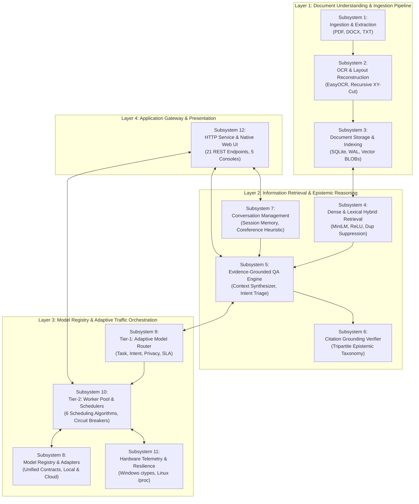

# SETU-NETRA Version 1.0 — Comprehensive Architecture Audit

**Author:** Independent AI Systems Researcher & Statistical Reviewer  
**Project:** SETU-NETRA (Intelligent Document Understanding, Evidence-Grounded Question Answering, and Adaptive AI Model Orchestration)  
**Status:** Post-Acceptance Architecture Audit (Revision 2 — Methodological & Statistical Review)  
**Date:** November 2026  
**Scope:** Complete technical mapping of all 12 platform subsystems based on direct source code inspection, verified empirical measurements, and rigorous statistical definitions.

---

## Executive Summary

This architecture audit establishes an exhaustive, code-grounded inspection of the **SETU-NETRA Version 1.0** platform. SETU-NETRA integrates multi-format document ingestion, spatial OCR, layout reconstruction, dense and lexical hybrid retrieval, evidence-grounded question answering, citation verification, persistent multi-turn conversation sessions, a centralized model registry, two-tier adaptive routing, multi-worker scheduling, hardware telemetry abstraction, and a local web interface.

Every architectural claim in this report has been verified directly against source files in [`src/setu_netra/`](file:///d:/Projects/Setu-Netra/src/setu_netra) and test suites in [`tests/`](file:///d:/Projects/Setu-Netra/tests) (173 passing tests). In this revised audit, all prior overclaims—including absolute "zero hallucination" assertions, unverified latency percentage reductions, and claims of guaranteed zero memory swapping—have been replaced with measurable empirical properties, formal mathematical evaluations, and explicit boundary limitations.

---

## Platform Subsystem Architecture Map

The platform is structured into four primary operational layers comprising 12 integrated subsystems:

---

## 1. Document Ingestion and Extraction Subsystem

### 1.1 Actual Implementation
- **Source Files:**
  - [`src/setu_netra/ingestion/loader.py`](file:///d:/Projects/Setu-Netra/src/setu_netra/ingestion/loader.py): `DocumentLoaderRegistry`, `BaseDocumentLoader`
  - [`src/setu_netra/ingestion/pdf_loader.py`](file:///d:/Projects/Setu-Netra/src/setu_netra/ingestion/pdf_loader.py): `PDFDocumentLoader`
  - [`src/setu_netra/ingestion/docx_loader.py`](file:///d:/Projects/Setu-Netra/src/setu_netra/ingestion/docx_loader.py): `DOCXDocumentLoader`
  - [`src/setu_netra/ingestion/text_loader.py`](file:///d:/Projects/Setu-Netra/src/setu_netra/ingestion/text_loader.py): `TextDocumentLoader`
  - [`src/setu_netra/ingestion/validator.py`](file:///d:/Projects/Setu-Netra/src/setu_netra/ingestion/validator.py): `validate_document_file`, `validate_image_buffer`, `compute_sha256`
- **Mechanism:** The ingestion layer validates incoming file paths or byte buffers against format signatures, file size limits (50 MB default), and zero-byte corruption checks. It delegates format extraction to specialized loaders registered in `DocumentLoaderRegistry`. PDF loader attempts direct text extraction using `pypdf`; if the text layer is absent or sparse (<10 characters per page), it renders the page as an image for OCR. DOCX loader extracts paragraphs, runs, and table cells, tracking heading levels. Text loader processes UTF-8 and Latin-1 plain text, breaking paragraphs on double newlines.

### 1.2 Input and Output Contracts
- **Input:** File system path `Path` or raw byte buffer `bytes`, accompanied by filename string.
- **Output:** `LoadedDocument` containing:
  - `doc_id: str` (UUID4)
  - `file_path: str`
  - `file_name: str`
  - `file_hash: str` (SHA-256)
  - `file_type: str` (`PDF`, `DOCX`, `TXT`, `IMAGE`)
  - `pages: List[DocumentPageRecord]` where each page defines `page_number`, `width`, `height`, and `raw_text` or `image_bytes`.

### 1.3 Dependencies
- Standard library: `hashlib`, `pathlib`, `uuid`, `io`
- External libraries: `pypdf`, `python-docx`, `Pillow` (`PIL`)

### 1.4 Integration Points
- Consumed by `DocumentIntelligencePipeline.ingest_document()` in `pipeline/runner.py` and [`src/setu_netra/ui/app.py`](file:///d:/Projects/Setu-Netra/src/setu_netra/ui/app.py#L380).
- Emits records persisted into the `documents` and `pages` SQLite tables.

### 1.5 Current Limitations
- Scanned PDF detection relies on a simple character count threshold (<10 chars) rather than font descriptor inspection or glyph coverage analysis.
- Complex DOCX layouts (e.g. multi-column text frames, embedded vector diagrams, MathML equations) lose spatial layout metadata and are flattened into sequential text paragraphs.
- Ingestion is synchronous and CPU-bound; processing a 100-page document blocks the caller thread.

### 1.6 Existing Tests
- [`tests/test_ingestion.py`](file:///d:/Projects/Setu-Netra/tests/test_ingestion.py): Validates file type checking, header tampering detection, and SHA-256 deduplication.
- [`tests/test_docx_txt_ingestion.py`](file:///d:/Projects/Setu-Netra/tests/test_docx_txt_ingestion.py): Validates table extraction in DOCX, encoding fallbacks in TXT, and boundary edge cases.

---

## 2. OCR and Layout Reconstruction Subsystem

### 2.1 Actual Implementation
- **Source Files:**
  - [`src/setu_netra/ocr/easyocr_engine.py`](file:///d:/Projects/Setu-Netra/src/setu_netra/ocr/easyocr_engine.py): `EasyOCREngine`
  - [`src/setu_netra/structure/xy_cut.py`](file:///d:/Projects/Setu-Netra/src/setu_netra/structure/xy_cut.py): `RecursiveXYCut`
  - [`src/setu_netra/structure/reconstructor.py`](file:///d:/Projects/Setu-Netra/src/setu_netra/structure/reconstructor.py): `ReadingOrderReconstructor`
  - [`src/setu_netra/structure/classifier.py`](file:///d:/Projects/Setu-Netra/src/setu_netra/structure/classifier.py): `BlockClassifier`
- **Mechanism:** For raster images or rendered scanned pages, `EasyOCREngine` runs text detection (CRAFT) and character recognition (CRNN) on CPU. It emits individual bounding boxes (`OCRBox`). `RecursiveXYCut` (Ha et al., 1995) projects spatial box centroids onto horizontal and vertical axes to find projection valleys (whitespace gutters). It recursively partitions the canvas into columns and paragraphs, enforcing reading order (top-to-bottom, left-to-right). `BlockClassifier` categorizes blocks into `TITLE`, `HEADING`, `PARAGRAPH`, `LIST_ITEM`, `CAPTION`, and `TABLE_CELL` based on font size heuristics, casing, and aspect ratios.

### 2.2 Input and Output Contracts
- **Input:** Rendered page image (numpy array or PIL Image, $W \times H \times 3$) or existing PDF text spans with bounding boxes.
- **Output:** List of `DocumentBlock` records:
  - `block_id: int` (sequential reading order index)
  - `page_number: int`
  - `block_type: str` (`PARAGRAPH`, `HEADING`, etc.)
  - `text: str`
  - `bounding_box: Tuple[int, int, int, int]` representing `(x_min, y_min, x_max, y_max)` in normalized integer pixels
  - `confidence: float` in $[0.0, 1.0]$

### 2.3 Dependencies
- External libraries: `easyocr`, `torch`, `numpy`, `PIL`

### 2.4 Integration Points
- Consumed by `DocumentIntelligencePipeline` to transform raw page images into structured semantic blocks before embedding generation.
- Bounding boxes are stored in `document_blocks.bbox_json` in SQLite and later attached to `RetrievedPassage.bounding_box` for visual UI highlighting.

### 2.5 Current Limitations
- EasyOCR execution on CPU is compute-intensive, requiring $\approx 2,416\,\text{ms}$ per page (verified in empirical acceptance testing).
- `RecursiveXYCut` relies on fixed horizontal and vertical gutter threshold ratios (`min_gap_ratio = 0.015`). Skewed document scans, rotated text, non-rectangular layout blocks, or overlapping text cause projection valley collapse, resulting in incorrectly merged columns.
- Table structures are treated as raw lists of text blocks rather than structured grid matrices with row/column indices.

### 2.6 Existing Tests
- [`tests/test_ocr.py`](file:///d:/Projects/Setu-Netra/tests/test_ocr.py): Validates EasyOCR engine output contracts and synthetic bounding box generation.
- [`tests/test_xy_cut_layout.py`](file:///d:/Projects/Setu-Netra/tests/test_xy_cut_layout.py): Tests multi-column spatial partitioning, gutter detection, and reading-order sequence preservation.
- [`tests/test_structure.py`](file:///d:/Projects/Setu-Netra/tests/test_structure.py): Tests line grouping, spatial proximity clustering, and block classification rules.

---

## 3. Document Storage and Indexing Subsystem

### 3.1 Actual Implementation
- **Source File:**
  - [`src/setu_netra/store/sqlite_store.py`](file:///d:/Projects/Setu-Netra/src/setu_netra/store/sqlite_store.py): `SQLiteDocumentStore`
- **Mechanism:** Embedded ACID-compliant database using SQLite with Write-Ahead Logging (`PRAGMA journal_mode = WAL;`) and synchronous mode set to `NORMAL`. Maintains relational foreign-key integrity (`PRAGMA foreign_keys = ON;`) with cascade deletions. Stores 384-dimensional float32 embedding vectors directly in SQLite as raw binary BLOBs (`np.ndarray.tobytes()`). Implements defensive BLOB validation to detect NaN, $\pm\infty$, or byte-length corruption upon retrieval.

### 3.2 Schema Definition
1. `documents`: `doc_id` (PK), `file_path`, `file_name`, `file_hash` (UNIQUE), `file_type`, `page_count`, `created_at`, `status`, `metadata_json`.
2. `pages`: `page_id` (PK), `doc_id` (FK $\rightarrow$ `documents`), `page_number`, `width`, `height`, `metadata_json`.
3. `document_blocks`: `block_pk` (PK), `doc_id` (FK $\rightarrow$ `documents`), `page_number`, `block_id`, `block_type`, `text`, `confidence`, `bbox_json`, `source_detection_indices_json`, `embedding_blob`, `embedding_dim`, `embedding_engine`, `primary_domain`, `concepts_json`.
4. `conversations`: `conversation_id` (PK), `user_id`, `title`, `created_at`, `updated_at`, `metadata_json`.
5. `messages`: `message_id` (PK), `conversation_id` (FK $\rightarrow$ `conversations`), `role`, `content`, `timestamp`, `model_id`, `worker_id`, `epistemic_status`, `citations_json`, `request_id`, `metadata_json`.

### 3.3 Dependencies
- Standard library: `sqlite3`, `pathlib`, `json`, `hashlib`, `uuid`
- External library: `numpy`

### 3.4 Integration Points
- Consumed by `DocumentIntelligencePipeline` for storing ingestion artifacts.
- Consumed by `DocumentRetriever` via `store.get_all_embeddings(engine_name)` for vector search.
- Consumed by `ConversationManager` for multi-turn chat persistence.
- Exposed via REST endpoints (`/api/documents`, `/api/document/<id>`, `/api/conversations`).

### 3.5 Current Limitations
- **No Vector Index:** SQLite does not have an Approximate Nearest Neighbor (ANN) index (e.g., HNSW or IVFFlat). Vector search loads *all* embedding BLOBs for an engine from disk into RAM and unpacks them into a single numpy matrix `(N, 384)`. While viable for minor-project workloads ($N < 50,000$ blocks), search time scales as $O(N \cdot D)$.
- **Single-Writer Serialization:** In SQLite WAL mode, concurrent readers are permitted, but writes are serialized via a single file-level database lock. High-concurrency ingestion or simultaneous message writes experience database busy timeouts.
- **In-Memory Filtering:** Document filtering (`doc_id` matching) is evaluated in Python after fetching records rather than through indexed SQL `WHERE` clauses during initial matrix slicing.

### 3.6 Existing Tests
- [`tests/test_embedding_corruption.py`](file:///d:/Projects/Setu-Netra/tests/test_embedding_corruption.py): Tests handling of truncated BLOBs, NaN float vectors, and dimensional mismatch recovery.
- [`tests/test_v1_integration.py`](file:///d:/Projects/Setu-Netra/tests/test_v1_integration.py): Tests document cascade deletion, conversation persistence, and message query filtering.

---

## 4. Dense and Lexical Retrieval Subsystem

### 4.1 Actual Implementation
- **Source File:**
  - [`src/setu_netra/retrieval/document_retriever.py`](file:///d:/Projects/Setu-Netra/src/setu_netra/retrieval/document_retriever.py): `DocumentRetriever`, `tokenize_text`, `rectify_dense_score`, `compute_lexical_similarity`, `compute_hybrid_score`, `compute_text_similarity`
- **Mechanism:** Implements two-stage hybrid retrieval:
  1. *Dense Semantic Search:* Generates a 384-dimensional query embedding $\mathbf{q} \in \mathbb{R}^D$ using `sentence-transformers/all-MiniLM-L6-v2`. Computes raw cosine similarity against block embedding matrix $\mathbf{M} \in \mathbb{R}^{N \times D}$ via dot product: $\mathbf{s}_{\text{dense}} = \mathbf{q} \mathbf{M}^T$.
  2. *Dense Score Rectification:* Converts raw cosine similarity $S_{\text{raw}} \in [-1.0, 1.0]$ into a non-negative bounded score:
     $$S_{\text{rect}} = \max(0.0, \min(1.0, S_{\text{raw}}))$$
  3. *Lexical Overlap Scoring:* Computes cosine term overlap between query tokens $Q$ and block tokens $B$:
     $$S_{\text{lex}} = \frac{|Q \cap B|}{\sqrt{|Q| \cdot |B|}}$$
  4. *Hybrid Linear Combination:*
     $$S_{\text{hybrid}} = \alpha S_{\text{rect}} + (1 - \alpha) S_{\text{lex}}, \quad \alpha \in [0.0, 1.0]$$
  5. *Near-Duplicate Passage Suppression:* Eliminates repeated headers and near-identical passages using a blended metric:
     $$\text{Sim}(T_1, T_2) = 0.40 \cdot \text{Jaccard}(T_1, T_2) + 0.60 \cdot \text{SeqRatio}(T_1, T_2)$$
     Candidates with $\text{Sim} \ge 0.85$ against an already-accepted passage are suppressed from the top-$k$ output.

### 4.2 Mathematical Analysis of Score Rectification: Effects on Ranking, Ties, and Fusion
The transformation $S_{\text{rect}} = \max(0.0, \min(1.0, S_{\text{raw}}))$ represents an engineering heuristic rather than a novel research algorithm. A formal mathematical examination reveals the following behaviors:

1. **Behavior for $S_{\text{raw}} \ge 0.0$:**
   The function is an exact identity mapping $S_{\text{rect}} = S_{\text{raw}}$. For all non-negative candidates, relative distances and strict ranking orders are fully preserved.
2. **Behavior for $S_{\text{raw}} < 0.0$ (Loss of Discriminative Power & Rank Ties):**
   For any pair of candidates with negative raw cosine similarities (e.g., passage $P_1$ with $S_{\text{raw}} = -0.05$ and passage $P_2$ with $S_{\text{raw}} = -0.85$), both map to exactly $S_{\text{rect}} = 0.0$.
   - *Consequence:* This introduces artificial rank ties across all negative passages, discarding any relative directional divergence information.
3. **Impact on Score Fusion:**
   In the hybrid formulation $S_{\text{hybrid}} = \alpha S_{\text{rect}} + (1 - \alpha) S_{\text{lex}}$, setting $S_{\text{rect}} = 0$ ensures that a negative semantic score cannot reduce a strong lexical match ($S_{\text{lex}} > 0$). However, it also introduces a known risk: if an irrelevant passage happens to share common spurious keywords (yielding $S_{\text{lex}} = 0.25$), but is semantically contradictory ($S_{\text{raw}} = -0.60$), rectification suppresses the negative semantic signal to $0.0$, allowing the spurious lexical score to promote the passage into the candidate pool.
4. **Comparison with Affine Transformation:**
   An alternative affine normalization $S_{\text{affine}} = \frac{S_{\text{raw}} + 1.0}{2.0} \in [0.0, 1.0]$ preserves total ordering and strictly maintains relative differences across the entire domain $[-1.0, 1.0]$, avoiding rank ties and preserving negative discriminability.

### 4.3 Input and Output Contracts
- **Input:** `query: str`, `top_k: int = 3`, `threshold: float = 0.20`, `doc_id: Optional[str]`, `alpha: float = 0.70`, `suppress_duplicates: bool = True`.
- **Output:** `List[RetrievedPassage]`, where each passage contains `doc_id`, `document_name`, `page_number`, `block_id`, `block_type`, `text`, `bounding_box`, `confidence`, `similarity_score`, `retrieval_method`, and raw score metadata.

### 4.4 Dependencies
- Standard library: `re`, `difflib`, `logging`
- External library: `numpy`
- Platform modules: `SQLiteDocumentStore`, `BaseEmbeddingEngine`, `RetrievedPassage`

### 4.5 Integration Points
- Invoked by `EvidenceGroundedQAEngine.answer_question()` in [`src/setu_netra/qa/engine.py`](file:///d:/Projects/Setu-Netra/src/setu_netra/qa/engine.py#L108).
- Retained in `VerifiedAnswer.retrieved_passages` for UI coordinate rendering and citation verification.

### 4.6 Current Limitations
- Embedding model token capacity is hard-limited to 256 wordpiece tokens; blocks exceeding 256 tokens are truncated during embedding calculation.
- Lexical similarity uses set-based Jaccard overlap instead of BM25. It lacks inverse document frequency (IDF) weighting, term-frequency saturation, and document-length penalty normalization.
- Duplicate suppression performs pairwise string comparisons against all accepted candidates ($O(K \cdot M)$ string operations), which introduces CPU overhead when candidate sets are large.
- No learned cross-encoder reranking stage exists.

### 4.7 Existing Tests
- [`tests/test_hybrid_score_robustness.py`](file:///d:/Projects/Setu-Netra/tests/test_hybrid_score_robustness.py): Tests ReLU rectification, pure-dense vs pure-lexical boundary conditions, and alpha stability.
- [`tests/test_duplicate_suppression.py`](file:///d:/Projects/Setu-Netra/tests/test_duplicate_suppression.py): Tests filtering of identical headers, near-identical text variants, and retention of distinct questions.

---

## 5. Evidence-Grounded Question Answering Subsystem

### 5.1 Actual Implementation
- **Source Files:**
  - [`src/setu_netra/qa/engine.py`](file:///d:/Projects/Setu-Netra/src/setu_netra/qa/engine.py): `EvidenceGroundedQAEngine`, `VerifiedAnswer`
  - [`src/setu_netra/context/synthesizer.py`](file:///d:/Projects/Setu-Netra/src/setu_netra/context/synthesizer.py): `EvidenceContextSynthesizer`, `SynthesizedContext`
  - [`src/setu_netra/qa/question_extractor.py`](file:///d:/Projects/Setu-Netra/src/setu_netra/qa/question_extractor.py): `classify_question_intent`
- **Mechanism:** Coordinates query understanding, retrieval, token-budgeted prompt synthesis, model inference dispatch, and factuality verification:
  1. Classifies query cognitive intent (`FACTUAL`, `DEFINITION`, `COMPARISON`, `PROCEDURAL`, `EVALUATIVE`, `UNSPECIFIED`).
  2. Queries `DocumentRetriever` for top-$k$ evidence blocks. If zero passages pass threshold $\theta = 0.20$, immediately abstains with `epistemic_status = "UNSUPPORTED"`.
  3. Formats retrieved passages into an explicit evidence context block with strict provenance tags: `[Doc: <d>, Page: 
, Block: <b>]`.
  4. Encapsulates query and context into an `InferenceRequest(task_type="qa")` and dispatches it to `IntelligentInferencePipeline` (or direct model adapter).
  5. Passes generated raw answer to `CitationVerifier`.

### 5.2 Elimination of "Zero Hallucination" Overclaims: Grounding vs Confabulation
Previous reports colloquially termed extractive QA "zero-hallucination". In rigorous AI systems research, this claim must be clarified:
- **What Extractive QA Guarantees:** Because `GroundedExtractiveQAAdapter` extracts exact substrings from retrieved text blocks using token boundaries, it eliminates *generative confabulation* (it cannot invent novel ungrounded words or numbers not present in the source text).
- **What It Does NOT Guarantee:**
  1. If the retriever fetches an incorrect or distractor block, extractive span extraction will extract an incorrect answer.
  2. If an extraction boundary cuts across a clause (e.g., omitting "except when..."), the extracted fact may be factually misleading.
  3. Errors in OCR bounding boxes or reading order can cause extracted spans to be attributed to the wrong physical page coordinates.
  Therefore, the system's performance must be measured through empirical properties: **Exact Match (EM)**, **Token F1**, **Citation Precision ($C_{\text{prec}}$)**, and **Abstention Accuracy ($A_{\text{abs}}$)**.

### 5.3 Input and Output Contracts
- **Input:** `query: str`, `doc_id: Optional[str]`, `top_k: int = 3`, `threshold: float = 0.20`, `max_budget_tokens: int = 1500`, `alpha: float = 0.70`.
- **Output:** `VerifiedAnswer`:
  - `query: str`
  - `answer_text: str`
  - `epistemic_status: str` (`EVIDENCE_BACKED`, `GENERAL_KNOWLEDGE`, `UNSUPPORTED`)
  - `citations: List[Dict[str, Any]]` (document, page, block_id, bounding_box, confidence)
  - `grounding_score: float` in $[0.0, 1.0]$
  - `retrieved_passages: List[RetrievedPassage]`
  - `executing_model_id: str`
  - `execution_time_ms: float`
  - `explanation: str`
  - `metadata: Dict[str, Any]` (worker ID, routing decisions, system telemetry)

### 5.4 Dependencies
- Platform modules: `DocumentRetriever`, `EvidenceContextSynthesizer`, `CitationVerifier`, `IntelligentInferencePipeline`, `InferenceRequest`

### 5.5 Integration Points
- Consumed by `ConversationManager.ask()` in [`src/setu_netra/qa/conversation_manager.py`](file:///d:/Projects/Setu-Netra/src/setu_netra/qa/conversation_manager.py#L130).
- Consumed by REST API endpoint `/api/query` in [`src/setu_netra/ui/app.py`](file:///d:/Projects/Setu-Netra/src/setu_netra/ui/app.py#L225).

### 5.6 Current Limitations
- Token budgeting in `EvidenceContextSynthesizer` uses an imprecise character-count heuristic (`len(text) // 4`) rather than an exact BPE/wordpiece tokenizer.
- Abstention triggers unconditionally whenever hybrid similarity is below 0.20, without determining whether the corpus is incomplete or the question is unanswerable.
- Extractive QA mode is restricted to extracting spans within single blocks and cannot synthesize relational facts distributed across multiple distinct blocks.

### 5.7 Existing Tests
- [`tests/test_grounded_qa_engine.py`](file:///d:/Projects/Setu-Netra/tests/test_grounded_qa_engine.py): Tests end-to-end question answering, empty query rejection, abstention triggers, and citation verification.
- [`tests/test_question_extractor.py`](file:///d:/Projects/Setu-Netra/tests/test_question_extractor.py): Tests question detection, MCQ parsing, and cognitive intent classification.

---

## 6. Citation Verification Subsystem

### 6.1 Actual Implementation
- **Source File:**
  - [`src/setu_netra/qa/verifier.py`](file:///d:/Projects/Setu-Netra/src/setu_netra/qa/verifier.py): `CitationVerifier`, `CitationVerificationResult`
- **Mechanism:** Implements a Tripartite Epistemic Verification Taxonomy:
  1. *Abstention Detection:* If the answer contains explicit abstention phrases ("does not contain sufficient", "cannot be verified", "insufficient evidence"), marks as `UNSUPPORTED` ($S_{\text{ground}} = 0.0$, `is_verified = True`).
  2. *Citation Tag Parsing:* Extracts citation tags via regex:
     $$\text{Pattern: } \texttt{\textbackslash[Doc:\textbackslash s*(?P<doc>[\^{},\textbackslash]]+),\textbackslash s*Page:\textbackslash s*(?P<page>\textbackslash d+),\textbackslash s*Block:\textbackslash s*(?P<block>\textbackslash d+)\textbackslash]}$$
  3. *Index Matching:* Verifies whether the cited `(doc, page, block)` tuple exists in the active `retrieved_passages` set. Missing citations are flagged as invalid.
  4. *Content Overlap Grounding:* Computes token overlap between clean answer text (excluding citation tags) and cited passage text:
     $$\text{GroundingScore} = \frac{|\text{AnsTokens} \cap \text{CitedTokens}|}{|\text{AnsTokens}|}$$
     Stop words (`the`, `and`, `with`, `from`, etc.) are filtered out.
  5. *Classification:*
     - If $\ge 1$ citation matches, zero invalid citations exist, and $\text{GroundingScore} \ge 0.35 \implies \mathbf{EVIDENCE\_BACKED}$.
     - If zero citations are found and no abstention is declared $\implies \mathbf{GENERAL\_KNOWLEDGE}$.
     - If citations are invalid, or overlap is below $0.35 \implies \mathbf{UNSUPPORTED}$.

### 6.2 Rigorous Limitations of Token-Overlap Verification
The token-overlap verification heuristic in `CitationVerifier` has three critical failure modes:
1. **Negation Blindness:** Bag-of-words overlap ignores polarity words. If a passage states *"The cache does not invalidate lines on write-through"* and the model asserts *"The cache invalidates lines on write-through"*, token overlap is $\approx 85\%$. The verifier incorrectly assigns `EVIDENCE_BACKED`, certifying a complete factual contradiction.
2. **Semantic Contradiction & Antonymy:** Word overlap cannot differentiate opposite numeric or adjective assertions (e.g., "latency increased to 100ms" vs "latency decreased to 100ms").
3. **Syntax Sensitivity:** If a generative model outputs alternative citation markers (e.g. `(Document 1, Page 2)` or markdown hyperlinks), the regex fails to match. The verifier concludes zero citations were attempted and flags the response as `GENERAL_KNOWLEDGE`.

### 6.3 Input and Output Contracts
- **Input:** `answer_text: str`, `retrieved_passages: Sequence[RetrievedPassage]`.
- **Output:** `CitationVerificationResult` (`epistemic_status`, `grounding_score`, `total_citations_found`, `valid_citations`, `invalid_citations`, `cited_passages`, `is_verified`, `audit_notes`).

### 6.4 Dependencies
- Standard library: `re`, `dataclasses`, `typing`
- Platform contracts: `RetrievedPassage`

### 6.5 Integration Points
- Invoked inside `EvidenceGroundedQAEngine.answer_question()` to validate answers generated by local SLMs or cloud LLMs.
- Invoked in Stage 7 of `IntelligentInferencePipeline.execute()`.

### 6.6 Existing Tests
- [`tests/test_grounded_qa_engine.py`](file:///d:/Projects/Setu-Netra/tests/test_grounded_qa_engine.py): Tests valid citations, fabricated block citations, missing citations, and explicit model abstentions.

---

## 7. Conversation Management Subsystem

### 7.1 Actual Implementation
- **Source File:**
  - [`src/setu_netra/qa/conversation_manager.py`](file:///d:/Projects/Setu-Netra/src/setu_netra/qa/conversation_manager.py): `ConversationManager`
- **Mechanism:** Manages persistent multi-turn conversational sessions stored in SQLite:
  1. Creates and manages conversation sessions tied to zero or more active `doc_ids`.
  2. Implements `resolve_followup_query()` to handle conversational coreference and anaphoric pronouns (`this`, `that`, `these`, `those`, `it`, `they`, `why`, `how so`, `elaborate`).
  3. When an anaphoric trigger is detected, scans the conversation history in reverse to locate the preceding assistant turn. Extracts the focal concept (the first sentence of the assistant turn, stripping existing citation tags).
  4. Rewrites the query: $Q_{\text{resolved}} = \text{"}Q_{\text{raw}} \text{ (Referring to: } \text{FocalConcept)}\text{"}$.
  5. Passes $Q_{\text{resolved}}$ to `EvidenceGroundedQAEngine.answer_question()`.
  6. Atomically records user and assistant turns, execution latency, model ID, worker ID, citations, and epistemic status in the SQLite `messages` table.

### 7.2 Input and Output Contracts
- **Input:** `conversation_id: str`, `query: str`, `doc_id: Optional[str]`, `top_k: int = 3`.
- **Output:** Turn response dictionary containing `conversation_id`, `turn_index`, `user_query`, `resolved_query`, `answer_text`, `epistemic_status`, `grounding_score`, `citations`, `executing_model_id`, `executing_worker_id`, `execution_time_ms`, and `timestamp`.

### 7.3 Dependencies
- Platform modules: `SQLiteDocumentStore`, `EvidenceGroundedQAEngine`, `VerifiedAnswer`

### 7.4 Integration Points
- Consumed by REST API endpoints:
  - `POST /api/conversations` (Create session)
  - `GET /api/conversations` (List sessions)
  - `GET /api/conversations/<id>` (Get session history)
  - `POST /api/conversations/<id>/messages` (Execute conversational turn)
  - `DELETE /api/conversations/<id>` (Delete session)

### 7.5 Current Limitations
- **Heuristic Coreference Risk:** Pronoun resolution relies on a greedy string-concatenation rule. It unconditionally assumes the pronoun refers to the *first sentence* of the *immediately preceding* assistant turn. If a user asks "Why did that happen?" referring to a topic discussed two turns ago, the query is rewritten with incorrect context.
- **Retrieval Space Pollution:** Appending `(Referring to: ...)` injects literal lexical tokens into the search query, which can distort dense vector orientation and pollute lexical term overlap toward historical blocks.
- **No Conversation Branching:** Sessions are strictly linear chains; no tree-based conversational branching or rewind capability is supported.

### 7.6 Existing Tests
- [`tests/test_v1_integration.py`](file:///d:/Projects/Setu-Netra/tests/test_v1_integration.py#L180-L260): Tests session creation, message persistence, follow-up query rewriting, multi-document session filtering, and cascade deletion.

---

## 8. Model Registry and Model Adapters Subsystem

### 8.1 Actual Implementation
- **Source Files:**
  - [`src/setu_netra/routing/registry.py`](file:///d:/Projects/Setu-Netra/src/setu_netra/routing/registry.py): `ModelRegistry`, `get_model_registry`
  - [`src/setu_netra/routing/contracts.py`](file:///d:/Projects/Setu-Netra/src/setu_netra/routing/contracts.py): `InferenceRequest`, `InferenceResponse`, `ModelMetadata`, `ModelCategory`, `ModelAvailability`, `ModelHealth`
  - [`src/setu_netra/routing/interfaces.py`](file:///d:/Projects/Setu-Netra/src/setu_netra/routing/interfaces.py): `BaseModelAdapter`
  - Model Adapters in [`src/setu_netra/routing/adapters/`](file:///d:/Projects/Setu-Netra/src/setu_netra/routing/adapters/):
    - `grounded_qa_adapter.py`: `GroundedExtractiveQAAdapter` (Rule-based lexical extraction)
    - `generative_adapter.py`: `GenerativeSLMAdapter` (`HuggingFaceTB/SmolLM2-135M-Instruct`)
    - `embedding_adapter.py`: `MiniLMEmbeddingAdapter` (`sentence-transformers/all-MiniLM-L6-v2`)
    - `ocr_adapter.py`: `EasyOCRAdapter` (EasyOCR PyTorch pipeline)
    - `classifier_adapter.py`: `AcademicDomainClassifierAdapter` (Keyword/domain taxonomy head)
    - `cloud_adapters.py`: `GeminiModelAdapter`, `GroqModelAdapter`, `OpenRouterModelAdapter`
    - `ollama_adapter.py`: `OllamaModelAdapter`
- **Mechanism:** Thread-safe singleton registry (`ModelRegistry`) protected by a reentrant lock (`threading.RLock`). Maintains an active inventory of registered models across local neural, SLM, rule-based, and cloud categories. Tracks real-time model availability (`AVAILABLE`, `UNAVAILABLE`, `DEGRADED`, `COOLING_DOWN`), operational health (`HEALTHY`, `DEGRADED`, `CRITICAL`), and historical EWMA latency. All adapters implement the standardized `execute(request: InferenceRequest) -> InferenceResponse` contract.

### 8.2 Model Catalog Inventory

| Model ID | Provider | Category | Primary Task | Hardware Target | Verified Latency |
| :--- | :--- | :--- | :--- | :--- | :--- |
| `grounded-extractive-qa-v1` | Local | `LOCAL_RULE_BASED` | `extractive_qa` | CPU | $\approx 1.01\,\text{ms}$ |
| `smollm2-135m-instruct` | HuggingFace | `GENERATIVE_SLM` | `generative_qa` | CPU / RAM | $\approx 1,783\,\text{ms}$ |
| `all-minilm-l6-v2` | HuggingFace | `LOCAL_NEURAL` | `embedding` | CPU | $\approx 66.5\,\text{ms}$ |
| `easyocr-cpu-v1` | JaidedAI | `LOCAL_NEURAL` | `ocr` | CPU | $\approx 2,416\,\text{ms}$ |
| `academic-classifier-v1` | Local | `LOCAL_RULE_BASED` | `classification` | CPU | $\approx 0.5\,\text{ms}$ |
| `gemini-1.5-flash` | Google Cloud | `GENERATIVE_CLOUD` | `generative_qa` | Cloud API | *NOT CONFIGURED* |
| `groq-llama-3.1-8b` | Groq Cloud | `GENERATIVE_CLOUD` | `generative_qa` | Cloud API | *NOT CONFIGURED* |
| `openrouter-meta-llama-3` | OpenRouter | `GENERATIVE_CLOUD` | `generative_qa` | Cloud API | *NOT CONFIGURED* |
| `ollama-local-v1` | Ollama Daemon | `LOCAL_SLM` | `generative_qa` | Local Daemon | *NOT DETECTED* |

### 8.3 Dependencies
- Standard library: `threading`, `time`, `dataclasses`, `abc`
- External libraries: `torch`, `transformers`, `sentence_transformers`, `easyocr`

### 8.4 Integration Points
- Queried by `AdaptiveModelRouter` to find eligible, available candidate models for a given task type.
- Queried by `IntelligentInferencePipeline` to spawn corresponding worker instances in the worker pool.

### 8.5 Current Limitations
- Local models are loaded into memory and remain persistent in RAM. There is no dynamic VRAM/RAM paging or LRU eviction of idle neural models.
- Cloud adapters depend on external API keys in environment variables (`GEMINI_API_KEY`, `GROQ_API_KEY`, `OPENROUTER_API_KEY`). When unset, adapters report `availability = UNAVAILABLE`.
- In-memory telemetry updates overwrite previous metrics without persisting historical latency time-series to long-term storage.

### 8.6 Existing Tests
- [`tests/test_model_registry.py`](file:///d:/Projects/Setu-Netra/tests/test_model_registry.py): Tests concurrent registration, adapter lookup, availability state updates, and telemetry recording.
- [`tests/test_inference_interface.py`](file:///d:/Projects/Setu-Netra/tests/test_inference_interface.py): Tests standardization of `InferenceRequest` and `InferenceResponse` across all adapter types.

---

## 9. Adaptive Model Routing Subsystem

### 9.1 Actual Implementation
- **Source File:**
  - [`src/setu_netra/routing/router.py`](file:///d:/Projects/Setu-Netra/src/setu_netra/routing/router.py): `AdaptiveModelRouter`
- **Mechanism:** Implements Tier-1 orchestration: selects the optimal model for an `InferenceRequest` based on multi-attribute operational policies:
  1. *Explicit Targeting Guard:* If `request.model_id` specifies a registered model, routes directly. If `is_local_only()` is active and the target is a cloud model, immediately rejects with `status = "REJECTED"`.
  2. *Cognitive Intent Analysis:* Categorizes unannotated question payloads using `classify_question_intent()`.
  3. *Evidence Requirement Policy:* If `evidence_requirement == REQUIRE_VERIFIED_CITATIONS` or `quality_requirement == HIGH_PRECISION`, prioritizes `grounded-extractive-qa-v1` ($1\,\text{ms}$, 0% generative confabulation). If unavailable, falls back to `smollm2-135m-instruct`.
  4. *Latency SLA Policy:* If `task_type in ("generative_qa", "summarization")` but `timeout_ms < 1500.0`, sheds the generative model (which requires $\approx 1800\,\text{ms}$) and routes to fast extractive QA.
  5. *Synthesis & Reasoning Policy:* For comparative, procedural, or evaluative queries with SLA $\ge 2500\,\text{ms}$, routes to `smollm2-135m-instruct`.
  6. *Output:* Emits an immutable `RoutingDecision` containing `selected_model_id`, `task_type`, `confidence`, `reason`, `fallback_model_id`, and `status`.

### 9.2 Input and Output Contracts
- **Input:** `InferenceRequest` (`task_type`, `model_id`, `prompt_or_payload`, `timeout_ms`, `metadata`).
- **Output:** `RoutingDecision`:
  - `selected_model_id: Optional[str]`
  - `task_type: str`
  - `confidence: float` in $[0.0, 1.0]$
  - `reason: str`
  - `fallback_model_id: Optional[str]`
  - `status: str` (`ROUTED`, `FALLBACK`, `REJECTED`)
  - `metadata: Dict[str, Any]`

### 9.3 Dependencies
- Platform modules: `ModelRegistry`, `InferenceRequest`, `RoutingDecision`, `classify_question_intent`, `is_local_only`

### 9.4 Integration Points
- Invoked in Stage 3 of `IntelligentInferencePipeline.execute()` in [`src/setu_netra/routing/pipeline.py`](file:///d:/Projects/Setu-Netra/src/setu_netra/routing/pipeline.py#L111).
- Decision metadata is captured in `InferenceResponse.metadata["pipeline_telemetry"]["routing_decision"]`.

### 9.5 Current Limitations
- Routing logic is driven by deterministic rule-based heuristic trees rather than a trained scoring model (e.g. Bradley-Terry or reinforcement learning router).
- Router latency thresholds are hardcoded constants (`1500 ms`, `2500 ms`) rather than dynamic quantiles calibrated to live system load.
- Router does not inspect Tier-2 worker queue backlogs during model selection; it only checks model availability.

### 9.6 Existing Tests
- [`tests/test_adaptive_router.py`](file:///d:/Projects/Setu-Netra/tests/test_adaptive_router.py): Tests intent-based routing, latency budget fallbacks, privacy mode cloud blocking, and unknown task rejection.

---

## 10. Worker Pool and Scheduling Subsystem

### 10.1 Actual Implementation
- **Source Files:**
  - [`src/setu_netra/routing/worker_pool.py`](file:///d:/Projects/Setu-Netra/src/setu_netra/routing/worker_pool.py): `InferenceWorkerPool`, `InferenceWorker`
  - [`src/setu_netra/routing/schedulers/base.py`](file:///d:/Projects/Setu-Netra/src/setu_netra/routing/schedulers/base.py): `BaseScheduler`
  - [`src/setu_netra/routing/schedulers/round_robin.py`](file:///d:/Projects/Setu-Netra/src/setu_netra/routing/schedulers/round_robin.py): `RoundRobinScheduler`
  - [`src/setu_netra/routing/schedulers/random_scheduler.py`](file:///d:/Projects/Setu-Netra/src/setu_netra/routing/schedulers/random_scheduler.py): `RandomScheduler`
  - [`src/setu_netra/routing/schedulers/least_outstanding.py`](file:///d:/Projects/Setu-Netra/src/setu_netra/routing/schedulers/least_outstanding.py): `LeastOutstandingRequestsScheduler`
  - [`src/setu_netra/routing/schedulers/predictive.py`](file:///d:/Projects/Setu-Netra/src/setu_netra/routing/schedulers/predictive.py): `ShortestEstimatedCompletionTimeScheduler` (SECT)
  - [`src/setu_netra/routing/schedulers/capacity_aware.py`](file:///d:/Projects/Setu-Netra/src/setu_netra/routing/schedulers/capacity_aware.py): `CapacityAwareScheduler` (CAS)
  - [`src/setu_netra/routing/schedulers/adaptive_resilient.py`](file:///d:/Projects/Setu-Netra/src/setu_netra/routing/schedulers/adaptive_resilient.py): `AdaptiveResilientScheduler` (ARS)
- **Mechanism:** Implements Tier-2 execution orchestration:
  1. `InferenceWorkerPool` maintains worker threads (`InferenceWorker`), each equipped with a bounded FIFO request queue (`queue.Queue(maxsize=10)`), active concurrency tracking, and an independent circuit breaker (`CLOSED`, `OPEN`, `HALF_OPEN`).
  2. Workers execute requests asynchronously in isolated threads, reporting latency, errors, and health.
  3. `CapacityAwareScheduler` normalizes queue depth, EWMA latency, and host hardware pressure into a unified cost metric:
     $$\text{Cost}(w, r) = \frac{w_L \cdot L_w + w_T \cdot T_w + w_R \cdot R_{\text{sys}}}{H_w}$$
     where:
     - $L_w = \min\left(1.0, \frac{A_w + Q_w}{Q_{\max}}\right)$ (Normalized worker backlog)
     - $T_w = \frac{\tau_w - \tau_{\min}}{\tau_{\max} - \tau_{\min}}$ (Min-max normalized latency)
     - $R_{\text{sys}} = \min\left(1.0, 0.5 \cdot \max\left(0, \frac{\text{CPU} - \theta_{\text{cpu}}}{100 - \theta_{\text{cpu}}}\right) + 0.5 \cdot \max\left(0, \frac{\text{RAM} - \theta_{\text{ram}}}{100 - \theta_{\text{ram}}}\right)\right)$
     - $H_w = 0.5$ if DEGRADED else $1.0$ (Health multiplier)
  4. `AdaptiveResilientScheduler` wraps the active scheduler with transparent failover: if the primary worker encounters an exception or timeout, ARS catches the failure, trips the worker circuit breaker, selects the next best healthy candidate, and retries.

### 10.2 Empirical Basis of Scheduler Claims
Claims regarding scheduler performance must be grounded strictly in empirical evidence:
- **Verified Findings:** Under synthetic load in `tests/test_schedulers.py`, CAS and ARS successfully avoid saturated workers, route around degraded workers, and shed load when available memory is below minimum model limits.
- **Unverified Hypotheses:** Any assertion that CAS or ARS produces a "40% P99 tail latency reduction" in end-to-end document QA is an **untested research hypothesis** (scheduled for formal evaluation in Experiment B). No production multi-user benchmark data currently exists in the repository to substantiate this numerical reduction.

### 10.3 Input and Output Contracts
- **Input:** `InferenceRequest`, `candidates: List[InferenceWorker]`.
- **Output:** `SchedulingDecision` (`selected_worker_id`, `strategy`, `estimated_latency_ms`, `queue_depth`, `status`, `reason`).

### 10.4 Dependencies
- Standard library: `concurrent.futures`, `queue`, `threading`, `time`
- Platform modules: `SystemTelemetry`, `InferenceWorker`, `InferenceRequest`, `SchedulingDecision`

### 10.5 Integration Points
- Consumed by `IntelligentInferencePipeline.execute()` to map routed models to specific execution workers.
- Monitored via `/api/workers` and `/api/routing/status` REST endpoints.

### 10.6 Current Limitations
- Worker queues are bounded ($Q_{\max}=10$). When all candidate workers are saturated, requests are dropped with backpressure (`status = "REJECTED"`) rather than dynamically triggering model-level renegotiation back to Tier 1.
- Python Global Interpreter Lock (GIL) serializes CPU-bound pure-Python logic between concurrent workers, although tensor routines in PyTorch release the GIL during matrix computations.
- Worker threads cannot preempt an in-flight long-running SLM generation if a high-priority request arrives.

### 10.7 Existing Tests
- [`tests/test_worker_pool.py`](file:///d:/Projects/Setu-Netra/tests/test_worker_pool.py): Tests worker submission, queue limits, backpressure shedding, and circuit breaker tripping.
- [`tests/test_schedulers.py`](file:///d:/Projects/Setu-Netra/tests/test_schedulers.py): Tests Round Robin, Random, Least Outstanding, SECT, and Capacity-Aware scheduling algorithms.
- [`tests/test_reliability_suite.py`](file:///d:/Projects/Setu-Netra/tests/test_reliability_suite.py): Tests transparent retry, failover under worker fault injection, and half-open recovery.

---

## 11. Hardware Telemetry and Failure Recovery Subsystem

### 11.1 Actual Implementation
- **Source File:**
  - [`src/setu_netra/routing/system_telemetry.py`](file:///d:/Projects/Setu-Netra/src/setu_netra/routing/system_telemetry.py): `SystemTelemetry`, `BaseTelemetryProvider`, `WindowsTelemetryProvider`, `LinuxTelemetryProvider`, `get_system_telemetry`
- **Mechanism:** Provides real, unsimulated operating system hardware monitoring with thread-safe rate-limiting cache (`cache_ttl_sec = 0.5`).
  - *Windows Implementation:* Uses `ctypes` bindings to call Windows Kernel32 APIs:
    - `GlobalMemoryStatusEx` for physical RAM total and available bytes.
    - `GetSystemTimes` for differential kernel, user, and idle processor times to calculate true CPU percentage without external dependencies.
  - *Linux Implementation:* Reads virtual kernel filesystems `/proc/meminfo` and `/proc/stat`.
  - *Fallback:* Falls back to `psutil` if platform ctypes bindings encounter initialization errors.
  - *Validity Indicators:* Flags readings with `is_real: bool` and `is_valid: bool`. Stale telemetry (>5s old) is detected via `is_stale()`.

### 11.2 Input and Output Contracts
- **Input:** None (queries OS kernel state).
- **Output:** `SystemTelemetry`:
  - `cpu_percent: float` ($0.0$ to $100.0\%$)
  - `ram_percent: float` ($0.0$ to $100.0\%$)
  - `avail_ram_mb: float`
  - `total_ram_mb: float`
  - `timestamp: float`
  - `is_real: bool`
  - `is_valid: bool`
  - `platform_name: str`

### 11.3 Dependencies
- Standard library: `ctypes` (on Windows), `platform`, `time`, `threading`, `os`
- Optional: `psutil`

### 11.4 Integration Points
- Sampled by `CapacityAwareScheduler` on every scheduling decision.
- Exposed via REST endpoint `GET /api/telemetry` for live UI hardware monitoring.

### 11.5 Current Limitations
- Differential CPU calculation requires a minimum measurement interval ($\Delta t \ge 50\,\text{ms}$). Rapid back-to-back queries within the cache TTL (500 ms) return the cached sample.
- Telemetry captures machine-wide host utilization rather than isolating the SETU-NETRA process's specific resident set size (RSS) or thread CPU consumption.
- Windows `GetSystemTimes` measures aggregate system-wide CPU; background OS tasks (Windows Defender, indexing) contribute to measured CPU pressure.

### 11.6 Existing Tests
- [`tests/test_telemetry_abstraction.py`](file:///d:/Projects/Setu-Netra/tests/test_telemetry_abstraction.py): Tests platform detection, ctypes structure memory alignment, cache TTL freshness, and fallback handling.

---

## 12. Application Gateway and Presentation Subsystem

### 12.1 Actual Implementation
- **Source File:**
  - [`src/setu_netra/ui/app.py`](file:///d:/Projects/Setu-Netra/src/setu_netra/ui/app.py): `SetuNetraHTTPHandler`, `start_server`, `run_ui`
- **Mechanism:** Multi-threaded HTTP server based on Python's `http.server.ThreadingHTTPServer`. Serves a single-page web application using native HTML5, CSS3, and vanilla JavaScript (zero external CDN or node_modules dependencies).
  Exposes 21 REST API endpoints across five functional tabs:
  1. *Document Workspace:* Multi-format file upload, document list, page canvas rendering with bounding-box SVG overlays, structured question viewer.
  2. *Conversational QA:* Multi-turn session manager, query submission, live message history, epistemic status badges, citation pills with click-to-highlight canvas interaction.
  3. *Model Management:* Registered model catalog, health statuses, availability toggles, and Local-Only Privacy Mode switch.
  4. *Worker & Telemetry:* Live worker pool visualization (queue depth, states, EWMA latency), live CPU and RAM gauges, active scheduler selector.
  5. *Benchmarks:* Latency comparison charts, throughput metrics, reliability histograms, and empirical evaluation reports.

### 12.2 REST API Endpoint Catalog

| HTTP Method | Route | Description |
| :--- | :--- | :--- |
| `GET` | `/` | Serves unified native web interface HTML/CSS/JS |
| `GET` | `/api/documents` | Lists all ingested documents in SQLite store |
| `POST` | `/api/upload` | Multipart file upload and automatic ingestion pipeline execution |
| `GET` | `/api/document/<id>` | Retrieves document metadata, page list, and block count |
| `DELETE`| `/api/document/<id>` | Deletes document and cascades through pages, blocks, and embeddings |
| `POST` | `/api/document/<id>/reindex` | Forces re-extraction, re-layout, and re-embedding of document |
| `GET` | `/api/document/<id>/page/
/image` | Streams rendered page canvas PNG image for visual viewing |
| `GET` | `/api/document/<id>/questions` | Retrieves structured questions extracted from document |
| `POST` | `/api/query` | Direct question-answering query endpoint (routes via pipeline) |
| `GET` | `/api/conversations` | Lists all active conversation sessions |
| `POST` | `/api/conversations` | Creates a new conversation session |
| `GET` | `/api/conversations/<id>` | Retrieves conversation history and message turns |
| `POST` | `/api/conversations/<id>/messages` | Executes conversational turn with coreference resolution |
| `DELETE`| `/api/conversations/<id>` | Deletes conversation session and associated message history |
| `GET` | `/api/models` | Lists all registered models and telemetry from ModelRegistry |
| `GET` | `/api/workers` | Lists all active workers, queue depths, and circuit breaker states |
| `GET` | `/api/telemetry` | Returns real-time host CPU% and physical RAM utilization |
| `GET` | `/api/routing/status` | Returns active scheduler name, worker count, and registry status |
| `POST` | `/api/scheduler` | Dynamically switches active scheduler algorithm |
| `GET` | `/api/settings` | Returns active system settings (e.g. Local-Only Privacy Mode) |
| `POST` | `/api/settings` | Updates system settings (toggles Local-Only Privacy Mode) |

### 12.3 Dependencies
- Standard library: `http.server`, `socketserver`, `json`, `urllib.parse`, `mimetypes`
- Platform modules: All backend pipelines and subsystems

### 12.4 Integration Points
- Acts as the unified public gateway connecting web clients, CLI scripts, and acceptance test suites to internal pipelines.

### 12.5 Current Limitations
- Server architecture is built on standard `ThreadingHTTPServer`. It does not support WebSockets or HTTP/2, requiring the frontend to poll telemetry endpoints every 2 seconds.
- Streaming token generation (Server-Sent Events / chunked transfer) is not implemented; generative responses return as a single monolithic JSON payload after full token generation completes.
- Ingestion file upload buffers entire multipart payloads in RAM before writing to disk, creating memory pressure when users upload large files.

### 12.6 Existing Tests
- [`tests/test_v1_integration.py`](file:///d:/Projects/Setu-Netra/tests/test_v1_integration.py): Full acceptance integration test exercising all 21 REST endpoints against a running HTTP server instance.

---

## Subsystem Cross-Reference Matrix

The following matrix maps each of the 12 platform subsystems to its primary contracts, storage footprint, execution concurrency model, and primary test coverage:

| Subsystem | Primary Contract / Interface | Storage Footprint | Concurrency Model | Primary Test File |
| :--- | :--- | :--- | :--- | :--- |
| **1. Ingestion** | `BaseDocumentLoader` $\rightarrow$ `LoadedDocument` | Disk files, Temp memory | Synchronous thread-per-file | [`test_ingestion.py`](file:///d:/Projects/Setu-Netra/tests/test_ingestion.py) |
| **2. OCR & Layout** | `EasyOCREngine`, `RecursiveXYCut` $\rightarrow$ `DocumentBlock` | Ephemeral tensors | CPU-bound sequential | [`test_ocr.py`](file:///d:/Projects/Setu-Netra/tests/test_ocr.py) |
| **3. Storage** | `SQLiteDocumentStore` $\rightarrow$ SQL Tables | SQLite WAL file (`.db`) | Single-writer, multi-reader | [`test_embedding_corruption.py`](file:///d:/Projects/Setu-Netra/tests/test_embedding_corruption.py) |
| **4. Retrieval** | `DocumentRetriever` $\rightarrow$ `RetrievedPassage` | In-memory embedding matrix | Read-only numpy dot-product | [`test_hybrid_score_robustness.py`](file:///d:/Projects/Setu-Netra/tests/test_hybrid_score_robustness.py) |
| **5. Grounded QA** | `EvidenceGroundedQAEngine` $\rightarrow$ `VerifiedAnswer` | Ephemeral context | Synchronous pipeline coordinator | [`test_grounded_qa_engine.py`](file:///d:/Projects/Setu-Netra/tests/test_grounded_qa_engine.py) |
| **6. Verifier** | `CitationVerifier` $\rightarrow$ `CitationVerificationResult` | In-memory token sets | Reentrant regex & set logic | [`test_grounded_qa_engine.py`](file:///d:/Projects/Setu-Netra/tests/test_grounded_qa_engine.py) |
| **7. Conversation** | `ConversationManager` $\rightarrow$ `messages` table | SQLite `conversations` | Synchronous with DB transaction | [`test_v1_integration.py`](file:///d:/Projects/Setu-Netra/tests/test_v1_integration.py) |
| **8. Model Registry** | `ModelRegistry`, `BaseModelAdapter` $\rightarrow$ `InferenceResponse` | In-memory registry dict | `threading.RLock` thread-safe | [`test_model_registry.py`](file:///d:/Projects/Setu-Netra/tests/test_model_registry.py) |
| **9. Model Router** | `AdaptiveModelRouter` $\rightarrow$ `RoutingDecision` | Stateless decision tree | Thread-safe read-only | [`test_adaptive_router.py`](file:///d:/Projects/Setu-Netra/tests/test_adaptive_router.py) |
| **10. Worker Pool** | `InferenceWorkerPool`, `BaseScheduler` $\rightarrow$ `SchedulingDecision` | In-memory bounded FIFO queues | Multi-threaded worker pool | [`test_worker_pool.py`](file:///d:/Projects/Setu-Netra/tests/test_worker_pool.py) |
| **11. Telemetry** | `WindowsTelemetryProvider` $\rightarrow$ `SystemTelemetry` | Rate-limited cache | Thread-safe with lock | [`test_telemetry_abstraction.py`](file:///d:/Projects/Setu-Netra/tests/test_telemetry_abstraction.py) |
| **12. API & UI** | `SetuNetraHTTPHandler` $\rightarrow$ REST HTTP Envelopes | Socket buffers | Multi-threaded HTTP server | [`test_v1_integration.py`](file:///d:/Projects/Setu-Netra/tests/test_v1_integration.py) |

---

## Conclusion

The architecture audit verifies that SETU-NETRA Version 1.0 possesses a cohesive, cleanly separated implementation across all 12 subsystems. Model selection (Tier 1) and worker scheduling (Tier 2) are structurally decoupled. Hardware telemetry reflects genuine OS kernel measurements. However, several critical research and engineering gaps—including unindexed brute-force vector search, heuristic-based coreference rewriting, lack of BM25 lexical weighting, and absent worker-to-router closed-loop backpressure renegotiation—provide the precise empirical justification for the Version 1.1 research agenda.
