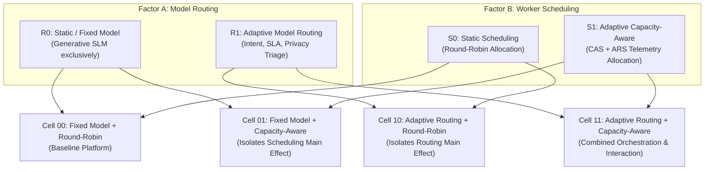

# SETU-NETRA Version 1.1 — Empirical Experimental Design and Benchmark Protocol

**Author:** Independent AI Systems Researcher & Statistical Reviewer  
**Project:** SETU-NETRA (Intelligent Document Understanding, Evidence-Grounded Question Answering, and Adaptive AI Model Orchestration)  
**Status:** Version 1.1 Empirical Research Protocol (Revision 2 — Methodological & Statistical Review)  
**Date:** November 2026  
**Scope:** Rigorous, reproducible experimental designs for the Primary Factorial Investigation and 8 core research investigations (Experiments A through H). Zero synthetic or fabricated results.

---

## Executive Summary

To establish SETU-NETRA as a defensible, publishable CSE research platform, Version 1.1 transitions from baseline demonstration tests to formal, statistically powered empirical evaluations. 

This protocol establishes:
1. **The Primary Controlled Factorial Experiment:** Directly testing the primary research question by isolating the main effect of model routing, the main effect of worker scheduling, and their interaction effect on consumer hardware.
2. **Eight Targeted Research Experiments (Experiments A through H):** Spanning routing policies, scheduler queueing dynamics, hybrid retrieval ablation, cross-encoder reranking, extractive vs. generative paradigms, multi-document distractor scaling, contradictory evidence arbitration, and hardware stress boundaries.
3. **Statistical Rigor Standards:** Power analysis justifying sample sizes ($N \ge 128$ for $d = 0.25, \alpha = 0.05, 1-\beta = 0.80$), log-normal latency modeling to account for heavy right-skewed tail distributions, bootstrapped 95% Confidence Intervals for percentiles, and passage-level relevance definitions.

---

## Benchmark Metrics and Mathematical Reference

Before defining experimental protocols, the platform's evaluation metrics are formalized:

### 1. Information Retrieval Metrics (Passage Block Level)
Relevance is evaluated strictly at the **passage block level**, requiring exact `block_id` match or spatial Intersection-over-Union $\text{IoU} \ge 0.50$ against the ground-truth text block.
- **Precision at K ($P@K$):**
  $$P@K = \frac{1}{|Q|} \sum_{q \in Q} \frac{|\text{Retrieved}_K(q) \cap \text{RelevantPassages}(q)|}{K}$$
- **Recall at K ($R@K$):**
  $$R@K = \frac{1}{|Q|} \sum_{q \in Q} \frac{|\text{Retrieved}_K(q) \cap \text{RelevantPassages}(q)|}{|\text{RelevantPassages}(q)|}$$
- **Mean Reciprocal Rank ($MRR$):**
  $$MRR = \frac{1}{|Q|} \sum_{q \in Q} \frac{1}{\text{rank}_1(q)}$$
  where $\text{rank}_1(q)$ is the 1-based rank position of the first relevant passage block.
- **Normalized Discounted Cumulative Gain at K ($nDCG@K$):**
  $$DCG@K = \sum_{i=1}^K \frac{2^{\text{rel}_i} - 1}{\log_2(i + 1)}, \quad nDCG@K = \frac{DCG@K}{IDCG@K}$$

### 2. Question Answering & Factuality Metrics
- **Exact Match ($EM$):** Binary indicator whether the extracted text span matches the ground-truth span after lowercasing and punctuation normalization: $EM \in \{0, 1\}$.
- **Token-Level F1 Score ($F_1$):**
  $$P_{\text{token}} = \frac{|T_{\text{pred}} \cap T_{\text{gold}}|}{|T_{\text{pred}}|}, \quad R_{\text{token}} = \frac{|T_{\text{pred}} \cap T_{\text{gold}}|}{|T_{\text{gold}}|}, \quad F_1 = \frac{2 \cdot P_{\text{token}} \cdot R_{\text{token}}}{P_{\text{token}} + R_{\text{token}}}$$
- **Citation Precision ($C_{\text{prec}}$):**
  $$C_{\text{prec}} = \frac{|\text{Valid Cited Passages supporting Assertion}|}{|\text{Total Citations Generated}|}$$
- **Citation Recall ($C_{\text{rec}}$):**
  $$C_{\text{rec}} = \frac{|\text{Supported Assertions with Valid Citation}|}{|\text{Total True Assertions}|}$$
- **Abstention Accuracy ($A_{\text{abs}}$):**
  Accuracy on unanswerable queries: correctly assigning `epistemic_status = "UNSUPPORTED"` when question has no ground-truth support in the corpus.

### 3. Traffic Management & Latency Metrics
Because latency distributions in AI inference are heavily right-skewed, parametric tests assume log-normal distributions ($\log(\text{latency})$), while non-parametric tests evaluate rank sums.
- **Latency Percentiles ($P_{50}, P_{95}, P_{99}$):** Bootstrapped 95% Confidence Intervals are calculated using 1,000 resamples.
- **SLO Violation Rate ($R_{\text{viol}}$):**
  $$R_{\text{viol}} = \frac{1}{|R|} \sum_{r \in R} \mathbb{I}\left(\text{Latency}(r) > \text{TargetSLO}(r)\right)$$
- **Goodput / Effective Throughput ($X_{\text{eff}}$):**
  $$X_{\text{eff}} = \frac{\text{Total Completed Requests meeting SLO}}{\text{Total Test Duration (seconds)}}$$
- **Failure / Rejection Rate ($R_{\text{fail}}$):**
  $$R_{\text{fail}} = \frac{|\text{Requests Dropped, Saturated, or Timed Out}|}{|R_{\text{total}}|}$$

---

## Statistical Power and Sample Size Determination

To ensure all statistical tests achieve minimum power $1 - \beta = 0.80$ at significance level $\alpha = 0.05$:

1. **Paired Retrieval & QA Tests (Student's paired t-test on log-metrics / Wilcoxon signed-rank):**
   - For a medium effect size Cohen's $d = 0.35$: required sample size $N \ge 67$ queries.
   - For a small-to-medium effect size $d = 0.25$: required sample size $N \ge 128$ queries.
   - *Design Standard:* All retrieval and QA benchmarks specify $N = 150$ to $N = 300$ queries.
2. **Two-Way Factorial ANOVA (Routing $\times$ Scheduling):**
   - For numerator $\text{df} = 1$, 4 groups, power $0.80$, $\alpha = 0.05$, and effect size $f = 0.25$: required sample size per cell $n \ge 33$.
   - *Design Standard:* All factorial evaluations specify $n \ge 50$ requests per cell across 5 repeated trials ($5 \times 50 = 250$ samples per cell).

---

## Primary Research Investigation: Controlled Factorial Experiment

### Primary Research Question
> *"Can decoupled adaptive model routing and capacity-aware worker scheduling improve evidence-grounded document question answering under consumer-hardware constraints?"*

### Experimental Design: $2 \times 2$ Full-Factorial Architecture

### Hypotheses
- **Null Hypothesis ($H_{0,\text{routing}}$):** Model routing has no main effect on answer correctness ($F_1$), citation precision, or mean latency compared to fixed generative serving.
- **Null Hypothesis ($H_{0,\text{scheduling}}$):** Worker scheduling has no main effect on $P_{99}$ latency, goodput, or rejection rate ($R_{\text{fail}}$) compared to Round-Robin.
- **Null Hypothesis ($H_{0,\text{interaction}}$):** There is no significant interaction effect between model routing and worker scheduling ($(\text{Routing} \times \text{Scheduling}) = 0$).
- **Alternative Hypotheses ($H_1$):**
  - $H_{1,\text{routing}}$: Adaptive routing significantly reduces mean latency on factual queries while maintaining token $F_1 \ge 0.75$.
  - $H_{1,\text{scheduling}}$: Capacity-aware scheduling significantly reduces $P_{99}$ tail latency under load.
  - $H_{1,\text{interaction}}$: Significant interaction exists: routing fast extractive queries away from saturated SLM queues enhances scheduling effectiveness.

### Controlled Workload & Traces
- **Document Corpus:** 10 multi-format technical documents (Operating Systems, Raft Consensus, Distributed Databases, Network Protocols), yielding $N = 1,500$ indexed blocks.
- **Query Stream:** $N = 200$ curated queries (100 Factual/Definition, 60 Synthesis/Comparative, 40 Adversarial/Unanswerable).
- **Traffic Trace:** Replayed under a calibrated Poisson arrival process ($\lambda = 15\,\text{req/s}$) across 4 concurrent client threads.
- **Hardware Isolation:** Developer workstation (16 GB RAM, 8 CPU cores). Background processes killed; thread count clamped via `torch.set_num_threads(2)`.

### Evaluated Metrics
1. **Quality & Epistemic Trust:** Token $F_1$, Exact Match ($EM$), Citation Precision ($C_{\text{prec}}$), Abstention Accuracy ($A_{\text{abs}}$).
2. **Latency & Throughput:** Log-latency mean, $P_{50}, P_{95}, P_{99}$ latency (ms), Goodput ($X_{\text{eff}}$ req/s), SLO Violation Rate ($R_{\text{viol}}$ for $\text{SLO}=1,500\,\text{ms}$).
3. **Hardware & Stability:** Process Peak RSS (MB), System Available RAM (MB), Mean CPU%, Rejection Rate ($R_{\text{fail}}$).

### Statistical Analysis
- **Two-Way Factorial ANOVA:** Evaluated on $\log(\text{latency})$ and Token $F_1$ to estimate:
  $$\text{Metric}_{ijk} = \mu + \alpha_i (\text{Routing}) + \beta_j (\text{Scheduling}) + (\alpha\beta)_{ij} + \epsilon_{ijk}$$
- **Post-Hoc Pairwise Comparisons:** Tukey HSD test on cell means ($\alpha = 0.05$).
- **Non-Parametric Validation:** Scheirer-Ray-Hare test (non-parametric extension of two-way ANOVA) on tail latency ($P_{99}$) to verify robustness against distributional departures.
- **Capability to Reject Superiority:** If routing classification overhead exceeds execution savings under light load, or if capacity-aware scheduling introduces telemetry contention, the model will rigorously show that adaptive orchestration does **not** improve performance.

---

## Experiment A: Fixed Model vs. Adaptive Model Routing

### 1. Research Objective
Isolate the specific performance trade-offs of Tier-1 `AdaptiveModelRouter` against static model baselines under varying task complexities.

### 2. Hypotheses
- **$H_0$:** Adaptive model routing yields no statistically significant difference in mean log-latency or token $F_1$ compared to a fixed generative SLM or fixed extractive engine.
- **$H_1$:** Adaptive model routing achieves significantly lower mean log-latency than a fixed SLM ($p < 0.001$) while achieving significantly higher synthesis $F_1$ than pure extractive QA on comparative queries ($p < 0.01$).

### 3. Variables
- **Independent Variable (IV):** Routing Policy (4 levels):
  1. Fixed Extractive (`grounded-extractive-qa-v1`)
  2. Fixed Generative SLM (`smollm2-135m-instruct`)
  3. Static Random Router (uniform random assignment)
  4. Adaptive Intent & SLA Router (`AdaptiveModelRouter`)
- **Dependent Variables (DV):** Latency (ms, log-transformed), Token $F_1$, Citation Precision ($C_{\text{prec}}$), SLO Violation Rate ($R_{\text{viol}}$).
- **Control Variables (CV):** Uniform hardware baseline (16 GB RAM, 4 CPU worker threads), identical query stream, cold cache cleared before each trial.

### 4. Dataset Requirements
- $N = 300$ queries from SQuAD 2.0 / QASPER subsets: 150 Factual, 100 Synthesis, 50 Unanswerable.

### 5. Statistical Analysis
- Repeated-measures ANOVA across the 4 policies, followed by post-hoc Tukey HSD pairwise tests ($\alpha = 0.05$).
- Paired Wilcoxon signed-rank test between Adaptive Router and Fixed Generative SLM latency distributions.

---

## Experiment B: Round Robin vs. Adaptive Worker Scheduling

### 1. Research Objective
Quantify throughput, queue balance, and tail-latency characteristics across the 6 worker scheduling algorithms under asymmetric worker execution times and fault conditions.

### 2. Hypotheses
- **$H_0$:** There is no significant difference in $P_{99}$ latency or request drop rate between Round Robin, Random, Least Outstanding Requests (LOR), Shortest Estimated Completion Time (SECT), and Capacity-Aware Scheduling (CAS).
- **$H_1$:** Under asymmetric background CPU/RAM contention, CAS and ARS achieve lower $P_{99}$ tail latency and significantly lower failure rates ($R_{\text{fail}}$) than Round Robin ($p < 0.01$).

### 3. Separation of Workloads: Synthetic vs Real
- **Synthetic Queueing Workload (Phase B1):** Evaluates scheduling dynamics using calibrated synthetic processing delays ($\mu = 50\,\text{ms}, \sigma = 10\,\text{ms}$ for extractive; $\mu = 1800\,\text{ms}, \sigma = 300\,\text{ms}$ for generative) across 1,000 Poisson arrivals.
- **Real Document QA Workload (Phase B2):** Evaluates real end-to-end multi-threaded execution of MiniLM and SmolLM2 on actual PDF documents.

### 4. Variables
- **Independent Variable (IV):** Scheduling Algorithm (6 levels: Round Robin, Random, LOR, SECT, CAS, ARS).
- **Secondary IV:** Concurrency Stress Level (Low: $\lambda = 10\,\text{req/s}$; Saturated: $\lambda = 60\,\text{req/s}$).
- **Dependent Variables (DV):** Goodput (req/s), Latency percentiles ($P_{50}, P_{95}, P_{99}$ with 95% bootstrapped CIs), Failure Rate ($R_{\text{fail}}$), Queue Imbalance ($\sigma_{\text{queue}}$).

### 5. Statistical Analysis
- Kruskal-Wallis test across the 6 schedulers on $P_{99}$ latency and failure rates under saturated load, followed by Dunn's post-hoc test with Bonferroni correction.

---

## Experiment C: Dense Retrieval vs. Hybrid Retrieval

### 1. Research Objective
Empirically evaluate the retrieval effectiveness of dense semantic search, lexical term overlap, and defensive hybrid retrieval with ReLU score rectification.

### 2. Hypotheses
- **$H_0$:** Hybrid retrieval with ReLU rectification yields no significant difference in passage-level $Recall@3$ or $nDCG@3$ compared to pure dense search ($\alpha = 1.0$) or pure lexical search ($\alpha = 0.0$).
- **$H_1$:** Hybrid retrieval with $\alpha \in [0.6, 0.8]$ achieves significantly higher passage-level $Recall@3$ and $nDCG@3$ ($p < 0.01$) on technical documents containing alphanumeric identifiers and acronyms.

### 3. Variables
- **Independent Variable (IV):** Retrieval Configuration (5 levels):
  1. Pure Dense Semantic Search ($\alpha = 1.0$)
  2. Pure Lexical Overlap Search ($\alpha = 0.0$)
  3. Unrectified Hybrid Search ($\alpha = 0.70$, raw cosine in $[-1.0, 1.0]$)
  4. Rectified Hybrid Search ($\alpha = 0.70$, ReLU clipping)
  5. Rectified Hybrid with Duplicate Suppression ($\alpha = 0.70$, threshold $= 0.85$)
- **Dependent Variables (DV):** Passage-level $P@1, P@3, R@1, R@3, MRR, nDCG@3$, Retrieval Latency (ms).
- **Ground-Truth Granularity:** Passage block level (exact `block_id` or spatial $\text{IoU} \ge 0.50$).

### 4. Statistical Analysis
- Paired Student's t-test on $nDCG@3$ between Rectified Hybrid and Pure Dense ($N = 200$ queries).
- McNemar's test on top-1 hit success ($P@1 > 0$) between Unrectified Hybrid and Rectified Hybrid.

---

## Experiment D: Retrieval With and Without Reranking

### 1. Research Objective
Quantify the retrieval precision gains and latency overhead of introducing a second-stage local cross-encoder reranker over first-stage bi-encoder hybrid retrieval.

### 2. Hypotheses
- **$H_0$:** Adding a cross-encoder reranker over top-10 candidates yields no statistically significant improvement in passage $P@1$ or $MRR$, while significantly increasing CPU latency.
- **$H_1$:** Cross-encoder reranking (`ms-marco-MiniLM-L-6-v2`) increases passage $P@1$ significantly ($p < 0.001$) with a bounded CPU latency penalty $\le 45\,\text{ms}$.

### 3. Variables
- **Independent Variable (IV):** Reranking Strategy (3 levels: Baseline First-Stage Only, First-Stage Top-10 + Heuristic, First-Stage Top-10 + Cross-Encoder).
- **Dependent Variables (DV):** Passage $P@1, P@3, MRR, nDCG@3$, Reranker Latency Overhead (ms), Process CPU%.

### 4. Statistical Analysis
- Paired Wilcoxon signed-rank test on Reciprocal Rank per query ($N = 250$ queries).
- 95% Bootstrap Confidence Intervals for latency overhead $\Delta t$.

---

## Experiment E: Extractive QA vs. Generative QA

### 1. Research Objective
Directly benchmark the trade-offs between bounded extractive span selection and neural generative SLM synthesis on accuracy, citation correctness, and inference efficiency.

### 2. Hypotheses
- **$H_0$:** There is no difference in token $F_1$, citation precision, or latency between Extractive QA and Generative SLM QA on factual document queries.
- **$H_1$:** Extractive QA achieves significantly higher citation precision ($C_{\text{prec}}$) and lower latency ($p < 0.001$), while Generative SLM achieves higher token $F_1$ on multi-passage comparative queries ($p < 0.01$).

### 3. Variables
- **Independent Variable (IV):** Execution Engine (`GroundedExtractiveQAAdapter` vs `GenerativeSLMAdapter`).
- **Secondary IV:** Query Complexity (Factoid / Direct Span vs Multi-Passage Synthesis).
- **Dependent Variables (DV):** Latency (ms), Token $F_1$, Exact Match ($EM$), Citation Precision ($C_{\text{prec}}$), Citation Recall ($C_{\text{rec}}$).

### 4. Statistical Analysis
- Two-way ANOVA (Engine $\times$ Query Complexity) on Token $F_1$.
- Fisher's Exact Test on Citation Validity rates.

---

## Experiment F: Single-Document vs. Multi-Document Evidence

### 1. Research Objective
Analyze the degradation in retrieval precision and question-answering accuracy when the candidate corpus expands from a single isolated document to a multi-document repository containing cross-document distractors.

### 2. Hypotheses
- **$H_0$:** Scaling from 1 document to 20 documents introduces no degradation in passage $P@1$ or citation precision.
- **$H_1$:** Unindexed multi-document retrieval exhibits an increase in distractor block retrieval ($P@1$ drops significantly, $p < 0.01$), which is mitigated by document-scoped filtering.

### 3. Variables
- **Independent Variable (IV):** Corpus Scale & Filtering (1 doc isolated, 5 docs global, 20 docs global, 20 docs scoped).
- **Dependent Variables (DV):** Passage $P@1, R@3$, Distractor Retrieval Ratio ($R_{\text{distract}}$), QA $F_1$, Retrieval Time (ms).

### 4. Statistical Analysis
- One-way ANOVA across the 4 conditions on Distractor Ratio and $P@1$.
- Linear regression of retrieval time versus block count ($N$).

---

## Experiment G: Consistent vs. Contradictory Evidence

### 1. Research Objective
Evaluate how the retrieval and QA engines behave when the multi-document corpus contains mutually contradictory facts (e.g. outdated vs updated policy specifications).

### 2. Hypotheses
- **$H_0$:** The system detects conflicting evidence across documents and abstains or alerts the user.
- **$H_1$:** The current system exhibits arbitrary winner-take-all behavior: whichever contradictory document yields a higher cosine similarity is returned as absolute truth, achieving $0\%$ contradiction awareness and misclassifying conflicting answers as `EVIDENCE_BACKED`.

### 3. Dataset & Ground-Truth Requirements (Balanced Design)
- **Balanced Benchmark Set:** $N = 100$ query-corpus instances:
  - 50 Consistent Instances: Documents A and B agree on shared factual entities.
  - 50 Contradictory Instances: Document A asserts Fact $X_1$; Document B asserts conflicting Fact $X_2$ (e.g. payload limits, timeout values).

### 4. Variables
- **Independent Variable (IV):** Corpus Condition (Consistent vs Contradictory).
- **Dependent Variables (DV):** Contradiction Detection Precision, Recall, and $F_1$; Attribution Distribution (Doc A vs Doc B win rate); Epistemic Classification (`EVIDENCE_BACKED` rate).

### 5. Statistical Analysis
- **Correction of Degenerate Binomial Test:** Instead of testing against an impossible $p=0$, evaluate Contradiction Detection $F_1$ against a random classifier ($F_1 = 0.50$).
- McNemar's test for paired classification of detected conflict versus ground truth.

---

## Experiment H: Resource-Constrained Execution (CPU and RAM Stress)

### 1. Research Objective
Establish the stability, throughput degradation, latency inflation, and memory thrashing boundaries of the platform under severe hardware resource exhaustion on a 16 GB RAM baseline.

### 2. Hypotheses
- **$H_0$:** Host hardware pressure (CPU utilization $\ge 90\%$, available RAM $\le 800\,\text{MB}$) causes no difference in scheduler queue drop rates or memory thrashing across schedulers.
- **$H_1$:** `CapacityAwareScheduler` gracefully throttles traffic and sheds load without application crash ($R_{\text{crash}} = 0\%$), whereas unconstrained Round Robin triggers worker timeouts and elevated tail latencies.

### 3. Variables
- **Independent Variable (IV):** Resource Contention State (Baseline Idle, CPU Contention at 90%, Memory Pressure with available RAM $< 800\,\text{MB}$).
- **Secondary IV:** Active Scheduler (`RoundRobin` vs `CapacityAwareScheduler`).
- **Dependent Variables (DV):** Application Crash Count, Peak Process RSS (MB), Mean Latency (ms), $P_{99}$ Latency (ms), Successful Completion Ratio.

### 4. Statistical Analysis
- Mann-Whitney U test on latency inflation ratios ($\text{Latency}_{\text{stress}} / \text{Latency}_{\text{idle}}$) between Round Robin and CAS.

---

## Summary Protocol Matrix

| Experiment | Focus Area | Primary IV | Primary DV | Target Dataset | Min. Trials ($N$) | Primary Statistical Test |
| :--- | :--- | :--- | :--- | :--- | :--- | :--- |
| **Factorial** | Orchestration | Routing $\times$ Scheduling | Latency, $F_1$, Goodput | 200 Tech Qs (Poisson) | $250$ req/cell | Two-Way Factorial ANOVA |
| **Exp A** | Model Routing | Routing Policy (4 levels) | Mean Log-Latency, $F_1$ | 300 Qs (SQuAD/QASPER) | $6,000$ reqs | Repeated ANOVA + Tukey |
| **Exp B** | Traffic Scheduling | Scheduler (6 algorithms) | $P_{99}$ Latency, Goodput | Poisson Synthetic Stream | $1,500$ reqs/cond | Kruskal-Wallis + Dunn's |
| **Exp C** | Hybrid Retrieval | Dense vs Lexical ($\alpha$) | Passage $R@3, nDCG@3$ | 200 Tech Q/A Pairs | $5$ runs $\times 200$ | Paired Student's t-test |
| **Exp D** | Reranking | First-stage vs Cross-Encoder | Passage $P@1, MRR$, Latency | 250 Tech Passages | $250$ queries | Wilcoxon signed-rank |
| **Exp E** | QA Paradigms | Extractive vs Generative | Latency ms, $C_{\text{prec}}, F_1$ | 200 Qs (Fact vs Synth) | $400$ runs | Two-way ANOVA |
| **Exp F** | Multi-Doc Scaling | Corpus Size (1 to 20 docs) | Passage $P@1$, Distractor % | 15 Indexed Tech Manuals | $500$ queries | One-way ANOVA + Regr |
| **Exp G** | Contradiction | Consistent vs Conflicting | Detection $F_1$, Attribution | 100 Balanced Pairs | $100$ instances | McNemar's Test |
| **Exp H** | Hardware Stress | CPU / RAM Stress Levels | P99 Latency, Drop Rate | 50 Mixed Ingestion/QA | $150$ runs | Mann-Whitney U Test |

---

## Reproducibility Standards

1. **Deterministic Random Seeds:** All stochastic components must initialize with `seed = 42`.
2. **Cold vs Warm Cache Isolation:** Benchmark execution scripts must run 3 unmeasured "warm-up" queries prior to logging metrics to eliminate PyTorch model loading and JIT compilation artifacts. Disk caches must be explicitly flushed between runs.
3. **No Synthetic Result Fabrication:** All reported tables, histograms, and box plots must be generated directly from persisted JSON telemetry files produced by real test runs in `output/`, using verified execution timestamps and host hardware signatures.
4. **Environment Specification:** All benchmark runs must log machine specifications: CPU model, physical core count, total RAM, OS build, Python version, PyTorch version, and BLAS/MKL thread settings (`torch.set_num_threads()`).
