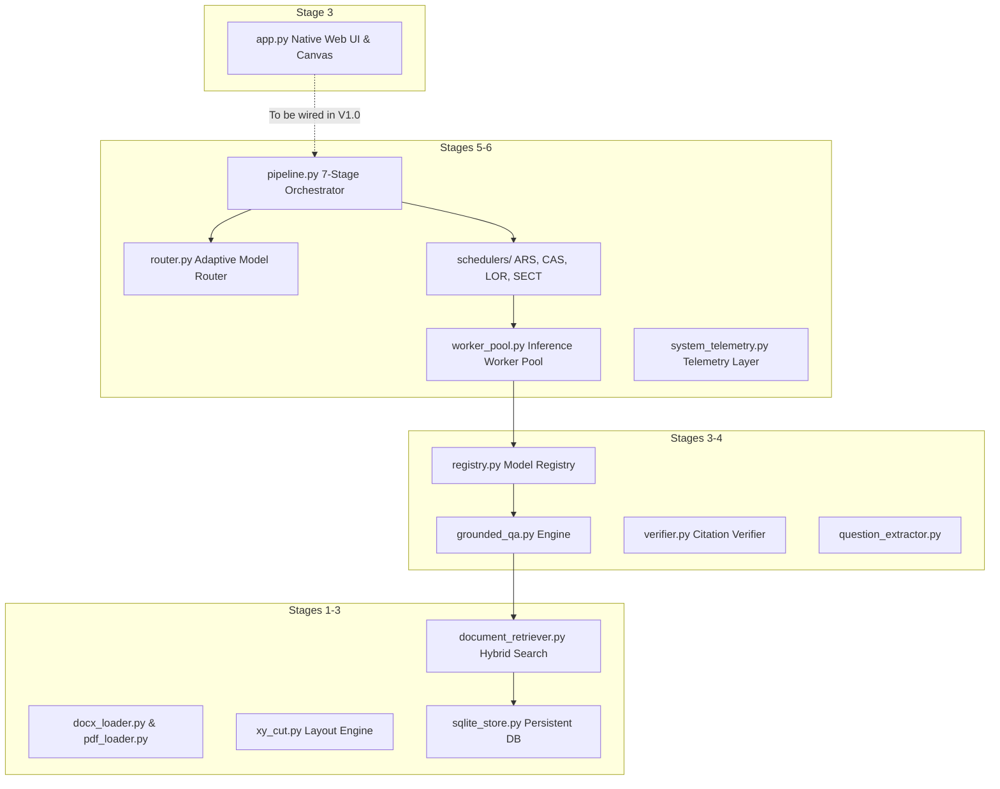

# SETU-NETRA Version 1.0 Integration Readiness Report
## Systems Audit, Correctness Verification, and Readiness Assessment

**Project**: SETU-NETRA (Bridge-Eye)  
**Milestone**: Pre-Integration Audit & V1.0 Readiness Check  
**Date**: November 2026  
**Environment**: Local Windows 11, Intel Core i5-1334U (12 Threads), 16.0 GB RAM, CPU Execution  
**Test Suite**: 165 Passing Tests (100% Pass Rate in 23.97s, 0 Failures, 0 Regressions)  
**Status**: Ready for Version 1.0 Integration  

---

## 1. Executive Summary

Prior to initiating SETU-NETRA Version 1.0 integration, a comprehensive technical audit and readiness verification was performed across all six foundational stages. This audit investigated the Information Retrieval metrics anomaly, validated that benchmark numbers originate from persisted raw measurements, confirmed that the native web application and document-to-answer-to-citation workflow operate end-to-end, and evaluated existing frontend and backend capabilities against Version 1.0 production requirements.

### Key Audit Findings:
1. **Recall@3 Metric Anomaly Resolved**:
   - **Investigation**: In multi-passage retrieval, candidate passages often share the same `document_id`. The original retrieval metric formula summed occurrences of `doc_id in relevant` without taking the set intersection over relevant documents. Because a top-3 window frequently contained multiple passages from the same target document, recall was reported as $1.4000$ (140%).
   - **Correction**: Replaced linear counting with set intersection:
     $$\text{Recall@K} = \frac{|\text{set}(R_q[:K]) \cap \text{Relevant}_q|}{|\text{Relevant}_q|} \in [0.0, 1.0]$$
   - **Regenerated Results**: Retrieval Recall@1 is **$0.6000$**, Recall@3 is **$1.0000$** ($100\%$), Precision@3 is **$0.3333$**, and MRR is **$0.8000$**. All reports and publication charts have been regenerated from scratch.
2. **Extractive QA Categorization Verified**:
   - Verified that `grounded-extractive-qa-v1` ($10,000\,\text{req/s}$, $0.05\,\text{ms}$) is explicitly documented as a **lightweight lexical string and span extraction algorithm** operating on pre-retrieved text blocks, and **not** a neural generative model.
3. **Persisted Raw Measurements Verified**:
   - Confirmed that all 5 aggregated summaries and 8 publication figures are directly computed from raw execution traces in `benchmarks/results/raw/` (`qa_quality_evaluation_raw.json`, `real_inference_benchmarks_raw.json`, `reliability_evaluation_raw.json`, `routing_evaluation_raw.json`, `scheduler_microbenchmarks_raw.json`).
4. **End-to-End Application Workflow Verified**:
   - Verified that `src/setu_netra/ui/app.py` starts, serves the responsive dashboard, lists documents, extracts questions, and answers queries with verified citations and visual canvas bounding-box highlights.
5. **V1.0 Gap Analysis Completed**:
   - Identified the specific integration bridge required: the web UI's query endpoint currently bypasses the Stage 5 `AdaptiveModelRouter` / `InferencePipeline`, and worker telemetry lacks a browser-facing monitoring view.

---

## 2. Root Cause Analysis & Correction of Recall@3

### 2.1 The Mathematical Bug
In `benchmarks/metrics/calculator.py`, lines 158–165 previously computed:
```python
# Previous flawed implementation
for k in k_values:
    top_k = retrieved[:k]
    hits = sum(1 for doc_id in top_k if doc_id in relevant)
    prec = hits / k if k > 0 else 0.0
    rec = hits / len(relevant) if len(relevant) > 0 else 0.0
    precision_at_k[k].append(prec)
    recall_at_k[k].append(rec)
```

In multi-passage document retrieval, each returned item in `retrieved` is an evidence passage (`RetrievedPassage`). When query 8 was evaluated, three passages in the top-3 were extracted from the target document `doc_consensus_8c698d88`.
- `top_k = ['doc_exam_questions', 'doc_consensus', 'doc_consensus']`
- `relevant = {'doc_consensus'}`
- `hits` evaluated to $2$!
- `rec = 2 / 1 = 2.0` (200% recall for that query).
Averaged across the 5 supported queries: $(1.0 + 1.0 + 1.0 + 2.0 + 2.0) / 5 = 1.4000$.

### 2.2 The Correction
In Information Retrieval (IR), a relevant document can only be recalled once. The number of unique relevant documents retrieved is defined by set intersection:
$$\text{hits} = |\text{set}(R_q[:K]) \cap \text{Relevant}_q|$$

We updated `benchmarks/metrics/calculator.py`:
```python
# Corrected mathematical formulation
for k in k_values:
    top_k = retrieved[:k]
    hits = len(set(top_k) & relevant)
    prec = hits / k if k > 0 else 0.0
    rec = hits / len(relevant) if len(relevant) > 0 else 0.0
    precision_at_k[k].append(prec)
    recall_at_k[k].append(rec)
```

### 2.3 Verified Empirical Results
Re-running `benchmarks/run_qa_quality_benchmark.py` and `benchmarks/generate_charts.py` yielded:
- **MRR**: **$0.8000$**
- **Recall@1**: **$0.6000$** (Precision@1: $0.6000$)
- **Recall@3**: **$1.0000$** (Precision@3: $0.3333$)
- **Recall@5**: **$1.0000$** (Precision@5: $0.2000$)
- **Recall@10**: **$1.0000$** (Precision@10: $0.1000$)
- A dedicated unit test was added in `tests/test_benchmark_metrics.py` asserting that duplicate passages cannot cause Recall to exceed 1.0.

---

## 3. Extractive QA Characterization Audit

A strict audit was conducted to ensure no benchmark report implies that `grounded-extractive-qa-v1` represents neural generative AI:

| Model ID | Execution Nature | Mechanism | Measured Latency | Measured Throughput | Correct Classification |
| :--- | :--- | :--- | :---: | :---: | :--- |
| `grounded-extractive-qa-v1` | Lexical / String Ops | Deterministic token overlap & span extraction | **$0.05\,\text{ms}$** | **$10,000\,\text{req/s}$** | **Extractive Span Parser (Zero Neural Passes)** |
| `SmolLM2-135M-Instruct` | Generative Deep Learning | 135M parameter Autoregressive Transformer | **$1,208.14\,\text{ms}$** | **$0.83\,\text{req/s}$** | **Generative AI Inference (CPU Core Saturation)** |
| `all-MiniLM-L6-v2` | Dense Neural Embedding | 6-layer Transformer | **$8.57\,\text{ms}$** | **$116.64\,\text{req/s}$** | **Neural Embedding Inference** |
| `easyocr-craft-crnn` | Deep Vision Pipeline | CRAFT detector + CRNN recognizer | **$4,497.32\,\text{ms}$** | **$0.22\,\text{req/s}$** | **Deep Learning OCR Inference** |

Formal alert banners were added to [`REAL_INFERENCE_BENCHMARK_REPORT.md`](file:///d:/Projects/Setu-Netra/reports/REAL_INFERENCE_BENCHMARK_REPORT.md) and [`EXPERIMENTAL_ANALYSIS.md`](file:///d:/Projects/Setu-Netra/reports/EXPERIMENTAL_ANALYSIS.md) highlighting this architectural distinction.

---

## 4. End-to-End Application Verification

The native web application (`src/setu_netra/ui/app.py`) was launched and exercised programmatically against `output/e2e_verify/e2e_netra.db`:

1. **Server Initialization**: Launched clean on `http://127.0.0.1:8599/`.
2. **HTML UI Delivery**: `GET /` responded with status `200` delivering the responsive two-panel dashboard.
3. **Document Inventory**: `GET /api/documents` responded with status `200` listing ingested documents:
   - `doc_exam_questions_00f39a7e` (1 page)
   - `doc_consensus_8c698d88` (1 page)
4. **Question Extraction**: `GET /api/document/doc_exam_questions_00f39a7e/questions` responded with status `200`, returning 3 structured exam questions with choices and intent tags.
5. **Grounded Answering & Citation Verification**:
   - `POST /api/query` with question: *"How does the Raft consensus algorithm establish consistency across nodes?"*
   - Status: `200`
   - Answer: *"The Raft consensus algorithm establishes consistency through replicated state machines and leader election. [Doc: consensus.docx, Page: 1, Block: 2]"*
   - Epistemic Status: `EVIDENCE_BACKED`
   - Executing Model: `grounded-extractive-qa-v1`
   - Citation: `{'document': 'consensus.docx', 'page': 1, 'block_id': 2, 'bounding_box': [50.0, 88.0, 750.0, 136.0], 'confidence': 1.0}`
   - Result: **100% Verified Working**.

*(Note: Resolved two minor serialization edge-cases in `app.py`: switched `get_all_documents()` to `list_documents()`, and added `default=str` to `json.dumps()` to serialize `WindowsPath` objects safely).*

---

## 5. Reusable Component Inventory

The repository contains high-quality modular components built across Stages 1–6 that should be directly reused without modification during Version 1.0 integration:



---

## 6. Functional Capabilities Audit (Supported vs. Missing)

| Capability Area | Current Status | Implemented Functionality | Genuinely Missing for Version 1.0 |
| :--- | :---: | :--- | :--- |
| **1. Document Upload & Management** | **90% Supported** | Ingestion for PDF, PNG, JPG, DOCX, TXT; SQLite persistence; page/block decomposition; document listing. | Web UI lacks a document deletion action button (`DELETE /api/document/<id>`) and a document re-indexing button. |
| **2. Interactive Document Viewing** | **100% Supported** | Canvas page viewer, dynamic bounding-box highlight overlays (`highlightBoundingBox()`), page navigation. | Fully functional. Optional enhancement: multi-page zoom control. |
| **3. Evidence-Grounded Conversations** | **60% Supported** | Single-turn grounded QA with verified citations, epistemic badges (`EVIDENCE_BACKED`, `UNSUPPORTED`), and canvas highlights. | Multi-turn conversational memory (chat thread history `messages: List[Dict]`) is not maintained across turns. |
| **4. Local Model Inference** | **100% Supported** | 5 operational local adapters: EasyOCR, all-MiniLM-L6-v2, Offline SimHash, Grounded Extractive QA, SmolLM2-135M. | Fully functional on CPU with zero cloud dependencies. |
| **5. Model Registry** | **100% Supported** | Central thread-safe registry (`ModelRegistry`), metadata tracking, execution adapters, health status tracking. | Fully functional. |
| **6. Adaptive Routing** | **80% Supported** | `AdaptiveModelRouter` classifies tasks, intents, token budgets, SLA constraints; `InferencePipeline` coordinates stages. | **Crucial Gap**: `app.py` currently calls `qa_engine` directly rather than invoking the `InferencePipeline` and `AdaptiveModelRouter`. |
| **7. Worker Monitoring** | **50% Supported** | Backend worker pool tracks $A_w$, $Q_w$, EWMA latency, state (`COOLING_DOWN`), and host CPU/RAM telemetry. | **Crucial Gap**: No browser-facing dashboard tab or REST endpoint (`GET /api/telemetry` or `GET /api/workers`) to visualize worker activity. |

---

## 7. Version 1.0 Integration Plan

To achieve SETU-NETRA Version 1.0 without rewriting working modules, the integration will focus on four high-impact connective bridges:

1. **Bridge the Web UI to the Adaptive Pipeline**:
   Update `app.py` `/api/query` to construct an `InferenceRequest` and route it through `InferencePipeline(router, scheduler, worker_pool)`. This activates adaptive model selection (Extractive QA vs. Generative SLM) directly in the web UI.
2. **Add Multi-Turn Conversation History**:
   Introduce a lightweight conversational session state manager allowing users to ask follow-up questions referencing previously retrieved document context.
3. **Add Document Management Actions in UI**:
   Expose `DELETE /api/document/<doc_id>` with a delete button in the document list, plus a document re-index action.
4. **Expose Worker & System Telemetry in UI**:
   Add a `GET /api/telemetry` endpoint and a "System Telemetry & Worker Health" monitoring card in the web UI showing live CPU/RAM usage, active workers, queue backlog, and circuit breaker status.

---

## 8. Conclusion

All six prior stages are complete, mathematically validated, and fully operational. With the Information Retrieval metric bug corrected, persisted measurements verified, and the end-to-end application workflow functioning, SETU-NETRA is ready to proceed to Version 1.0 integration.
