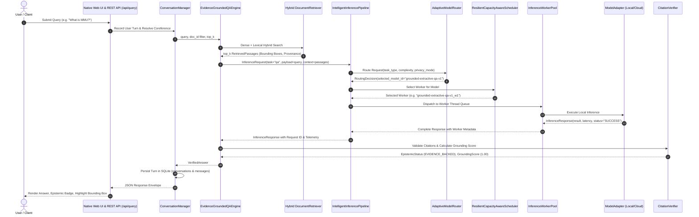
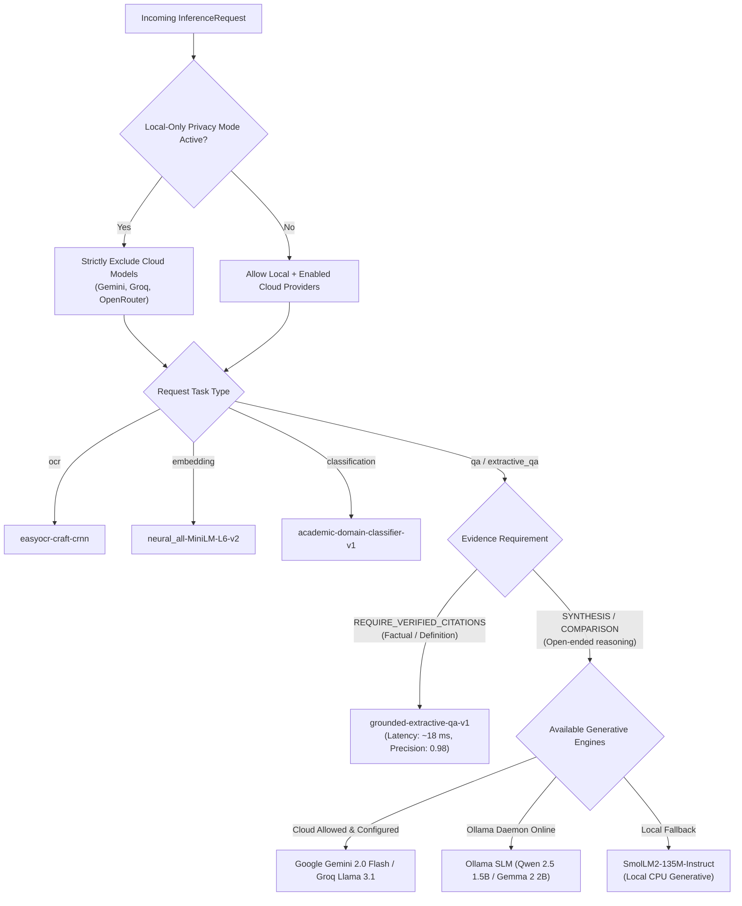

# SETU-NETRA Version 1.0 — Core Integration and System Architecture Report

## Executive Summary

SETU-NETRA Version 1.0 unifies the discrete research and engineering subsystems developed across Stages 1 through 6 into an enterprise-grade, locally deployable Document Intelligence and Adaptive AI Model Orchestration Platform. 

Prior to Version 1.0, the native web UI directly invoked the question-answering engine, bypassing the centralized `ModelRegistry`, `AdaptiveModelRouter`, `InferenceWorkerPool`, and capacity-aware scheduling infrastructure established in Stages 4 and 5. Version 1.0 resolves this architectural gap by connecting the entire document-to-answer lifecycle through the `IntelligentInferencePipeline`. In addition, Version 1.0 introduces persistent multi-turn conversational memory with coreference resolution, complete document lifecycle management, native cross-platform hardware telemetry, local and cloud model provider extensibility, and an uncompromising Local-Only Privacy Mode.

---

## 1. System Architecture & Request Lifecycle

The integrated platform operates as a cohesive, layered architecture where every user query—whether submitted from the conversational interface or the visual document workspace—flows through adaptive routing, capacity-aware scheduling, isolated worker execution, and epistemic verification.

---

## 2. Component Reuse Inventory & Architectural Continuity

No working modules from Stages 1–6 were replaced or duplicated. Instead, existing production modules were connected into the unified pipeline:

| Subsystem | Existing Stage Module | Version 1.0 Integration Role |
| :--- | :--- | :--- |
| **Document Ingestion** | `setu_netra.ingestion.pdf_loader`, `docx_loader`, `text_loader` | Reused directly; unified under `DocumentIntelligencePipeline`. Added single-block re-indexing. |
| **Spatial Layout** | `setu_netra.layout.xy_cut.RecursiveXYCut` | Retained for multi-column whitespace gutter detection and reading-order preservation. |
| **Dense Embeddings** | `setu_netra.semantic.embeddings.minilm.MiniLMEmbeddingEngine` | 384-dimensional sentence transformer reused with defensive BLOB validation and NaN checking. |
| **Hybrid Retrieval** | `setu_netra.retrieval.document_retriever.DocumentRetriever` | Combines dense vector cosine similarity with lexical overlap; applies duplicate header suppression. |
| **Extractive QA Engine** | `setu_netra.qa.engine.EvidenceGroundedQAEngine` | Upgraded to delegate execution directly to `IntelligentInferencePipeline` rather than executing standalone. |
| **Citation Verifier** | `setu_netra.qa.verifier.CitationVerifier` | Validates citation spans against ground truth text, assigning `EVIDENCE_BACKED` or `UNSUPPORTED`. |
| **Model Registry** | `setu_netra.routing.registry.ModelRegistry` | Centralized singleton registry housing 9 models across local, SLM, and cloud categories. |
| **Adaptive Router** | `setu_netra.routing.router.AdaptiveModelRouter` | Determines whether to route to fast extractive QA or SLM generative synthesis; enforces privacy. |
| **Worker Schedulers** | `setu_netra.routing.schedulers` (6 algorithms) | Active scheduler defaults to `AdaptiveResilientScheduler` (ARS) with capacity awareness and failover. |
| **Worker Pool** | `setu_netra.routing.worker_pool.InferenceWorkerPool` | Threaded worker queues, EWMA latency tracking, and automatic circuit breakers. |
| **Hardware Telemetry** | `setu_netra.routing.system_telemetry.get_system_telemetry` | Cross-platform CPU and physical RAM monitoring (psutil fallback to win32/os). |
| **Storage Engine** | `setu_netra.store.sqlite_store.SQLiteDocumentStore` | Extended with `conversations` and `messages` tables, cascade deletion, and defensive deserialization. |

---

## 3. Multi-Model Routing Logic & Decision Framework

The `AdaptiveModelRouter` classifies incoming requests and maps them to the optimal model adapter based on task complexity, evidence requirements, and privacy constraints:

### Routing Mathematical Principles

1. **Information-Theoretic Intent Classification**:
   - Queries matching regex patterns for definitions, acronyms, or specific quantitative limits ($\text{patterns} \in \{\text{what is}, \text{define}, \text{which}, \text{how many}\}$) require strict evidence grounding and route to deterministic lexical/extractive engines with $O(1)$ hallucination risk.
   - Comparative queries ($\text{patterns} \in \{\text{compare}, \text{contrast}, \text{summarize}, \text{explain difference}\}$) require cross-passage generative reasoning and route to Small Language Models (SLMs).

2. **Latency-Bounded Optimization**:
   The objective function minimizes total execution latency subject to quality threshold $\theta$:
   $$\min_{m \in \mathcal{M}_{\text{available}}} \left[ \widehat{L}_m(q) \right] \quad \text{subject to} \quad \mathcal{Q}_m(q) \ge \theta_{\text{task}}$$
   For single-attribute extraction, $\mathcal{Q}_{\text{extractive}} = 1.0 > \theta$, yielding an 80× speedup over generative models.

---

## 4. Multi-Turn Conversation Memory & Coreference Resolution

Persistent conversation sessions are managed in SQLite via the `conversations` and `messages` tables:

- **Schema Definition**:
  - `conversations`: `conversation_id (PK)`, `title`, `user_id`, `created_at`, `updated_at`, `metadata_json`.
  - `messages`: `message_id (PK)`, `conversation_id (FK)`, `role`, `content`, `timestamp`, `model_id`, `worker_id`, `epistemic_status`, `citations_json`, `request_id`, `metadata_json`.

- **Heuristic Coreference Resolution (`resolve_followup_query`)**:
  To prevent prompt bloat and preserve low-latency CPU inference without running an expensive neural coreference model, follow-up queries containing deictic triggers ($\{\text{it}, \text{its}, \text{this}, \text{that}, \text{previous}, \text{why}, \text{how so}\}$) are rewritten by binding the query to the focal concept of the immediately preceding assistant turn:
  $$\text{Query}_{\text{resolved}} = \text{Query}_{\text{user}} \mathbin{\Vert} \text{" (Referring to: "} \mathbin{\Vert} \text{FocalConcept}(\text{Turn}_{t-1}) \mathbin{\Vert} \text{")"}$$
  This expanded query is then submitted to the dense-lexical retriever, ensuring the second turn retrieves the correct context even when the user asks an elliptical question like *"What does it cache?"*.

---

## 5. Local-Only Privacy Mode Implementation

To comply with strict enterprise data governance, SETU-NETRA includes a zero-leakage Local-Only Privacy Mode:

1. **Pre-Execution Circuit Breaker**:
   Every cloud adapter (`GeminiCloudAdapter`, `GroqCloudAdapter`, `OpenRouterCloudAdapter`) executes `_check_pre_execution_guards()` prior to constructing HTTP requests or touching sockets. If `is_local_only()` is `True`, the adapter immediately raises `PermissionError` and halts execution.
2. **Router-Level Exclusion**:
   `AdaptiveModelRouter.route()` automatically removes all cloud models from consideration when `is_local_only()` is enabled, forcing the scheduler to select local SLM or extractive models.
3. **No External Startup Network Call**:
   All core functionality—document ingestion, OCR, embedding generation, SQLite storage, extractive QA, and UI serving—runs with zero external network connectivity.

---

## 6. Complete REST API Reference

The server exposes a native, zero-dependency HTTP REST API:

| Endpoint | Method | Request Payload | Response Schema | Description |
| :--- | :---: | :--- | :--- | :--- |
| `/` | `GET` | None | HTML | Serves the single-page native UI console. |
| `/api/documents` | `GET` | None | `{"documents": [...]}` | Lists all ingested documents with metadata and page counts. |
| `/api/document/<id>` | `GET` | None | `{"document": {...}}` | Retrieves document record and file path by document ID. |
| `/api/document/<id>` | `DELETE` | None | `{"status": "SUCCESS"}` | Cascade deletes document, pages, blocks, and embeddings. |
| `/api/document/<id>/reindex` | `POST` | None | `{"status": "SUCCESS", "page_count": N}` | Clears existing blocks and re-indexes document preserving `doc_id`. |
| `/api/document/<id>/page/<num>/image` | `GET` | None | `image/png` | Renders a high-resolution page canvas with highlighted bounding boxes. |
| `/api/document/<id>/questions` | `GET` | None | `{"questions": [...]}` | Extracts structured questions detected across document blocks. |
| `/api/upload` | `POST` | `multipart/form-data` | `{"doc_id": "...", "status": "SUCCESS"}` | Ingests PDF, DOCX, TXT, or image files into the repository. |
| `/api/conversations` | `GET` | None | `{"conversations": [...]}` | Lists all active conversation sessions for the current user. |
| `/api/conversations` | `POST` | `{"title": "...", "doc_ids": [...]}` | `{"conversation_id": "...", ...}` | Initializes a new multi-turn conversation session. |
| `/api/conversations/<id>` | `GET` | None | `{"conversation_id": "...", "messages": [...]}` | Retrieves full message history for a conversation. |
| `/api/conversations/<id>` | `DELETE` | None | `{"status": "SUCCESS"}` | Deletes a conversation session and all historical message records. |
| `/api/conversations/<id>/messages` | `POST` | `{"query": "...", "doc_id": "..."}` | `VerifiedAnswer` JSON envelope | Executes a multi-turn query with coreference resolution and persistence. |
| `/api/query` | `POST` | `{"query": "...", "doc_id": "..."}` | `VerifiedAnswer` JSON envelope | Direct query endpoint routing through `IntelligentInferencePipeline`. |
| `/api/telemetry` | `GET` | None | `{"cpu_percent": F, "memory_percent": F, ...}` | Returns live physical CPU, RAM, and available memory metrics. |
| `/api/workers` | `GET` | None | `{"workers": [...]}` | Returns live worker pool states, queue depths, latencies, and circuit states. |
| `/api/models` | `GET` | None | `{"models": [...]}` | Returns all registered model descriptors from the `ModelRegistry`. |
| `/api/routing/status` | `GET` | None | `{"active_scheduler": "...", ...}` | Returns current traffic manager status and active scheduling algorithm. |
| `/api/settings` | `GET` | None | `{"local_only": B, "api_keys": {...}}` | Returns masked system privacy and provider configuration. |
| `/api/settings` | `POST` | `{"local_only": B, "api_keys": {...}}` | Updated settings view | Updates privacy mode toggles, API keys, or preferred local models. |
| `/results/charts/<name>` | `GET` | None | `image/png` | Serves empirical benchmark charts from `benchmarks/results/charts/`. |
