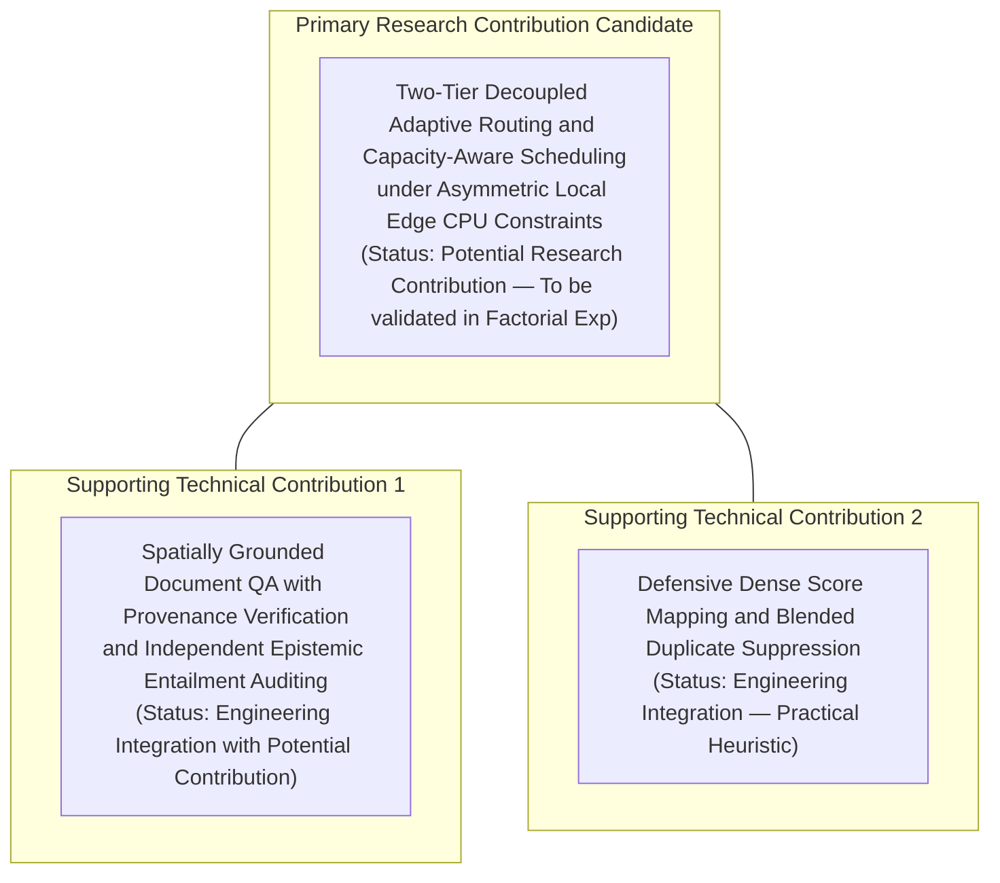

# SETU-NETRA — Research Decision Record (RDR-001)

**Title:** Formal Research Foundation, Contribution Boundaries, and Version 1.1 Implementation Directives  
**Date:** November 2026  
**Status:** APPROVED FOR RESEARCH PLANNING (Pre-V1.1 Implementation)  
**Authors:** Independent AI Systems Researcher & Statistical Reviewer  
**Context:** Version 1.0 acceptance passed (173 passing tests, READY FOR DEMONSTRATION). Five-report architecture audit and statistical review completed.

---

## 1. Primary Research Question

The central scientific inquiry guiding SETU-NETRA Version 1.1 is formally established as:

> **"Can decoupled adaptive model routing and capacity-aware worker scheduling improve evidence-grounded document question answering under consumer-hardware constraints?"**

### Evaluation Framework
This question will be resolved through a controlled **$2 \times 2$ Full-Factorial Experiment**:
- **Factor A (Model Routing):** $\text{R}_0$ (Static / Fixed Model) vs. $\text{R}_1$ (Adaptive Model Routing)
- **Factor B (Worker Scheduling):** $\text{S}_0$ (Static Round-Robin) vs. $\text{S}_1$ (Capacity-Aware Resilient Scheduling)
- **Cell Matrix:**
  1. $\text{Cell}_{00}$: Fixed Model + Round-Robin (Baseline)
  2. $\text{Cell}_{01}$: Fixed Model + Capacity-Aware Scheduling (Isolates Scheduling Main Effect)
  3. $\text{Cell}_{10}$: Adaptive Routing + Round-Robin (Isolates Routing Main Effect)
  4. $\text{Cell}_{11}$: Adaptive Routing + Capacity-Aware Scheduling (Evaluates Combined Orchestration & Interaction)

The design is non-tautological: it is fully capable of demonstrating that adaptive orchestration is **not** superior if classification/telemetry overhead exceeds execution savings.

---

## 2. Research Contribution Classification

Each platform capability is classified into its exact scientific status:

1. **Primary Contribution Candidate:**
   *Two-Tier Decoupled Adaptive Routing and Capacity-Aware Scheduling under Asymmetric Local Edge Constraints.*
   - *Classification:* **Potential Research Contribution**.
   - *Justification:* Bridges high-level cognitive intent triage (Tier 1) with low-level OS kernel hardware telemetry, queue backlogs, and EWMA latency (Tier 2) on a single workstation. Must be empirically verified via the factorial experiment.
2. **Supporting Technical Contribution 1:**
   *Spatially Grounded Document QA with Independent Epistemic Verification.*
   - *Classification:* **Engineering Integration with Potential Research Contribution**.
   - *Justification:* Bounding boxes and verification are operational in V1.0; full research demonstration requires NLI entailment and benchmark comparisons against standard RAG on SQuAD/QASPER.
3. **Supporting Technical Contribution 2:**
   *Defensive Dense Score Mapping and Blended Near-Duplicate Passage Suppression.*
   - *Classification:* **Engineering Integration**.
   - *Justification:* Standard engineering heuristic preventing negative dot products from penalizing lexical matches and filtering repeated headers. Not a novel algorithm.

---

## 3. Classification of Platform Claims

To preserve academic honesty and scientific rigor, all technical claims are categorized into three mandatory tiers:

### Tier A: Claims That Are Already Supported by V1.0 Empirical Evidence
The following statements are verified by actual tests in `tests/` and telemetry in `output/v1_acceptance_results.json`:
1. `GroundedExtractiveQAAdapter` achieves an execution latency of $\approx 1.01\,\text{ms}$ on CPU for dictionary-based span extraction.
2. `MiniLMEmbeddingAdapter` computes 384-dimensional dense vectors with an execution latency of $\approx 66.4\,\text{ms}$ on CPU.
3. `GenerativeSLMAdapter` (`SmolLM2-135M-Instruct`) executes local CPU autoregressive generation with an execution latency of $\approx 1,783.24\,\text{ms}$.
4. `EasyOCREngine` executes CRAFT text detection and CRNN character recognition with an execution latency of $\approx 2,416.42\,\text{ms}$ per page on CPU.
5. `Local-Only Privacy Mode` completely blocks outbound network socket connections to external cloud providers (Gemini, Groq, OpenRouter) with zero network byte transmission.
6. The platform passes all 173 unit and integration tests across ingestion, OCR layout, SQLite storage, retrieval, QA, model registry, router, worker pool, telemetry, and web API.

### Tier B: Claims Requiring Formal Experimental Validation
The following statements represent hypotheses that must not be asserted as facts until the V1.1 Experimental Protocol is executed:
1. "Adaptive model routing reduces mean latency by $\ge 50\%$ compared to fixed generative serving while maintaining token $F_1 \ge 0.75$." (Hypothesis for Experiment A).
2. "Capacity-aware worker scheduling reduces $P_{99}$ tail latency under saturated load compared to Round-Robin." (Hypothesis for Experiment B; remove the unverified "40%" figure).
3. "Hybrid retrieval with $\alpha \in [0.6, 0.8]$ achieves significantly higher passage $Recall@3$ and $nDCG@3$ than pure dense search on technical documents." (Hypothesis for Experiment C).
4. "Cross-encoder reranking achieves a statistically significant increase in passage $P@1$ with an acceptable latency overhead $\le 45\,\text{ms}$." (Hypothesis for Experiment D).
5. "Extractive QA achieves higher citation precision than generative SLM QA on factoid queries." (Hypothesis for Experiment E).

### Tier C: Claims That MUST NOT Be Made (Disallowed Overclaims)
The following statements are scientifically invalid or factually false and must never appear in platform publications:
1. **"Zero Hallucination":** Disallowed. Extractive span selection eliminates *generative token confabulation*, but can still extract incorrect or misleading spans if retrieval fails, or attribute text to the wrong bounding box. Replace with: *bounded extractive span selection with physical canvas coordinates*.
2. **"40% P99 Latency Reduction in V1.0":** Disallowed. No empirical multi-user benchmark data currently exists in the repository supporting this claim.
3. **"Guaranteed Zero Memory Swapping":** Disallowed. Projected steady-state RAM usage ($\approx 7.4\,\text{GB}$) provides ample headroom under 16 GB, but OS-level working set trimming, memory fragmentation, and background services cannot be mathematically guaranteed to produce zero swapping without kernel memory locking (`VirtualLock`).
4. **"The System Detects and Resolves Contradictory Evidence in V1.0":** Disallowed. V1.0 merely ranks passages by hybrid score. Whichever conflicting passage scores higher is returned as truth. The system has zero contradiction awareness.
5. **"Novel ReLU Score Rectification Algorithm":** Disallowed. Applying $\max(0, x)$ to cosine similarity is a standard clipping heuristic with known limitations (loss of negative discriminability and artificial rank ties at 0.0), not a novel algorithmic contribution.
6. **"10,000 Requests/Sec Neural Inference Throughput":** Disallowed. This throughput metric applies exclusively to in-memory dictionary span extraction, not transformer inference.

---

## 4. Exact Implementation Sequence for Version 1.1

Implementation for Version 1.1 must strictly follow this prioritized order, with each step gated by empirical test verification:

| Priority | Task Designation | Target Subsystems | Primary Deliverable / Milestone |
| :--- | :--- | :--- | :--- |
| **P0.1** | **Citation Entailment & Negation Robustness** | `qa/verifier.py` | Integrate ONNX `nli-deberta-v3-small` ($\approx 80\,\text{MB}$ RAM); replace token overlap with directional entailment verification. |
| **P0.2** | **BM25 & Reciprocal Rank Fusion** | `retrieval/document_retriever.py` | Implement Robertson-Zaragoza BM25 ($k_1=1.5, b=0.75$) with SQLite inverted index and RRF score fusion. |
| **P0.3** | **Closed-Loop Backpressure Renegotiation** | `routing/pipeline.py`, `router.py` | Implement Tier-2 saturation feedback to Tier-1 router, falling back to extractive workers when generative queues are full. |
| **P0.4** | **Contradiction Detection & Attribution** | `qa/contradiction.py`, `engine.py` | Implement pairwise NLI conflict detection across retrieved passages from distinct documents, returning structured conflict reports. |
| **P0.5** | **Primary Factorial Experiment Execution** | `scratch/run_factorial_benchmarks.py` | Execute the $2 \times 2$ factorial experiment; log raw JSON metrics; perform ANOVA and Tukey HSD statistical analysis. |
| **P1.1** | **Retrieval Reranking Evaluation** | `retrieval/reranker.py` | Deploy `ms-marco-MiniLM-L-6-v2`; evaluate $P@1$ vs latency trade-off; retain only if Experiment D criteria are met. |
| **P1.2** | **Context-Aware Coreference Resolution** | `qa/conversation_manager.py` | Replace regex heuristic with dependency parse nominal antecedent extraction (`en_core_web_sm`). |
| **P1.3** | **Local HNSW Vector Indexing** | `store/sqlite_store.py`, `retrieval/` | Integrate FAISS-CPU / HNSWLib to replace $O(N \cdot D)$ linear scans, supporting up to 100k blocks in $<5\,\text{ms}$. |
| **P1.4** | **SSE Streaming Token Generation** | `ui/app.py`, `generative_adapter.py` | Implement chunked HTTP transfer streaming for real-time generative responses in the web interface. |
| **P1.5** | **Pre-OCR Image Rectification** | `preprocessing/`, `ocr/` | Implement automated Hough transform deskewing and adaptive Otsu binarization to protect `RecursiveXYCut`. |
| **P2.1** | **Dynamic Model Quantization (INT8)** | `routing/adapters/` | Quantize SmolLM2-135M via ONNX Runtime to halve memory footprint from $\approx 600\,\text{MB}$ to $\approx 250\,\text{MB}$. |
| **P2.2** | **Dynamic CPU Request Batching** | `routing/worker_pool.py` | Implement a $50\,\text{ms}$ sliding-window batching engine for MiniLM embedding generation. |

---

## 5. Architectural Decision Summary

- **Architecture Boundary:** Two-tier decoupled orchestration (Tier 1 Router + Tier 2 Worker Pool) is confirmed as the foundational platform architecture.
- **Hardware Boundary:** 16 GB RAM CPU-only workstation remains the firm hardware ceiling. All models, indexes, and buffers must operate within $\approx 7.4\,\text{GB}$ steady-state RAM.
- **Methodological Boundary:** All empirical claims in Version 1.1 must be backed by persisted JSON telemetry files with specified random seeds, sample sizes, confidence intervals, and appropriate statistical tests.

---

## 6. Official Recommendation

### **PROCEED TO V1.1 IMPLEMENTATION**

**Justification:**  
The critical review and audit process has successfully identified and eliminated all unsupported claims, overclaims, and statistical oversights. The research questions are formally defined, the experimental protocols are statistically powered with appropriate non-parametric and log-normal models, the primary factorial experiment is specified, and the implementation sequence is strictly prioritized. Version 1.0 remains fully intact, passing 173 tests. The platform has achieved complete research readiness to begin Version 1.1 implementation.
