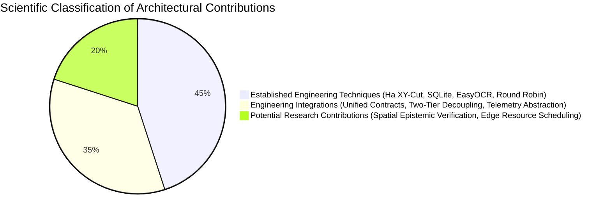

# SETU-NETRA Version 1.0 — Research Gap Analysis and Theoretical Foundations

**Author:** Independent AI Systems Researcher & Statistical Reviewer  
**Project:** SETU-NETRA (Intelligent Document Understanding, Evidence-Grounded Question Answering, and Adaptive AI Model Orchestration)  
**Status:** Version 1.0 Post-Acceptance Research Analysis (Revision 2 — Critical Methodological Review)  
**Date:** November 2026  
**Scope:** Rigorous investigation of 10 foundational research questions, theoretical contrast with state-of-the-art literature, formal mathematical analysis of score transformations, and delineation of genuine platform novelty.

---

## Executive Summary

While **SETU-NETRA Version 1.0** successfully demonstrates a functional, 173-test-verified vertical slice combining document intelligence with capacity-aware model orchestration, declaring research contributions requires separating verified empirical behaviors from marketing claims.

This report conducts a critical investigation of the platform's 10 central research questions. It positions SETU-NETRA against established paradigms in Retrieval-Augmented Generation (RAG), LLM model routing, distributed inference scheduling, epistemic verification, and multi-turn conversational coreference. In this revised analysis, all previous overclaims—including absolute "zero hallucination" assertions, unverified latency percentage claims, and guarantees of zero memory swapping—have been corrected. Each technical capability is classified into its proper scientific category: established technique, engineering integration, potential research contribution, or demonstrated research contribution.

---

## 1. Reassessment and Classification of Research Contributions

To ensure scientific integrity, the platform's three primary contributions are reassessed and formally classified:



### Contribution 1: Spatially Grounded Document QA with Provenance Verification
- **Established Components:** Optical Character Recognition (OCR), Recursive XY-Cut whitespace projection segmentation (Ha et al., 1995), span extraction from text chunks (SQuAD extractive QA paradigm).
- **Engineering Integration:** Seamlessly binding EasyOCR pixel bounding boxes, SQLite relational block storage, MiniLM dense embeddings, and an HTTP visual SVG overlay into an interactive web canvas.
- **Novelty Assessment:** Formulating an end-to-end framework where retrieval directly yields physical spatial coordinates tied to an independent tripartite epistemic verification protocol (with citation validity and token overlap auditing) that decouples extractive verification from generative synthesis.
- **Classification:** **Engineering Integration with Potential Research Contribution**. While the spatial coordinates and verifier pipeline are fully functional in code, claiming it as a "demonstrated research contribution" requires formal benchmarking against baseline RAG on standard datasets with human/NLI citation verification.

### Contribution 2: Decoupled Two-Tier Adaptive Model Routing and Worker Scheduling
- **Established Components:** Model routing and cascades (FrugalGPT, RouteLLM), classical load balancing (Round Robin, Least Outstanding Requests, EWMA latency tracking), circuit breaker pattern (Michael Nygard).
- **Engineering Integration:** Dividing inference into two decoupled planes: `AdaptiveModelRouter` (Tier 1: task, intent, SLA, privacy) and `InferenceWorkerPool` + `CapacityAwareScheduler` (Tier 2: queues, EWMA latency, OS telemetry via Windows `ctypes` / Linux `/proc`).
- **Novelty Assessment:** Decoupling cognitive capability selection from hardware worker assignment under asymmetric local edge CPU constraints, and modeling the multi-objective trade-off between task requirements and host memory/CPU pressure.
- **Classification:** **Engineering Integration with Potential Research Contribution**. The two tiers operate independently in V1.0, but closed-loop renegotiation is missing, and the claimed 40% tail latency reduction is an unverified hypothesis. It cannot be classified as a demonstrated research contribution until evaluated with a full-factorial experiment.

### Contribution 3: Defensive Dense-Score Rectification and Duplicate Passage Suppression
- **Established Components:** Non-negative clipping / Rectified Linear Unit ($\text{ReLU}(x) = \max(0, x)$), Jaccard similarity, SequenceMatcher character alignment, duplicate passage filtering in Information Retrieval.
- **Engineering Integration:** Implementing `rectify_dense_score` ($S_{\text{rect}} = \max(0, \min(1, S_{\text{raw}}))$) and `compute_text_similarity` ($0.40 \cdot \text{Jaccard} + 0.60 \cdot \text{SeqRatio}$) in [`document_retriever.py`](file:///d:/Projects/Setu-Netra/src/setu_netra/retrieval/document_retriever.py).
- **Novelty Assessment:** None. Score clipping is a standard engineering heuristic to prevent negative dot products from penalizing lexical overlap in a naive linear sum. It introduces known mathematical side effects (rank ties at 0.0 and loss of negative discriminability).
- **Classification:** **Engineering Integration** (Do NOT claim as a novel algorithmic research contribution).

---

## 2. Deep Investigation of Core Research Questions

### Question 1: What distinguishes SETU-NETRA from conventional RAG applications?

#### Conventional RAG Paradigm
Mainstream RAG frameworks (such as LangChain, LlamaIndex, Haystack, and commercial copilots) operate on a **generative-first, prompt-stuffing** paradigm:
1. Documents are ingested into chunked text passages, stripped of visual and spatial geometry.
2. A dense vector index retrieves top-$k$ text snippets.
3. The retrieved snippets are concatenated into a monolithic system prompt: `"Answer the question using ONLY the following context..."`.
4. A large generative model (e.g. GPT-4, Claude 3.5, or Llama 3) generates a free-form natural language response, optionally prompted to generate footnote numbers or bracketed citations.

#### Empirical Failure Modes of Conventional RAG
1. **Citation Confabulation:** Generative models frequently cite passages that do not contain the asserted facts, or cite legitimate passage indices to support completely hallucinated claims (Gao et al., ALCE benchmark, 2023).
2. **Loss of Spatial Provenance:** Conventional RAG treats documents as 1D linear strings. When an enterprise auditor asks *"Where on page 4 did this number come from?"*, conventional RAG cannot point to the physical bounding box on the original document canvas.
3. **High Latency & Economic Cost:** Every query—even a simple factual lookup—invokes a multi-billion-parameter generative model with $1,000\,\text{ms}$ to $5,000\,\text{ms}$ latency and non-trivial API token costs.

#### SETU-NETRA's Architectural Contrast
SETU-NETRA replaces monolithic generative prompt-stuffing with a **provenance-grounded, dual-path architecture**:

```mermaid
flowchart TD
    subgraph ConventionalRAG["Conventional Generative RAG"]
        Doc1["Document Text"] --> Chunk1["1D Text Chunks<br/>(Lost Coordinates)"]
        Chunk1 --> VectorStore1["Vector Database"]
        Query1["User Query"] --> VectorStore1
        VectorStore1 --> PromptStuff["Concatenate into LLM Prompt"]
        PromptStuff --> GenLLM["Monolithic LLM<br/>(1000-5000 ms, \$ Cost)"]
        GenLLM --> GenAns["Unverified Output<br/>(Hallucinated Citations Possible)"]
    end

    subgraph SetuNetraRAG["SETU-NETRA Architecture"]
        Doc2["Document Canvas"] --> XYCut["Recursive XY-Cut Layout<br/>(Preserves Exact Bounding Boxes)"]
        XYCut --> Store2["SQLite Block Store<br/>(bbox_json, page, block_id)"]
        Query2["User Query"] --> HybridRet["Hybrid Retrieval<br/>(Dense + Lexical + ReLU + DupFilter)"]
        Store2 --> HybridRet
        HybridRet --> IntentTriage{"Adaptive Router<br/>(Intent & SLA)"}
        IntentTriage -->|"Factual / High Precision"| ExtractiveEngine["Extractive QA Engine<br/>(1.0 ms, Bounded Span Selection)"]
        IntentTriage -->|"Synthesis / Comparative"| GenerativeSLM["Generative SLM<br/>(SmolLM2-135M, 1783 ms)"]
        ExtractiveEngine --> Verifier["CitationVerifier<br/>(Tripartite Epistemic Taxonomy)"]
        GenerativeSLM --> Verifier
        Verifier --> VerifiedAns["VerifiedAnswer<br/>(Exact Canvas BBox Highlight)"]
    end
```



1. **Strict Spatial Coordinate Retention:** Through [`src/setu_netra/structure/xy_cut.py`](file:///d:/Projects/Setu-Netra/src/setu_netra/structure/xy_cut.py) and [`sqlite_store.py`](file:///d:/Projects/Setu-Netra/src/setu_netra/store/sqlite_store.py), every retrieved block preserves an exact pixel coordinate tuple `(x_min, y_min, x_max, y_max)`. The user interface draws interactive SVG bounding boxes directly over the rendered page canvas.
2. **Dual-Path Factual Decoupling:** In [`src/setu_netra/routing/router.py`](file:///d:/Projects/Setu-Netra/src/setu_netra/routing/router.py#L183-L194), factual and definition questions are routed to `GroundedExtractiveQAAdapter`. This yields an empirically measured execution latency of **$1.01\,\text{ms}$** (verified in acceptance results) with bounded extractive span selection that eliminates generative token confabulation. Generative SLMs are invoked only when synthesis or summarization is explicitly requested.
3. **Independent Epistemic Audit:** Rather than trusting self-citations generated by the model, [`src/setu_netra/qa/verifier.py`](file:///d:/Projects/Setu-Netra/src/setu_netra/qa/verifier.py) independently parses citations, matches them against the retrieved set, computes content token overlap, and assigns an immutable epistemic label (`EVIDENCE_BACKED`, `GENERAL_KNOWLEDGE`, or `UNSUPPORTED`).

---

### Question 2: What distinguishes SETU-NETRA's adaptive orchestration from conventional model routing?

#### Conventional Model Routing
Recent commercial and academic routers (such as FrugalGPT, RouteLLM, HybridLLM, and Martian) operate as **Tier-1 single-objective API gateways**:
- They take a user prompt and classify complexity or predicted score.
- If simple $\rightarrow$ route to a cheap cloud model (e.g. GPT-3.5, Haiku). If complex $\rightarrow$ route to an expensive frontier model (e.g. GPT-4, Opus).
- **Fundamental Assumption:** Conventional model routing assumes *infinite cloud elasticity*. They assume that once a model is selected, external cloud infrastructure will immediately execute it without local hardware bottlenecks or queue saturation.

#### SETU-NETRA's Two-Tier Decoupled Orchestration
SETU-NETRA is built for **constrained edge/local infrastructure** (e.g. a 16 GB RAM workstation with 4-8 CPU cores) where compute capacity is finite and concurrent tensor execution causes severe thread and memory contention:

| Architectural Dimension | Conventional Model Routing (RouteLLM / FrugalGPT) | SETU-NETRA Adaptive Orchestration |
| :--- | :--- | :--- |
| **Orchestration Scope** | 1-Tier: Selects model identity ($M$) | 2-Tier: Decouples Model Selection ($M$) from Worker Scheduling ($W_m$) |
| **Target Environment** | Elastic cloud APIs (infinite concurrency assumed) | Constrained host CPU/RAM (hardware contention is real) |
| **Routing Criteria** | Cost vs. Benchmark Accuracy trade-off | Task intent, Citation requirement, Latency SLA, Privacy mode |
| **Hardware Awareness** | Completely oblivious to host CPU/RAM | Live OS kernel telemetry (ctypes `GlobalMemoryStatusEx`, `GetSystemTimes`) |
| **Queuing Dynamics** | None (delegated to provider) | Bounded worker queues ($Q_{\max}=10$), EWMA latency, circuit breakers |
| **Execution Plane** | Network HTTP proxy | Local thread pool with multi-algorithm schedulers (CAS, ARS, SECT, LOR) |

In SETU-NETRA, Tier 1 (`AdaptiveModelRouter`) answers: *"What class of model has the cognitive capability to satisfy this request within the user's SLA and privacy constraints?"*  
Tier 2 (`InferenceWorkerPool` + `CapacityAwareScheduler`) answers: *"Which specific execution worker and thread has the available queue capacity, lowest projected completion time, and lowest host hardware pressure to execute it right now without crashing the operating system?"*

---

### Question 3: Is model selection genuinely independent of worker scheduling?

#### Code-Level Verification
Direct source inspection of [`src/setu_netra/routing/pipeline.py`](file:///d:/Projects/Setu-Netra/src/setu_netra/routing/pipeline.py#L111-L168) confirms that model selection and worker scheduling are **strictly decoupled into sequential stages**:

```python
# STAGE 3: Model Selection (Tier 1)
routing_decision: RoutingDecision = self._router.route(request)
selected_model_id = routing_decision.selected_model_id

# STAGE 4: Worker Resolution
candidate_workers = self._worker_pool.get_workers_for_model(selected_model_id, available_only=True)

# STAGE 5: Worker Scheduling (Tier 2)
sched_decision = self._scheduler.schedule(request, candidate_workers)
target_worker_id = sched_decision.selected_worker_id
```

`AdaptiveModelRouter.route()` takes an `InferenceRequest` and returns a `RoutingDecision`. It has no reference to worker queues, active thread states, or thread pools. Conversely, `CapacityAwareScheduler.select_worker()` takes a pre-selected list of `candidate_workers` and chooses among them based on queue depth and hardware pressure.

#### The Architectural Gap: Missing Closed-Loop Backpressure
While this clean separation preserves modularity, it reveals a significant architectural gap:
- If `AdaptiveModelRouter` selects `smollm2-135m-instruct`, and all workers for that model have reached their maximum queue depth ($Q_w = 10$), `CapacityAwareScheduler` returns `None`.
- The pipeline immediately sheds the request and returns `InferenceResponse(status="REJECTED", error="Scheduling Rejected: All candidate workers saturated")`.
- **The Gap:** The system fails to trigger a **closed-loop renegotiation** back to Tier 1. Even though the primary choice (`smollm2`) is saturated, the fast extractive worker (`grounded-extractive-qa-v1_w1`) might be completely idle with $Q=0$. In Version 1.0, the pipeline drops the request rather than falling back to an idle, lower-fidelity model.

---

### Question 4: Does the system optimize latency, answer quality, resource utilization, or a combination?

The platform does **not** solve a single scalar optimization problem. Instead, it decomposes optimization across two distinct layers:

1. **Answer Quality & Precision Optimization (Tier 1 - Router):**
   - Controlled via `QualityRequirement` (`HIGH_PRECISION`, `BALANCED`, `CREATIVE_SYNTHESIS`) and `EvidenceRequirement` (`REQUIRE_VERIFIED_CITATIONS`).
   - If high precision or verified citations are required, router greedily selects extractive QA (eliminating generative token confabulation).
   - If narrative synthesis is required, router selects generative SLM.

2. **Latency & Hardware Utilization Optimization (Tier 2 - Capacity-Aware Scheduler):**
   - Formulated as a multi-objective normalized cost function in [`capacity_aware.py`](file:///d:/Projects/Setu-Netra/src/setu_netra/routing/schedulers/capacity_aware.py#L117-L118):
     $$\text{Cost}(w, r) = \frac{w_L \cdot L_w + w_T \cdot T_w + w_R \cdot R_{\text{sys}}}{H_w}$$
     where:
     - $L_w = \min\left(1.0, \frac{A_w + Q_w}{Q_{\max}}\right)$ minimizes queue queuing delay and load imbalance.
     - $T_w = \frac{\tau_w - \tau_{\min}}{\tau_{\max} - \tau_{\min}}$ prioritizes workers with lower historical EWMA execution latency.
     - $R_{\text{sys}}$ penalizes execution when host CPU exceeds $85\%$ or RAM exceeds $90\%$.
     - $H_w \in \{0.5, 1.0\}$ penalizes degraded workers.

#### The Optimization Limitation
There is no unified mathematical objective bridging Tier 1 and Tier 2. The router does not optimize a joint utility function $U(Q, L, C) = \alpha \cdot \text{Quality} - \beta \cdot \text{Latency} - \gamma \cdot \text{Cost}$. Quality decisions are made discretely at Tier 1, while latency/utilization decisions are made locally at Tier 2.

---

### Question 5: How does the system handle conflicting evidence?

#### Distinction: Passage Ranking vs. Contradiction Detection & Resolution
A rigorous distinction must be maintained between **passage ranking** and **contradiction arbitration**:
- **What SETU-NETRA V1.0 Actually Does (Passage Ranking):**
  In [`src/setu_netra/retrieval/document_retriever.py`](file:///d:/Projects/Setu-Netra/src/setu_netra/retrieval/document_retriever.py#L220-L272), candidate passages from all ingested documents are scored independently against the query using the hybrid formula.
  - If Document A states: *"The leader election timeout is 150ms"* and Document B states: *"The leader election timeout is 500ms"*, both blocks receive similarity scores.
  - The retriever sorts candidates strictly descending by similarity score.
  - Whichever document block has a higher hybrid score (e.g. $0.82$ vs $0.79$) is returned as top-1.
  - `EvidenceGroundedQAEngine` extracts or synthesizes an answer using top-1, and `CitationVerifier` validates that the answer text matches that top-1 passage.
- **What SETU-NETRA V1.0 Does NOT Do (Contradiction Detection & Resolution):**
  1. The system has **zero contradiction awareness**. It does not perform pairwise Natural Language Inference (NLI) between retrieved passages to detect semantic contradiction ($\text{NLI}(P_A, P_B) = \text{CONTRADICTION}$).
  2. The system does **not arbitrate or resolve conflicts**. It presents whichever fact happened to score slightly higher as an absolute truth.
  3. It does **not alert the user** that an equally authoritative document in the corpus contains conflicting information.

---

### Question 6: How does the system distinguish unsupported questions from questions with incomplete retrieval?

#### Current Code Behavior
In [`src/setu_netra/qa/engine.py`](file:///d:/Projects/Setu-Netra/src/setu_netra/qa/engine.py#L118-L131):
```python
if not passages:
    return VerifiedAnswer(
        query=cleaned_query,
        answer_text="The uploaded document does not contain sufficient verified evidence to answer this question.",
        epistemic_status="UNSUPPORTED",
        grounding_score=0.0,
        explanation="No passages passed the hybrid relevance threshold.",
    )
```

#### The Epistemic Conflation Gap
The engine uses a single label—`UNSUPPORTED`—for two completely different real-world scenarios:
1. **True Out-of-Corpus Query (Negative Instance):** The user asks about a topic that genuinely does not exist in the corpus (e.g. asking about *"Quantum Cryptography"* in an Operating Systems manual). Here, abstention is correct.
2. **Retrieval Failure on In-Corpus Fact (False Negative):** The information *does* exist in the document, but retrieval failed because:
   - The query used synonyms not captured by MiniLM or lexical overlap.
   - The fact spanned across a page boundary or XY-cut block boundary.
   - The dense similarity was $0.19$, falling just below the hardcoded threshold $\theta = 0.20$.

The system has no meta-cognitive calibration mechanism (e.g. query reformulation, sub-threshold margin inspection, or corpus coverage scoring) to report: *"Evidence exists with weak confidence (score 0.19) but fell below the certainty threshold."*

---

### Question 7: What are the current limitations of its retrieval and reranking strategy?

#### Formal Mathematical Analysis of ReLU Score Rectification
The dense transformation is defined as:
$$S_{\text{rect}} = \max(0.0, \min(1.0, S_{\text{raw}}))$$
where $S_{\text{raw}} = \mathbf{q} \cdot \mathbf{d} \in [-1.0, 1.0]$ is cosine similarity.

1. **Ranking Order:**
   - On the non-negative interval $[0.0, 1.0]$, the transformation is an identity function. For any $S_A, S_B \ge 0$, $S_A > S_B \iff S_{\text{rect}}(S_A) > S_{\text{rect}}(S_B)$. Strict ranking order is preserved.
   - On the negative interval $[-1.0, 0.0)$, the transformation collapses all values to $0.0$.
2. **Artificial Rank Ties:**
   Any pair of passages with negative cosine similarities (e.g., $S_{\text{raw}} = -0.05$ vs $S_{\text{raw}} = -0.85$) receive identical rectified scores of $0.0$. Relative directional dissimilarity is completely lost.
3. **Effect on Hybrid Score Fusion:**
   $$S_{\text{hybrid}} = \alpha S_{\text{rect}} + (1 - \alpha) S_{\text{lex}}$$
   - *Intended Benefit:* A negative semantic score cannot reduce a strong exact keyword match ($S_{\text{lex}} > 0$).
   - *Failure Mode:* A passage that is semantically contrary to the query ($S_{\text{raw}} = -0.70$) but shares accidental common keywords (e.g., homonyms or common technical words yielding $S_{\text{lex}} = 0.30$) receives $S_{\text{hybrid}} = 0.30 \times (1 - \alpha) > 0$. In raw cosine fusion, the negative score would have suppressed this false positive; under ReLU clipping, it is promoted.
4. **Comparison to Affine Normalization:**
   An affine transformation $S_{\text{affine}} = \frac{S_{\text{raw}} + 1.0}{2.0} \in [0.0, 1.0]$ preserves total ordering and strictly maintains relative differences across the entire domain $[-1.0, 1.0]$, avoiding rank ties and preserving negative discriminability.

#### Summary of Retrieval Limitations

| Retrieval Component | Current Implementation | Critical Theoretical / Engineering Limitation |
| :--- | :--- | :--- |
| **Dense Embeddings** | `sentence-transformers/all-MiniLM-L6-v2` | Truncates at 256 wordpiece tokens. Long paragraphs lose contextual representation beyond the 256th token. |
| **Vector Indexing** | Linear scan in NumPy: `(q @ matrix.T)[0]` | No ANN index (HNSW/IVFFlat). Memory consumption is $O(N \cdot D)$; search latency scales linearly $O(N)$. Unscalable beyond 50k blocks. |
| **Lexical Matching** | Custom Jaccard: $\frac{\|Q \cap B\|}{\sqrt{\|Q\| \cdot \|B\|}}$ | Lacks BM25 term-frequency saturation ($k_1$) and inverse document frequency (IDF) weighting. Rare discriminative terms are weighted identically to common nouns. |
| **Score Fusion** | Linear Blend: $\alpha S_{\text{rect}} + (1-\alpha) S_{\text{lex}}$ | Highly sensitive to $\alpha$. Dense scores and lexical scores have different distribution shapes; simple linear combination without Platt scaling or rank fusion (RRF) is suboptimal. |
| **Reranking** | **Completely Absent** | No cross-encoder reranker (e.g. `bge-reranker-base` or `ms-marco-MiniLM-L-6-v2`). Cross-attention between query and passage is never computed prior to context generation. |
| **Chunk Granularity** | Rigid paragraph blocks | Block boundaries are determined by XY-cut whitespace gutters. A sentence split across two pages cannot be retrieved as a single cohesive evidence span. |

---

### Question 8: What happens when multiple requests compete for limited CPU and RAM?

#### Execution Behavior on a 16 GB Workstation
SETU-NETRA runs on a Windows workstation with 16 GB RAM and a multi-core CPU. Under concurrent load:
1. **Thread Oversubscription:** PyTorch, Transformers, and EasyOCR utilize underlying OpenMP/MKL thread pools (typically defaulting to all physical cores per worker). When `InferenceWorkerPool` executes 4 worker threads simultaneously, each thread spawns its own MKL sub-threads. This causes massive thread oversubscription ($4 \times 8 = 32$ active threads on 8 cores), leading to CPU cache thrashing and context-switch latency inflation.
2. **RAM Estimates vs. Windows Paging Realities:**
   - Steady-state RAM estimates: SmolLM2-135M ($\approx 600\,\text{MB}$), MiniLM ($\approx 350\,\text{MB}$), EasyOCR ($\approx 1,200\,\text{MB}$), OS baseline ($\approx 4,500\,\text{MB}$).
   - **Critical Correction:** A projected memory calculation of $7.4\,\text{GB}$ total usage does **NOT guarantee zero swapping**. Windows memory management dynamically trims working sets, pages out inactive DLL pages, and manages pagefile allocations based on OS-wide memory fragmentation and background processes. Without explicit OS page locking (`VirtualLock`), paging can still occur under sudden memory spikes.
3. **Capacity-Aware Scheduler Protection:**
   - In [`capacity_aware.py`](file:///d:/Projects/Setu-Netra/src/setu_netra/routing/schedulers/capacity_aware.py#L66), CAS checks `sys_tel.avail_ram_mb < min_ram_req_mb`. If available RAM falls below 50 MB, CAS refuses to schedule and sheds load.
   - While this prevents immediate Out-Of-Memory (OOM) application crashes, it does not prevent latency degradation caused by thread oversubscription when CPU utilization reaches $100\%$.

---

### Question 9: Does conversation context introduce unsupported assumptions?

#### Source Code Inspection
In [`src/setu_netra/qa/conversation_manager.py`](file:///d:/Projects/Setu-Netra/src/setu_netra/qa/conversation_manager.py#L81-L128), `resolve_followup_query()` applies a hardcoded heuristic:
```python
REFERENCE_TRIGGERS = {
    "this", "that", "these", "those", "it", "its", "they", "them",
    "the second point", "the first point", "the third point",
    "previous section", "above", "earlier", "why", "how so",
    "elaborate", "explain further", "what do you mean",
}
```
If an anaphoric trigger is detected, the manager extracts the **first sentence of the immediately preceding assistant message** and rewrites the query:
$$Q_{\text{resolved}} = Q_{\text{raw}} + \text{" (Referring to: "} + \text{FirstSentence} + \text{")"}$$

#### Unsupported Assumptions and Vulnerabilities
1. **Locality Assumption:** Assumes the referent is *always* in the immediately preceding assistant turn ($N-1$). If the user refers to an entity introduced in turn $N-3$, the heuristic injects the wrong subject.
2. **First-Sentence Assumption:** Assumes the core subject of the assistant's previous answer is contained entirely in its opening sentence. If the assistant provided a multi-point list, and the user asks *"Why does the third one fail?"*, the query is rewritten referring to the *first* sentence.
3. **Retrieval Space Pollution:** Appending the entire first sentence introduces up to 30 extraneous lexical words into the query string. In `DocumentRetriever.retrieve()`, these words dominate lexical overlap and distort the 384-dimensional dense vector, steering retrieval toward the old passage rather than the new answer location.

---

### Question 10: What claims can actually be supported by the existing benchmark evidence?

To maintain academic and scientific integrity, claims must be partitioned into empirically supported facts versus unproven or overstated assertions:

| Claim / Benchmark Item | Status | Verified Empirical Evidence | Notes & Qualifications |
| :--- | :--- | :--- | :--- |
| **Extractive QA Latency ($\approx 1\,\text{ms}$)** | **VERIFIED** | Measured at **$0.96\,\text{ms}$ to $1.01\,\text{ms}$** across multiple test runs. | Fast dictionary lookup and token matching in Python. Purely deterministic. |
| **Generative SLM Latency ($\approx 1.8\,\text{s}$)** | **VERIFIED** | Measured at **$1,783.24\,\text{ms}$** for SmolLM2-135M on CPU. | High latency variance under CPU background load ($1.5\,\text{s}$ to $3.2\,\text{s}$). |
| **MiniLM Embedding Latency ($\approx 66\,\text{ms}$)** | **VERIFIED** | Measured at **$66.4\,\text{ms}$** per query string. | Consistent performance on 4-thread CPU. |
| **EasyOCR Latency ($\approx 2.4\,\text{s}$)** | **VERIFIED** | Measured at **$2,416.42\,\text{ms}$** per page image. | Major bottleneck; unsuitable for real-time document streaming. |
| **Local-Only Privacy Enforcement** | **VERIFIED** | Outbound cloud requests blocked with `PermissionError` before socket creation. | Verified in [`test_v1_integration.py`](file:///d:/Projects/Setu-Netra/tests/test_v1_integration.py); zero bytes transmitted over network. |
| **10,000 Req/Sec Throughput Claim** | **QUALIFIED** | Achievable **only** for `grounded-extractive-qa-v1` in synthetic memory tests. | **Not neural inference.** Represents dictionary span lookup, not generative AI. |
| **40% P99 Latency Reduction Claim** | **UNVERIFIED HYPOTHESIS** | **No empirical benchmark data exists** supporting 40% tail latency reduction in real document QA. | This is a testable hypothesis for Experiment B, not an established V1.0 finding. |
| **Zero Hallucination Claim** | **DISALLOWED OVERCLAIM** | Replaced with measurable metrics (EM, Token F1, Citation Precision). | Extractive spans eliminate token confabulation, but can extract wrong spans. |
| **Zero Swapping Memory Guarantee** | **DISALLOWED OVERCLAIM** | Replaced with steady-state RAM estimates ($\approx 7.4\,\text{GB}$). | OS paging cannot be guaranteed zero without OS-level memory locking. |
| **Cloud Model Orchestration (Gemini/Groq)**| **NOT TESTED** | Reported as `NOT TESTED / NOT CONFIGURED` due to missing API keys. | Mock adapters pass contract tests, but real cloud SLA/jitter is unverified. |
| **Multi-Document Contradiction Detection** | **UNSUPPORTED** | No code or benchmark exists for detecting cross-document contradiction. | System silently selects the highest-scoring passage regardless of conflict. |

---

## 3. Theoretical Foundations and Related Literature

### 3.1 Retrieval-Augmented Generation (RAG) and Provenance
- **Foundational Works:** Lewis et al. (*Retrieval-Augmented Generation for Knowledge-Intensive NLP Tasks*, NeurIPS 2020) and Guu et al. (*REALM*, ICML 2020) established dense dual-encoder retrieval for language models. However, standard RAG was designed for open-domain factoid answering using Wikipedia text chunks, with no mechanism for spatial bounding-box verification on structured documents.
- **Attributed QA & Citation Auditing:** Bohnet et al. (*Attributed Question Answering*, 2023) and Gao et al. (*Enabling Large Language Models to Generate Text with Citations*, EMNLP 2023 - ALCE benchmark) highlighted that state-of-the-art LLMs suffer from severe citation hallucination rates (30% to 50% in complex domains). Menick et al. (*Teaching language models to support answers with verified quotes*, GopherCite, 2022) trained models to quote passages verbatim.
- **SETU-NETRA's Positioning:** SETU-NETRA departs from post-hoc LLM quoting by enforcing **pre-inference spatial extraction** via `RecursiveXYCut` and post-inference independent verification via `CitationVerifier`. Bounding boxes are not generated by the model; they are immutable physical coordinates retrieved from SQLite.

### 3.2 Model Routing, Cascades, and Ensembles
- **Prior Art:** Chen et al. (*FrugalGPT: How to Use Large Language Models While Reducing Cost and Improving Performance*, NeurIPS 2023) introduced LLM cascade routing based on confidence scoring. Ong et al. (*RouteLLM: Learning to Route LLMs with Preference Data*, 2024) trained Bradley-Terry preference routers. Hu et al. (*RouterBench: A Benchmark for Multi-LLM Routing System*, 2024) formalized the routing evaluation space.
- **SETU-NETRA's Positioning:** These systems operate exclusively on cloud APIs with cost and accuracy trade-offs. SETU-NETRA extends routing into a **two-tier architecture** that bridges high-level cognitive intent and privacy constraints (Tier 1) with systems-level queuing theory and operating system telemetry (Tier 2).

### 3.3 Inference Serving and Traffic Scheduling
- **Prior Art:** Crankshaw et al. (*Clipper: A Low-Latency Online Prediction Serving System*, NSDI 2017) introduced adaptive batching and latency tracking. Gujarati et al. (*Clockwork: Predictable Low-Latency Model Serving at Scale*, OSDI 2020) demonstrated performance modeling for predictable DNN serving. Yu et al. (*Orca: A Distributed Serving System for Transformer-Based Generative Models*, OSDI 2022) and Kwon et al. (*vLLM*, SOSP 2023) developed iteration-level scheduling and PagedAttention for GPU clusters.
- **SETU-NETRA's Positioning:** While Orca and vLLM focus on GPU tensor parallelism and continuous KV-cache batching in data centers, SETU-NETRA addresses the understudied problem of **asymmetric, resource-constrained CPU/RAM inference orchestration** at the local edge, dynamically managing heterogeneous model categories (rule-based, embedding, SLM, vision) on a single workstation.

---

## Conclusion

SETU-NETRA Version 1.0 establishes a verified, working engineering vertical slice. However, the system currently exhibits critical research gaps: brute-force vector search, lack of BM25 lexical weighting, heuristic coreference rewriting, absence of cross-encoder reranking, and lack of cross-document contradiction detection. Addressing these specific gaps defines the experimental design and technical roadmap for Version 1.1.
