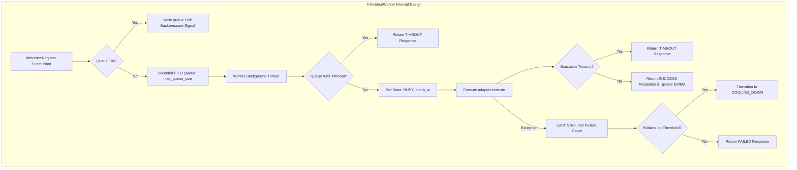
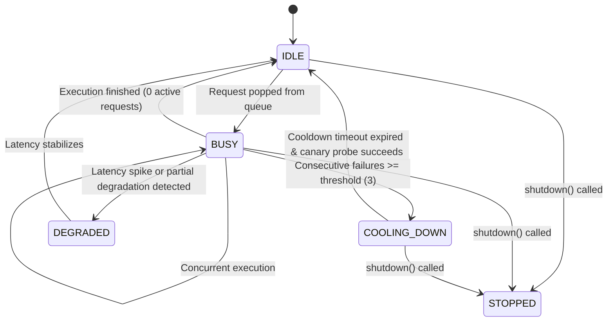

# SETU-NETRA Inference Worker Pool Architecture
## Technical Architecture of the Asynchronous Worker Subsystem

**Document Reference**: ARCH-STAGE5-POOL-001  
**Project**: SETU-NETRA (Bridge-Eye)  
**Date**: November 2026  
**Status**: APPROVED & IMPLEMENTED  

---

## 1. Scope & System Role

The **Inference Worker Pool Subsystem** (`src/setu_netra/routing/worker_pool.py`) provides the execution engine for SETU-NETRA. While the `ModelRegistry` catalogs model definitions and the `AdaptiveModelRouter` selects the target model, the Worker Pool manages the physical worker instances, execution threads, queues, backpressure, circuit breaking, and operational states.

---

## 2. Worker Architecture (`InferenceWorker`)

Each `InferenceWorker` encapsulates an isolated execution thread running on top of a concrete model adapter (`BaseModelAdapter`).

### 2.1 Core Worker Attributes
- **`worker_id`**: Globally unique worker identifier (e.g. `grounded-extractive-qa-v1_w1`, `smollm2-135m-instruct_w2`).
- **`model_id`**: Logical model family served by this worker.
- **`adapter`**: Concrete `BaseModelAdapter` executing the model.
- **`queue`**: Thread-safe bounded `queue.Queue` with configurable `max_queue_size`.
- **`active_requests` ($A_w$)**: Count of requests currently executing on the worker thread.
- **`queued_requests` ($Q_w$)**: Count of pending requests waiting in the FIFO queue.
- **`ewma_latency_ms`**: Exponentially Weighted Moving Average of execution latency:
  $$S_t = \alpha S_{\text{new}} + (1 - \alpha) S_{t-1}, \quad \alpha = 0.2$$

---

## 3. Worker State Machine & Circuit Breaking

Workers transition across 6 distinct operational states:

### 3.1 Circuit Breaker Logic
To prevent cascading failures across the system:
1. Every unhandled exception in `adapter.execute()` increments `_failure_count`.
2. When `_failure_count >= failure_threshold` (default: 3):
   - The worker transitions into `WorkerState.COOLING_DOWN`.
   - A cooldown timer is set: `_cooldown_until = time.time() + cooldown_period_sec` (default: 5.0 seconds).
   - The worker is marked unavailable (`is_available() == False`).
3. Schedulers detect this state and immediately bypass the worker, routing traffic to alternate replicas.
4. When the cooldown timer elapses, the worker transitions back to `IDLE` with `_failure_count = 0`, allowing a trial canary request to test recovery.

---

## 4. Backpressure & Queue Limit Enforcement

In high-concurrency or burst traffic scenarios, worker threads may be unable to process incoming requests at line rate.

1. **Queue Capacity Limit**: Every worker enforces a hard queue ceiling (`max_queue_size`, default: 50).
2. **Backpressure Signal**: If `worker.submit(request)` is called when `queue.qsize() >= max_queue_size`:
   - It raises `queue.Full`.
   - The caller/pool catches this and issues an immediate `InferenceResponse(status="REJECTED", error="Backpressure applied")`.
   - This prevents unconstrained memory growth, bufferbloat, and out-of-memory (OOM) crashes.

---

## 5. Dual-Phase Timeout Enforcement

Requests specify a maximum SLA duration (`timeout` in seconds, `timeout_ms` in milliseconds). The worker enforces timeouts in two separate phases:

1. **Phase 1: Queue Waiting Timeout**:
   - Each request records its exact enqueue timestamp `submit_time`.
   - When the worker thread pulls the request from the queue:
     $$T_{\text{wait}} = \text{now} - \text{submit\_time}$$
   - If $T_{\text{wait}} > \text{timeout}$, the request is **aborted before model execution begins**, saving compute resources:
     `status="TIMEOUT"`, `error="Request timed out waiting in worker queue"`.
2. **Phase 2: Execution Duration Timeout**:
   - If model execution exceeds the remaining timeout budget, the response status is marked `TIMEOUT`.

---

## 6. Worker Pool Management (`InferenceWorkerPool`)

The `InferenceWorkerPool` orchestrates collections of workers:
- **Thread Safety**: Synchronized via `threading.RLock`.
- **Worker Registry**: `_workers: Dict[str, InferenceWorker]` (lookup by `worker_id`).
- **Model Mapping**: `_model_workers: Dict[str, List[InferenceWorker]]` (lookup by `model_id`).
- **Graceful Shutdown**: `stop_all(drain=True, timeout=5.0)` signals worker threads to stop, allows currently executing requests to finish within the timeout budget, and joins background threads cleanly.
